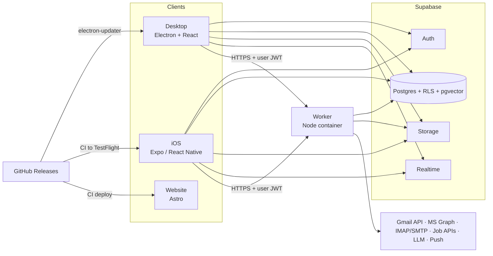

# Build Prompt: Job Search Super-App (iOS · macOS · Windows · Website)

> **How to use:** give this whole file to your coding agent (Claude Code or similar). The agent needs the **design** plugin (`/design:design-critique`) and the **Mobbin MCP** server connected. Fill in §0 first. The agent asks about anything left blank once, at kickoff.

---

## 0. Project variables

| Variable | Value | If left blank |
|---|---|---|
| App name | | Agent proposes 3 options at kickoff |
| Bundle / app ID | | `com.<github-owner>.<app-slug>` |
| GitHub owner + source repo | | Ask |
| Public releases repo | | Source repo if it's public, otherwise `<app-slug>-releases` |
| Domain (website + API) | | Ask (OAuth redirect URIs need a domain you control) |
| Target job markets | | Ask (countries/cities, remote, relocation) |
| Languages (UI, CVs, mail parsing) | | English + the user's primary language |
| Audience | | Personal use first; architecture stays multi-user-capable |
| AI provider | | Anthropic Claude via the user's API key |

---

## 1. Mission

You are the lead engineer and product designer. Build a **job search super-app** that lets one person:

1. **Find job offers** from many sources, ranked against their profile and CVs.
2. **Send applications**, either by email from their own accounts or through the employer's site with everything prepared.
3. **Manage CVs**: create, import, modify, tailor, version and export multiple CVs.
4. **Track every application** from "saved" to "offer".
5. **Connect mail accounts** (Gmail, Outlook/Microsoft 365, any IMAP) and read incoming mail to **update application results automatically**.

Ship:

- **iOS app** (iPhone).
- **Desktop app** for **macOS** (Apple silicon + Intel) and **Windows 10/11** (x64), **auto-updating from GitHub Releases**.
- **Website**: landing, download, changelog, privacy policy, terms, support.
- **Backend**: cross-device sync, mail sync worker, job ingestion, AI.
- **Release pipeline**: publishing one GitHub Release updates every platform.
- **Docs**: PRD, ADRs, design research, critique logs, runbooks.

The UI/UX has to be best-in-class. The mandatory design protocol in §5 is how you get there.

---

## 2. Non-negotiables

1. **The design protocol (§5) is mandatory** for every app screen and every website page or section. Do Mobbin MCP research before designing anything. Run `/design:design-critique` after, and iterate until the screen passes. If either tool is missing from your environment, stop and tell the user. Don't design without them.
2. **GitHub Releases are the single source of truth for versions.** Publishing a release auto-updates the desktop apps, ships the iOS build to TestFlight, deploys backend changes and refreshes the website download page (§7).
3. **Never send anything on the user's behalf without explicit confirmation** of that specific message (recipient, subject, body, attachments). No bulk auto-apply.
4. **Never fabricate CV content.** AI may rephrase, reorder, shorten, translate, and quantify only with numbers the user supplied. It must never invent employers, titles, dates, degrees, skills or metrics. Unknowns become visible placeholders (`[X%]`) that the user has to fill in.
5. **No ToS violations.** Don't scrape LinkedIn, Indeed, Glassdoor or any site that forbids it. Don't bypass logins or CAPTCHAs, and don't automate submission of third-party application forms. Use official APIs, public ATS job-board APIs, schema.org JSON-LD from pages the user explicitly shares, and the user's own email.
6. **Every automatic change is explained and reversible**, e.g. "Moved to Rejected: email from jobs@acme.com, 12 Oct · Undo".
7. **No secrets in client bundles.** GitHub tokens, OAuth client secrets, Supabase service-role keys and LLM keys never ship in the desktop or iOS app.
8. **Verify, don't assume.** SDKs change (for example, electron-builder v27 restructured its config keys). Check current official docs before writing config or integration code. Prove every milestone by running it (§9, §10).

---

## 3. Platform constraints (decided; change only through an ADR)

- **iOS can't self-update from GitHub.** App Review Guideline 2.5.2 forbids apps from downloading or installing executable code, so updates only come through TestFlight or the App Store. Decision: publishing a GitHub Release triggers CI, which builds the iOS app and uploads it to **TestFlight**. Internal testing needs no Beta App Review, and TestFlight's Automatic Updates installs new builds. TestFlight builds expire after **90 days**, so release at least that often or move to App Store distribution (also release-triggered). The app also compares its own version with `app_config` (written by the release workflow). It shows an "Update available" banner, or a blocking screen if the version is below `min_supported_version`. Sideloading (AltStore/SideStore source → IPA attached to the release) is an optional extra, not the default.
- **Desktop auto-update requires code signing.** On macOS, auto-update only works for signed apps, so sign with Developer ID and notarize. On Windows, sign with Azure Artifact Signing (formerly Trusted Signing; eligibility depends on country and entity type) or an OV certificate on an HSM/cloud HSM. Unsigned Windows builds trigger SmartScreen warnings. The user needs an Apple Developer Program membership (also required for TestFlight) and a Windows signing option; confirm both at kickoff.
- **Release assets must be publicly downloadable.** Updating from a private repo would need a GitHub token inside the app, which §2.7 forbids. If the source repo is private, publish binaries to the public releases repo.
- **Gmail.** `gmail.readonly` is a *restricted* scope and `gmail.send` is *sensitive*. For personal use (fewer than 100 users), set the OAuth consent screen to **"In production"** and accept the unverified-app warning. **Don't stay in "Testing"**: refresh tokens expire after 7 days there. A public launch needs Google verification plus an annual CASA security assessment, because mail is processed server-side. Document that in a runbook; it doesn't block v1.
- **Outlook / Microsoft 365.** Outlook.com and Exchange Online require OAuth (basic auth is retired). Use Microsoft Graph with delegated `Mail.Read`, `Mail.Send`, `offline_access` and `User.Read`, and authority `common` (personal + work/school accounts). Work tenants may require admin consent. Do publisher verification before distributing to anyone else.
- **Supabase Edge Functions can't run the mail worker.** Outbound ports 25/587 are blocked, CPU is capped at 2 s per request, and wall clock at 150–400 s. Mail sync, IMAP/SMTP, PDF rendering and scheduled jobs run in a dedicated worker container (§6).
- **LinkedIn / Indeed / Glassdoor** offer no job-search API for this use. Their jobs get in through two paths: (a) a posting the user explicitly shares or pastes, fetched once while honoring robots.txt, with a fallback to the user pasting the description text; (b) parsing the user's own job-alert emails from those sites (§4.7).

---

## 4. Product requirements (v1)

### 4.1 Information architecture (starting point; validate it in §5)

- **iOS** tab bar: Today · Jobs · Tracker · CVs · Mail. Profile and settings open from the avatar.
- **Desktop**: left sidebar (Today, Jobs, Tracker, CVs, Mail, Insights, Settings), ⌘K / Ctrl+K command palette, full keyboard shortcuts, multi-pane layouts.
- **Today** shows what needs attention: upcoming interviews, mail updates to review, follow-ups due, new top matches, deadlines.
- **Device roles.** iOS is for quick actions: triage, saving jobs from the share sheet, applying with an existing CV, interview reminders. Desktop is for heavy work: CV editing, tailoring, bulk tracking, insights. Every core action must work on both.

### 4.2 Onboarding (value in under 3 minutes)

1. Sign in with an **email one-time code** (no passwords). Adding any social login on iOS also requires Sign in with Apple or an equivalent (Guideline 4.8), so v1 uses email codes only.
2. Import a CV (PDF, DOCX, JSON Resume, LinkedIn data-export ZIP) or start from scratch.
3. Set preferences: roles, seniority, locations/remote, salary floor + currency, work authorization, languages.
4. Connect mail account(s). This triggers a **backfill**: scan the last 90 days (configurable) and propose the applications found ("We found 14 applications and 3 interview invites") for one-tap import with the correct status.

**Acceptance:** a new user with a CV and a Gmail or Outlook account reaches a populated tracker without typing application data by hand.

### 4.3 Job discovery

- **Source connectors** share one interface (`search`, `fetch`, rate limits, attribution). Pick the sources that fit the target markets from: Adzuna, Jooble, Remotive, Arbeitnow, The Muse, USAJOBS, and public ATS job boards (Greenhouse, Lever, Ashby, SmartRecruiters, Workable, Recruitee) for a user-managed **company watchlist**. A paid aggregator (e.g. JSearch, SerpApi Google Jobs) is allowed behind the user's own API key. Before integrating a source, check its current ToS, pricing, attribution and country coverage, and record them in `docs/integrations/<source>.md`. Skip any source that forbids this use.
- **Save from anywhere.** On iOS, use a Share Extension; on desktop, paste a URL or drag a link. Parse schema.org `JobPosting` JSON-LD first. If that fails, fall back to readable text + LLM extraction. The user confirms the fields before saving.
- **Normalize + dedupe** across sources: fingerprint on normalized company/title/location plus description shingles, keeping every source link.
- **Match score 0–100** per job against the profile and the selected CV. Apply hard filters first (location, remote, authorization, salary, seniority), then skill/keyword overlap, then embedding similarity (pgvector). Generate an LLM rationale only for the top N. Show "why it matches" and "gaps".
- **Saved searches** run on a schedule and send a push for matches above a threshold (optional daily digest). Job actions: save, dismiss (the reason feeds back into ranking), apply.

### 4.4 Applying

Opening the Apply sheet from any job (or a manual entry):

1. **CV:** pick a variant, or choose **Tailor for this job**. AI proposes edits as a diff; the user accepts or rejects each one, and the result is saved as a new CV revision.
2. **Cover letter:** generated from CV + job + the user's preferred tone, fully editable, with reusable templates.
3. **Channel:**
   - **Email** (the job lists an apply address, or the user enters a recruiter's address): from-account picker, template with merge fields, attachments (pinned CV PDF + cover letter PDF), full preview, explicit **Send**, a 10-second undo window, and a daily send cap. Store provider message and thread IDs for reply tracking. Graph attachments over 3 MB need an upload session.
   - **External link** (ATS or company site): open it in the browser (in-app Safari view on iOS) and show a copy-ready kit: CV file, cover letter, and an answers library (work authorization, notice period, salary expectation, links, common Q&A). When the user comes back, ask "Did you submit?" and mark the job Applied. The ATS confirmation email also confirms it automatically.
4. Each application **pins the exact CV revision, PDF and cover letter used** (immutable).

### 4.5 CV Studio

- **Canonical model:** JSON Resume schema plus `meta` extensions (template, theme, custom sections). Stored as JSONB with immutable revisions.
- **Create** guided or from blank. **Import** PDF/DOCX/JSON Resume/LinkedIn export: parse into structure, then show a review screen that highlights low-confidence fields. Imported CVs are re-rendered with our templates; the original file stays attached.
- **Edit.** Desktop: split view with the structured editor next to a live preview. iOS: section list → edit sheets, plus a preview tab. Users can reorder sections and items, write rich bullets and spell-check. AI assists (rewrite, shorten, stronger verb, translate) appear as suggestions the user accepts or rejects.
- **Variants:** a base CV with role and language variants. Revision history with diff and restore; duplicate; archive.
- **Templates:** at least 3 ATS-safe templates (single column, real text, standard headings, embedded fonts, no content inside images or layout tables). Theme options: accent color, font pair, density, A4/Letter.
- **Export:** PDF (Chromium engine everywhere, tagged PDF where supported; see §6), DOCX, JSON. Default file name `First-Last-CV-<Company>.pdf`.
- **ATS check:** extract text from our own PDF to confirm every section round-trips, and show keyword coverage against a chosen job description.

### 4.6 Tracker

- **Statuses:** Saved → Preparing → Applied → Acknowledged → Screening (recruiter call, assessment) → Interviewing → Offer → Accepted | Declined. Any active status can also move to **Rejected**, **Withdrawn** or **Ghosted**.
- **Rules** (one state machine in `packages/core`, used by every client and the worker): automation may move an application forward or to Rejected only, never to Accepted, Declined, Withdrawn or Ghosted. Only the user can move an application backward. "Ghosted" is suggested after 21 silent days (configurable) and never set automatically. Every transition writes an `application_event`.
- **Views:** Board (drag between columns), Table (filter, sort, bulk edit, CSV export), Calendar (interviews, deadlines). The **detail** page has a header (company, role, status, next action), a timeline (status changes, inbound and outbound emails with snippets, notes), the documents used, contacts, interview rounds and reminders.
- Manual add, plus CSV import from spreadsheet trackers.
- **Reminders:** suggest a follow-up 7 days after Applied with no response (configurable), interview prep reminders, `.ics` export for interviews.

### 4.7 Mail intelligence

**Accounts:** several per user. Gmail (Gmail API), Microsoft (Graph), and IMAP/SMTP for iCloud, Yahoo and custom domains (app passwords or XOAUTH2).

Worker pipeline:

1. **Sync incrementally.** Gmail: `history.list` from the stored `historyId`; if it has expired, resync the lookback window. Microsoft: Graph delta queries per folder. IMAP: UID/MODSEQ. Include Spam/Junk, since ATS mail often lands there. Poll every 5 min (configurable); push (Gmail watch, Graph subscriptions) can come later.
2. **Pre-filter cheaply before any LLM call.** Signals: the message is in a thread of an application we sent; the sender domain is a known ATS (greenhouse.io, lever.co, ashbyhq.com, myworkday.com, smartrecruiters.com, icims.com, workable.com, teamtailor.com, recruitee.com, jobvite.com, successfactors.com, taleo.net, bamboohr.com, personio.com, etc., kept as data, not code) or a tracked company domain; multilingual keyword heuristics. For non-candidates, store only the message ID + a hash, never the body.
3. **Classify** (rules first, then a structured-output LLM for the rest): `application_received`, `rejection`, `interview_invite`, `assessment`, `offer`, `recruiter_outreach`, `info_request`, `job_alert`, `other_job`, `not_job`. Extract company, role, dates/times with timezone, meeting links, deadlines and the contact person.
4. **Job alerts** (LinkedIn, Indeed, Glassdoor, company alerts the user subscribed to): extract each posting into the Jobs feed with source "Alert email".
5. **Link to an application** using the strongest evidence available: thread/In-Reply-To match > ATS sender + company + role match > company domain > LLM choice among the top candidates (or "create new application").
6. **Act.** If confidence is ≥ 0.9 and the link is strong, apply the transition and notify with Undo. Otherwise, send it to the **Review queue** (Mail tab) for one-tap confirm or correct. Store corrections as labeled examples to improve the rules and prompts.
7. **Notify** about interview invites, offers, assessments with deadlines, rejections (gentle copy, can be muted) and accounts that need re-auth.

**Acceptance:** a labeled fixture set reaches **macro-F1 ≥ 0.90**, and **precision ≥ 0.97** on transitions that are applied automatically. The set needs ≥ 150 messages in ≥ 2 languages covering every category, including hard cases: newsletters, job alerts, and "we received your application" vs. "unfortunately". CI fails below these thresholds.

### 4.8 Insights

Funnel (applied → response → interview → offer), response rate by source, channel and CV variant, median time to first response, weekly activity. All computed from `application_event`.

### 4.9 Settings and data control

- **Mail accounts:** connect, re-auth, disconnect + purge data.
- **Job sources** and their API keys.
- **AI:** provider and key, plus an "Allow sending email text to AI" toggle.
- **Notifications** and quiet hours.
- **Desktop:** launch at login + menu bar / tray mode (opt-in, for notifications while the window is closed); update channel (stable/beta) and "Check for updates".
- **Export everything** as a ZIP (JSON + files).
- **Delete account:** hard delete, including storage and token revocation.

### 4.10 Website

- Astro static site that shares the app's design tokens.
- **Pages:** Home, Features, Download, Changelog, Privacy Policy, Terms, Support.
  - **Download:** detects the OS, links directly to the latest release assets with checksums, and includes the TestFlight/App Store link.
  - **Changelog:** rendered from GitHub Releases.
  - **Privacy Policy:** must describe mail data handling accurately. Google's OAuth consent screen and the App Store both require one.
- Redeploys on every release. Lighthouse ≥ 90 for Performance, Accessibility, Best Practices and SEO.

### 4.11 Out of scope for v1

Android, Linux, browser-extension autofill, automated form submission, LinkedIn integration beyond share/paste/alert emails, two-way calendar sync, payments, team/recruiter features, local LLMs. Keep the AI interface pluggable so local models can be added later.

---

## 5. Design protocol (mandatory)

### 5.1 Tools

- **Mobbin MCP:** `list_collections`, `get_collection_contents`, `search_screens` (`platform: ios | web`), `search_flows` (`ios | web`), `search_sections` (website sections).
- **`/design:design-critique`:** the critique skill of the design plugin. It takes a screenshot/file or a description, plus context: what the design is, who it's for, the stage (exploration / refinement / final) and an optional focus.
- From the same plugin, also run **`/design:accessibility-review`** (WCAG 2.1 AA) on every screen, **`/design:ux-copy`** for empty states, errors, CTAs and notifications, and **`/design:design-system`** to document tokens and components.

### 5.2 Mobbin rules

- Start with `list_collections`. If the user has saved collections, read the relevant ones with `get_collection_contents` before searching. The user's saves and their comments outrank search results. If two collections share a name, ask which one is meant.
- Use the same `task_intent` on every call ("Design a cross-platform job search, CV builder and application tracker app") and `output_destination: "code"`.
- One screen, flow or section per query. Start the query with its type ("job detail screen", "resume editor", "kanban board"). Leave out style adjectives and platform words; set `platform` instead. Use `mode: "deep"` for nuanced queries. Name an app to study that app specifically.
- **Desktop app patterns come from Mobbin's `web` platform** (desktop-class SaaS apps); iOS patterns come from `ios`.
- Judge each result from its **images**, not its metadata. Cite every reference with its `mobbin_url`.
- **Never commit Mobbin images** to the repo: they're third-party copyrighted screenshots, and the repo may be public. If you need the files, download `image_url` (it expires in 30 days) into a gitignored `design-refs/` folder.
- Minimum per screen or flow: examine ≥ 5 candidates and keep ≥ 3 as references.

### 5.3 Research matrix (minimum coverage)

| Area | iOS (`search_screens` / `search_flows`) | Desktop (`web`) |
|---|---|---|
| Onboarding, sign-in with email code | flows: onboarding, sign in | flows: onboarding, sign in |
| Connect email account / permissions | flow: connect account; permission request screen | same |
| Today / home | home dashboard, task inbox | dashboard, inbox-style home |
| Job feed, search, filters, saved searches | job listings, search filters | list + detail split view, filter bar |
| Job detail + match explanation | job detail screen | job detail panel |
| Apply | flow: job application; email compose; attachment picker | email compose, side panel |
| CV editor, preview, templates | resume builder, document editor, template picker | document editor with live preview, template gallery |
| Tracker board / table / detail | pipeline tracking, kanban board, activity timeline | kanban board, data table with filters, record detail |
| Mail review queue | email inbox, review/triage queue, notification center | three-pane email client, triage queue |
| Insights | analytics dashboard, funnel chart | analytics dashboard |
| Settings, export, account deletion | settings, delete account flow | settings |
| Empty, loading, error, offline states | each core screen | each core screen |
| Desktop only | — | command palette, sidebar navigation, keyboard shortcuts sheet, update-available banner |
| Website (`search_sections`) | — | hero, features, how it works, download CTA, FAQ, changelog, footer, legal page |

### 5.4 Synthesis

- For each area, write `docs/design/research/<area>.md`. List the references (link, what we borrow, why), the patterns we rejected and why, and the decision for each platform.
- From that, produce the IA, the user flows (as mermaid diagrams), the design tokens in `packages/ui-tokens` (color with dark mode, type scale mapped to iOS Dynamic Type, spacing, radius, elevation, motion) and a component inventory.
- **Platform-native behavior, one brand:**
  - **iOS:** follow the HIG. Use native primitives, not JS imitations: native stack, native tabs, form sheets with detents, swipe actions, context menus, SF Symbols, haptics, Dynamic Type, Reduce Motion.
  - **macOS:** sidebar + toolbar, hidden-inset title bar with traffic lights, a native menu bar that lists the shortcuts, ⌘ shortcuts, optional vibrancy.
  - **Windows:** title bar overlay with native caption buttons, optional Mica, Ctrl shortcuts, Segoe UI Variable, minimum sizes that work with Snap layouts.
- **UX principles:**
  - **Calm and supportive.** Job hunting is stressful: gentle rejection copy, mutable rejection notifications, no guilt-driven gamification.
  - **Trust.** Every automatic action shows its source and reason and can be undone.
  - **Speed.** Optimistic UI, under 100 ms response to input, keyboard-first desktop.
  - **Progressive disclosure** with sensible defaults.
- The app icon (iOS, macOS, Windows) and the wordmark also go through critique at every size.

### 5.5 Critique loop (per screen, per platform, per stage)

1. **Build it.** Use a quick prototype for the *exploration* stage, the real implementation for *refinement*, and the release candidate for *final*.
2. **Capture screenshots** in light + dark mode, in the empty, loading, populated and error states:
   - **iOS:** smallest and largest supported iPhone simulators, plus the largest Dynamic Type size (`xcrun simctl io booted screenshot`, or Maestro).
   - **Desktop:** 1280×800 and 1920×1080 on macOS and Windows (Playwright `_electron`; Windows shots from a Windows CI runner or a VM).
   - **Website:** 375, 768 and 1440 px wide.
3. **Run `/design:design-critique <screenshot>`** with context: the screen, the user's goal, the persona (an active job seeker, often stressed and short on time, switching between phone and desktop), the stage, and the focus.
4. **Save the output verbatim** to `docs/design/critiques/<platform>/<screen>/r<N>.md`. Add a **Resolution** section that maps each finding to either *fixed (commit)* or *rejected (reason)*.
5. **Fix every Critical and Moderate finding.** Fix or log the Minor ones. Re-capture and re-run.
6. **Exit criteria:** the latest round has zero Critical and zero unresolved Moderate findings, and the accessibility review passes. Then mark the row approved in `docs/design/STATUS.md` (columns: screen × platform × references × critique rounds × a11y × status).
7. Critique **whole flows** too (onboarding, apply, mail review, CV tailoring), by passing the screenshot sequence.

### 5.6 Design gates

- **Design checkpoint with the user at the end of M0.** Present the IA, the tokens, and the 5 core screens (Today, Job detail, CV editor, Tracker board, Mail review) on iOS and desktop, with their references and critique logs. Get approval before broad implementation.
- No UI change merges unless its `STATUS.md` row is approved.
- Before v1.0, run a final-stage critique and an accessibility review on every screen and every website page.

---

## 6. Architecture (default stack)



| Layer | Default | Why |
|---|---|---|
| Language | TypeScript (strict) everywhere | One language across clients, worker and website; shared types and schemas |
| Monorepo | pnpm workspaces + Turborepo | Shared packages, cached CI |
| Desktop | Electron (latest stable), electron-vite, React, Tailwind, accessible headless primitives (e.g. Radix), cmdk, dnd-kit, TanStack Query/Virtual; electron-builder + electron-updater | Most proven GitHub-Releases auto-update path; Chromium `printToPDF` for CVs |
| iOS | Expo (latest SDK, dev builds, expo-router), Reanimated, Gesture Handler, expo-secure-store, expo-notifications, expo-web-browser, share-extension config plugin | Native navigation and feel, shares the TypeScript core |
| Website | Astro + Tailwind on GitHub Pages | Static, fast, SEO |
| Backend | Supabase: Postgres (RLS, pgvector), Auth (email OTP via custom SMTP such as Resend/Postmark, since the built-in sender is rate-limited), Storage, Realtime, Vault | Sync and auth without writing a custom server |
| Worker | Node LTS container on Fly.io (any Docker host works): HTTP API (OAuth callbacks, AI, render, send), Postgres-backed queue (pg-boss or Graphile Worker; session-mode connection), schedulers, headless Chromium | Long-running mail sync, IMAP/SMTP, PDF rendering |
| AI | Provider interface with Anthropic Claude as default; zod-validated structured outputs; versioned prompts with evals; per-day cost cap | Swappable providers, testable behavior |
| Push | Expo Push Service (or direct APNs); minimal payloads when "private notifications" is on | Simple iOS push |

**Rejected alternatives** (record them in `docs/adr/0001-stack.md`):

- **Tauri 2 everywhere:** webview UI on iOS, immature mobile plugins, weaker PDF control.
- **Flutter:** viable, but adds a second language and needs third-party desktop updaters.
- **SwiftUI + a separate Windows app:** three codebases.

**Code sharing:** share everything except views: domain logic, validation, API client, query hooks, tokens, i18n strings and CV templates. Desktop uses React DOM and iOS uses React Native. Don't force shared view components; platform-native UI is the goal.

### 6.1 Monorepo layout

```
apps/
  desktop/      Electron main / preload / renderer (React)
  ios/          Expo app + share extension
  web/          Astro website
  worker/       OAuth callbacks, mail sync, job ingestion, AI, PDF/DOCX render, send, push
packages/
  core/         domain types, zod schemas, status state machine, dedupe, matching rules (no platform deps)
  api/          typed Supabase client + worker client (+ generated DB types)
  ui-tokens/    tokens → CSS variables, Tailwind preset, React Native theme
  cv-render/    CV JSON + template + theme → HTML (embedded fonts); DOCX builder
  mail-intel/   ATS sender list, heuristics, prompts, labeled fixtures, eval runner
  ai/           provider interface, versioned prompts, schemas, evals
supabase/       migrations, RLS policies, seed, config
docs/           BRIEF.md (this file), PRD.md, STATUS.md, adr/, design/, integrations/, runbooks/
.github/workflows/  ci.yml, release.yml, website.yml
```

### 6.2 Data model (refine in an ADR; every table has `user_id` + RLS)

| Entity | Key fields |
|---|---|
| `profile` | name, contact, target_roles[], seniority, locations[], remote_pref, salary_floor + currency, work_authorization, languages[], timezone |
| `cv` | title, language, parent_cv_id (variant of), current_revision_id, template_id, theme, is_default, archived_at, version (optimistic concurrency) |
| `cv_revision` | cv_id, json_resume (JSONB), source (manual / import / ai_tailor), diff_summary; immutable |
| `rendered_file` | cv_revision_id or cover_letter_id, kind (pdf / docx), storage_path, sha256 |
| `cover_letter` | application_id?, language, body, author (user / ai) |
| `job` | source, source_id, url, apply_url, apply_email, company, company_domain, title, location, remote_type, salary range, description, posted_at, fingerprint, embedding |
| `job_match` | job_id, score, reasons, gaps, state (new / saved / dismissed), dismiss_reason |
| `saved_search` | query, filters, schedule, alert_threshold |
| `application` | job_id?, company, role, status, channel, applied_at, cv_revision_id, cover_letter_id, from_account_id, thread_refs, next_action_at, priority, notes |
| `application_event` | application_id, type, from_status, to_status, actor (user / rule / ai), confidence, evidence (mail_message_id, reason), occurred_at, reverted_by |
| `interview` | application_id, round, starts_at, timezone, location / link, people, prep_notes |
| `contact` | name, email, company, role, links |
| `mail_account` | provider, address, status, sync_cursor, secret_ref, scopes, last_synced_at, last_error |
| `mail_message` | account_id, provider ids (message / thread / rfc822 / in-reply-to), from, subject, received_at, category, confidence, extracted, application_id, review_state, body_text (job-related only) |
| `device` | platform, push_token, app_version |
| `app_config` | platform, latest_version, min_supported_version, feature flags |

### 6.3 Sync, offline, compatibility

- Supabase is the source of truth. Clients persist their query cache, queue mutations while offline (outbox), and receive live updates over Realtime.
- CVs use optimistic concurrency (`version`). On conflict, show a "keep mine / keep theirs / compare" UI.
- Migrations are expand → contract so older clients keep working. `app_config.min_supported_version` gates clients that are too old.

### 6.4 Auth and account connection

- **App login:** Supabase email one-time code on every platform.
- **Mail connect:**
  1. The client opens `https://<api-domain>/connect/{google|microsoft}?nonce=<short-lived signed nonce>` in the system browser (on iOS, an ASWebAuthenticationSession via `expo-web-browser`).
  2. The worker runs authorization-code + PKCE and validates `state`.
  3. It stores tokens encrypted (Supabase Vault, or AES-256-GCM envelope encryption with a key only the worker holds).
  4. It redirects to `<app-scheme>://connected`. Clients also see the account row change over Realtime.
- **IMAP:** host, port and app password go over TLS to the worker once, get tested, then are stored encrypted.
- **Disconnect** revokes tokens and purges the account's mail data.

### 6.5 CV rendering

- `packages/cv-render` is a pure, deterministic function: CV JSON + template + theme → HTML with embedded fonts.
- **Desktop** renders PDFs locally with Electron `printToPDF` (works offline).
- **Worker** renders with headless Chromium for iOS exports and email attachments.
- **iOS live preview** shows the same HTML in a WebView.
- DOCX is built from the same CV JSON with the `docx` package.
- Visual regression compares rasterized PDFs from both engines.

---

## 7. Release and auto-update pipeline

1. **Versioning.** Use Changesets (or release-please) on `main`. Merging the version PR creates tag `vX.Y.Z` and a **draft** GitHub Release with notes. All platforms share the version.
2. **`release.yml`** (on tag):
   - **backend:** apply Supabase migrations (expand-only), deploy the worker image.
   - **desktop-mac** (macOS runner): build universal (or arm64 + x64) **DMG + ZIP** (electron-updater needs the ZIP), sign with Developer ID, notarize (notarytool with an App Store Connect API key), upload the assets + `latest-mac.yml`.
   - **desktop-win** (Windows runner): build the **NSIS** installer (electron-updater's Windows target; x64, ARM64 optional), sign it, upload it + `latest.yml` + blockmap.
   - **ios** (macOS runner): `expo prebuild` → fastlane (match or App Store Connect API-key signing → build → `upload_to_testflight`) with the release notes. Build number = CI run number; marketing version = `X.Y.Z`. EAS Build/Submit is an acceptable alternative.
   - **publish:** only when every job is green, publish the release (as a pre-release for the beta channel) and write `latest_version` / `min_supported_version` to `app_config`.
   - **website** (on `release: published`): rebuild and deploy, so download links resolve to the new assets.
3. **Client behavior:**
   - **Desktop:** electron-updater (GitHub provider) checks at launch and every 6 h, downloads in the background, and shows a non-blocking "Restart to update" with the release notes. It installs on quit and never interrupts unsaved edits. The beta channel follows pre-releases. Use `stagingPercentage` for staged rollouts and keep Windows signature verification enabled.
   - **iOS:** TestFlight auto-update, plus the in-app banner driven by `app_config`.
4. **Rollback:** never delete a release that clients have installed. Ship `X.Y.Z+1`. To halt a bad rollout, set the staging percentage to 0.
5. **Secrets inventory** lives in `docs/runbooks/release.md`: Apple API key + Developer ID certificate, match storage/password, Windows signing credentials, Supabase access token, worker deploy token. All of them are CI-only.

**Acceptance (M1):** install `v0.1.0` on a clean macOS machine and a clean Windows machine (or VMs), publish `v0.1.1`, and both update with nothing more than "Restart". TestFlight receives `0.1.1`, and the website's download page shows `0.1.1`.

---

## 8. Security, privacy, compliance

- **Supabase:** RLS is deny-by-default on every table, with tests proving user A can't read user B's rows. The service-role key lives only in the worker.
- **OAuth:** least-privilege scopes, encrypted tokens, refresh handling, revocation on disconnect, and a "needs re-auth" state with a notification.
- **Electron hardening:** `contextIsolation`, `sandbox`, no `nodeIntegration`, strict CSP, a typed IPC allowlist validated with zod, `shell.openExternal` limited to an https allowlist, unexpected navigation blocked, Electron Fuses set (RunAsNode off, ASAR integrity on).
- **iOS:** sessions in the Keychain (secure store), a privacy manifest (`PrivacyInfo.xcprivacy`), App Privacy answers documented.
- **Data minimization:**
  - Non-job mail is never stored.
  - Job-mail bodies are kept while the application is active, plus 180 days (configurable).
  - Full export and hard delete are available.
- **AI:** behind a user toggle. Send the minimum text, use providers whose API terms exclude training, and keep raw PII out of logs.
- **CI:** dependency audit and secret scanning (gitleaks). Crash reporting is opt-in and PII-scrubbed.

---

## 9. Quality bar and testing

- **Unit (Vitest):** state machine, dedupe, matching, parsers, merge fields, CV mapping.
- **Integration:** the worker against local Supabase with recorded Gmail/Graph fixtures; IMAP/SMTP against a containerized test server (e.g. GreenMail).
- **Evals in CI:**
  - The mail-intel thresholds from §4.7.
  - An AI tailoring **grounding check**: every entity, number and date in the output must exist in the source CV. Any fabricated item in a fixture fails CI.
- **E2E:**
  - Playwright for Electron (macOS + Windows runners) and for the website.
  - Maestro on iOS covering onboarding, saving a job via share, applying by email, a mail-driven status change, and CV export.
- **Visual:** CV PDF raster diffs across the two engines; screenshot baselines for the core screens.
- **Accessibility:** axe on desktop and web; a VoiceOver + Dynamic Type pass on iOS; a keyboard-only pass on desktop.
- **Performance budgets:**
  - Desktop cold start < 2.5 s.
  - 60 fps scrolling with 5,000 jobs and 1,000 applications.
  - iOS launch to interactive < 2 s on a recent iPhone.
  - Incremental sync of 3 mail accounts < 30 s.

**Definition of done (every feature):**

- The acceptance criteria are met on each relevant platform.
- Tests pass.
- The `STATUS.md` design row is approved.
- The accessibility review passes.
- Docs are updated.
- It has been demonstrated by running it, with screenshots or recordings as evidence.

No stubs, mock data in production paths, or `TODO: implement`.

---

## 10. Milestones (each ends with a demo + evidence)

| # | Scope | Exit criteria |
|---|---|---|
| M0 Foundations | Kickoff questions, ADRs, monorepo, CI, Supabase project, worker skeleton, Mobbin research (§5.3), IA, tokens, 5 core screens critiqued | User approves the design checkpoint; all three apps launch |
| M1 Walking-skeleton release | Signing, notarization, electron-updater, TestFlight pipeline, website download page, `app_config` | §7 acceptance demonstrated |
| M2 CV Studio | Create, import, edit, variants, revisions, templates, PDF/DOCX export, ATS check | PDF parity tests pass; all CV screens approved |
| M3 Tracker | Manual applications, board / table / calendar / detail, reminders, CSV import, Insights v1 | Full lifecycle on iOS + desktop; state-machine tests |
| M4 Jobs + Apply | Connectors, share/URL import, dedupe, matching, saved searches + alerts, email and external apply flows | A real email application is sent and tracked end to end |
| M5 Mail intelligence | Gmail / Graph / IMAP sync, backfill, classification, job-alert parsing, review queue, notifications | Eval gate passes; live demo with a real Gmail and Outlook account |
| M6 Hardening + v1.0 | Security review, a11y review, performance budgets, final-stage critiques, privacy policy, user guide, runbooks | All `STATUS.md` rows approved; `v1.0.0` released through the pipeline |

---

## 11. How you work

1. **Kickoff (one batch of questions; defaults apply where the user has none):**
   - **Blank §0 values.**
   - **Accounts:** Apple Developer Program, Windows signing option (eligibility), Google Cloud project, Microsoft Entra app registration, Supabase, Fly.io (or another Docker host), domain, transactional email provider (Resend/Postmark/Brevo), LLM key, job API keys.
   - **Audience:** personal tool or public product. This decides Google verification/CASA, TestFlight vs. App Store, and how much legal documentation is needed.
2. Expand this brief into `docs/PRD.md`. Record every decision as an ADR (`docs/adr/NNNN-title.md`).
3. **Work in vertical slices:** Mobbin research → critique-approved design → implementation → tests → docs → demo. If your environment supports parallel agents, desktop and iOS work on an approved design can run in parallel.
4. Keep `docs/STATUS.md` current. At the end of each milestone, report what's done, the evidence (commands run, screenshots, test output, critique-log links), open risks, and what's next.
5. Ask the user only about decisions that need them: accounts, money, legal and taste. For anything else, pick the conservative option and log it in an ADR.
