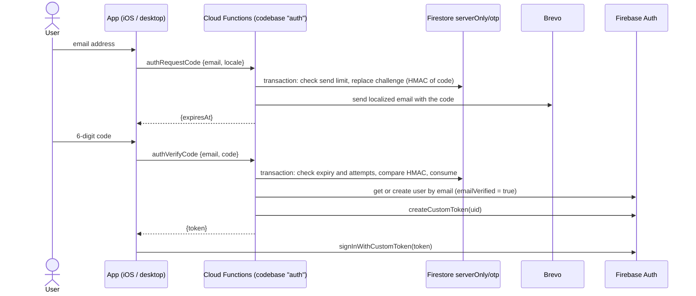

# ADR 0003 — Sign-in with an emailed one-time code

- **Status:** Accepted
- **Date:** 2026-10-22
- **Deciders:** Savas (owner), lead engineer agent
- **Supersedes:** BRIEF.md §6 "Supabase Auth (email OTP via custom SMTP)" and §6.4 "App login"
- **Related:** [0001-stack.md](0001-stack.md), [0002-data-model.md](0002-data-model.md), [0006-hosting-domains.md](0006-hosting-domains.md), [runbooks/accounts.md](../runbooks/accounts.md)

## Context

- BRIEF §4.2: users sign in with an **email one-time code**, no passwords, on iOS and desktop. Adding any third-party social login on iOS would also require Sign in with Apple or an equivalent (App Review Guideline 4.8), so v1 uses email codes only.
- ADR 0001 replaced Supabase with Firebase. Firebase Authentication has email/password, email _link_ and phone sign-in, but **no email code** sign-in. It does accept **custom tokens**: a trusted server signs a token for a uid and the client exchanges it with `signInWithCustomToken` ([Create custom tokens](https://firebase.google.com/docs/auth/admin/create-custom-tokens)). Custom tokens are valid for one hour; `createCustomToken` signs through the IAM `signBlob` API, so the runtime service account needs `roles/iam.serviceAccountTokenCreator` on itself (same page, "Troubleshooting").
- Transactional mail goes through **Brevo** (owner's choice; free plan 300 emails/day, [Brevo free plan limits](https://help.brevo.com/hc/en-us/articles/208580669-FAQs-What-are-the-limits-of-the-Free-plan)) via its HTTP API ([Send a transactional email](https://developers.brevo.com/reference/send-transac-email)). There is no custom domain yet (ADR 0006), so the sender is a Brevo-verified single sender.
- Firestore deletes documents after a TTL field passes, typically within 24 hours, not instantly ([Manage data retention with TTL policies](https://firebase.google.com/docs/firestore/ttl)). Code expiry must therefore be enforced by the code, with TTL only as cleanup.

## Decision

### Flow

### Functions

Two **callable** functions (`onCall`, gen2, `europe-west1`) in a separate functions codebase **`auth`** (`apps/functions/src/auth.ts`, bundled to `apps/functions/lib/auth`): `authRequestCode` and `authVerifyCode`. Both work before sign-in. Clients call them with the Functions SDK (`httpsCallable` on desktop, `@react-native-firebase/functions` on iOS) with region `europe-west1`.

- **Why callables, not `/api/**`:** the callable protocol handles CORS, request/response encoding and typed errors (`HttpsError` with `details`), and can enforce App Check later with one option. Sign-in therefore does not go through the Hosting rewrite; ADR 0006's `/api/**` stays for the HTTP API.
- **Why a separate codebase:** the CLI resolves every param and secret of a codebase when deploying any function in it. Keeping auth separate lets the API (`default` codebase, e.g. `health`) deploy without `BREVO_API_KEY`, and keeps auth deploys isolated (`firebase deploy --only functions:auth`).
- `setGlobalOptions({ region: "europe-west1", maxInstances: 10 })`: `maxInstances` caps what a flood of unauthenticated requests can cost.

### Code and storage

| Item               | Decision                                                                                                                                                              |
| ------------------ | --------------------------------------------------------------------------------------------------------------------------------------------------------------------- |
| Code               | 6 digits from `crypto.randomInt(0, 1_000_000)` (CSPRNG, uniform), zero-padded.                                                                                        |
| Challenge document | `serverOnly/otp/challenges/{sha256(lowercased, trimmed email)}`: `codeHash`, `salt`, `createdAt`, `expiresAt`, `failedAttempts`.                                      |
| Hash               | `HMAC-SHA256(OTP_PEPPER, "<emailKey>:<salt>:<code>")`, `salt` = 16 random bytes per challenge. The code is never stored or logged. Comparison with `timingSafeEqual`. |
| Send log           | `serverOnly/otp/sendLogs/{emailKey}`: `sentAt[]` (sends of the last hour), `expiresAt`.                                                                               |
| Atomicity          | Every request/verify is one Firestore transaction over both documents (`OtpStore.transact`), so concurrent requests can't exceed limits or verify one code twice.     |
| Cleanup            | TTL policies on `expiresAt` for collection groups `challenges` and `sendLogs` (`firebase/firestore.indexes.json` → `fieldOverrides`, field exempt from indexing).     |
| Client access      | None: `serverOnly/**` is denied by the security rules (tested in `firebase/tests`).                                                                                   |

The logic lives in `apps/functions/src/otp/service.ts` behind the `OtpStore` interface; unit tests run it against an in-memory store (`apps/functions/test`).

### Limits

| Limit                   | Value                                                                | Enforced in                                            |
| ----------------------- | -------------------------------------------------------------------- | ------------------------------------------------------ |
| Code lifetime           | 10 minutes                                                           | `verifyCode` compares `expiresAt` (TTL only cleans up) |
| Wrong attempts per code | 5; the 5th wrong attempt locks the code until a new one is requested | `verifyCode`                                           |
| Codes sent per email    | 5 per rolling hour                                                   | `issueCode` (sliding window over `sentAt`)             |
| Active codes per email  | 1; a new code invalidates the previous one                           | `issueCode` replaces the challenge                     |
| Use                     | Single use; consumed in the transaction that accepts it              | `verifyCode`                                           |
| Concurrency             | ≤ 10 instances per function                                          | `setGlobalOptions`                                     |

### Accounts

On a correct code the function looks up the Auth user by email, creates it if missing (`emailVerified: true`; possession of the code proves the address), marks an existing unverified user verified, rejects disabled users, and returns `createCustomToken(uid)`. No sign-in provider (email/password, email link, Google, …) is enabled in Firebase Auth; custom tokens need none.

### Responses (client contract)

Clients branch on `HttpsError.details.reason`; copy is written by the clients (calm, specific; no blame).

| Function          | `HttpsError` code     | `details`                                     | Meaning                                   |
| ----------------- | --------------------- | --------------------------------------------- | ----------------------------------------- |
| both              | `invalid-argument`    | `{reason: "invalid_input"}`                   | Malformed email or code                   |
| `authRequestCode` | (success)             | `{expiresAt}` (ISO)                           | Code sent                                 |
| `authRequestCode` | `resource-exhausted`  | `{reason: "rate_limited", retryAfterSeconds}` | 5 codes in the last hour                  |
| `authRequestCode` | `unavailable`         | `{reason: "delivery_failed"}`                 | Brevo rejected or timed out (10 s)        |
| `authVerifyCode`  | (success)             | `{token}`                                     | Call `signInWithCustomToken`              |
| `authVerifyCode`  | `permission-denied`   | `{reason: "invalid_code", attemptsRemaining}` | Wrong code                                |
| `authVerifyCode`  | `resource-exhausted`  | `{reason: "too_many_attempts"}`               | Locked; request a new code                |
| `authVerifyCode`  | `failed-precondition` | `{reason: "no_active_code"}`                  | Expired, already used, or never requested |
| `authVerifyCode`  | `permission-denied`   | `{reason: "account_disabled"}`                | Disabled by the owner                     |

### Email

- Brevo `POST https://api.brevo.com/v3/smtp/email` with header `api-key`, text + HTML body, tag `auth-code`, 10 s timeout. Errors are logged with Brevo's status and error code only (Brevo messages can echo addresses) plus the email key, never the address or the code.
- Localized subject and body for EN/TR/DE from the request's `locale` (BCP 47; `de-AT` → `de`, unsupported → `en`), in `apps/functions/src/otp/messages.ts`. The code is **not** in the subject, so it does not show on lock-screen notification previews. German uses "du", Turkish the polite "siz".

|     | Subject                           | Body (essentials)                                                                                                                                                                                                                                                                      |
| --- | --------------------------------- | -------------------------------------------------------------------------------------------------------------------------------------------------------------------------------------------------------------------------------------------------------------------------------------- |
| EN  | Your BruteForceHR sign-in code    | Here's your code to sign in to BruteForceHR: · It works once and expires in 10 minutes. · Didn't ask for a code? You can ignore this email. No one can sign in without it. · Keep this code to yourself. We'll never ask you for it.                                                   |
| TR  | BruteForceHR giriş kodunuz        | BruteForceHR'a giriş yapmak için kodunuz: · Kod yalnızca bir kez kullanılabilir ve 10 dakika geçerlidir. · Kod istemediyseniz bu e-postayı görmezden gelebilirsiniz. Bu kod olmadan kimse giriş yapamaz. · Bu kodu kimseyle paylaşmayın. Sizden bu kodu asla istemeyiz.                |
| DE  | Dein Anmeldecode für BruteForceHR | Hier ist dein Code für die Anmeldung bei BruteForceHR: · Er gilt einmalig und läuft in 10 Minuten ab. · Du hast keinen Code angefordert? Dann kannst du diese E-Mail ignorieren. Ohne den Code kann sich niemand anmelden. · Gib diesen Code nicht weiter. Wir fragen dich nie danach. |

### Secrets, params and project setup

| Name                 | Kind   | Where                                                                                                                                               |
| -------------------- | ------ | --------------------------------------------------------------------------------------------------------------------------------------------------- |
| `OTP_PEPPER`         | secret | Secret Manager; 48 random bytes (base64), created 2026-10-22 with `firebase functions:secrets:set`. Rotating it invalidates outstanding codes only. |
| `BREVO_API_KEY`      | secret | Secret Manager; set by the owner (runbook §1).                                                                                                      |
| `BREVO_SENDER_EMAIL` | param  | `apps/functions/.env.bruteforcehr`, added once the Brevo sender is verified.                                                                        |
| `BREVO_SENDER_NAME`  | param  | same file; default `BruteForceHR`.                                                                                                                  |

Done on 2026-10-22 for project `bruteforcehr`:

- Firebase Authentication initialized with the Identity Platform REST method [`projects.identityPlatform.initializeAuth`](https://cloud.google.com/identity-platform/docs/reference/rest/v2/projects.identityPlatform/initializeAuth) (the project config was `CONFIGURATION_NOT_FOUND` before; `firebase deploy --only auth` only enables email/password, anonymous or Google providers, none of which we want). This makes the project "Firebase Authentication with Identity Platform"; the upgrade can't be undone, and tier-1 sign-in (custom tokens included) stays free up to 50,000 MAU.
- `roles/iam.serviceAccountTokenCreator` granted to the functions runtime service account `33654863934-compute@developer.gserviceaccount.com` on itself.

## Threat model

| Threat                                                           | Mitigation                                                                                                                                                                                                                                                       | Residual risk                                                                                                                                                                                                                    |
| ---------------------------------------------------------------- | ---------------------------------------------------------------------------------------------------------------------------------------------------------------------------------------------------------------------------------------------------------------- | -------------------------------------------------------------------------------------------------------------------------------------------------------------------------------------------------------------------------------- |
| **Account enumeration**                                          | `authRequestCode` never looks up accounts; the response and its timing are the same for new and existing addresses. Accounts are only touched after a correct code, when the caller has proven ownership of the address. Document ids are hashes, not addresses. | `rate_limited` reveals that codes were requested for an address in the last hour (not whether an account exists). Hashes of known addresses are guessable by anyone who can read `serverOnly` (only the server).                 |
| **Brute force of a code**                                        | 10⁶ codes; 5 wrong attempts lock a code; 5 codes per address per hour; every code is a fresh random value. A targeted attacker gets ≤ 25 guesses per hour: ≤ 2.5 × 10⁻⁵ success per hour, and every attempt mails the victim a code they didn't request.         | A patient attacker sustaining 600 guesses/day for a year reaches ~20 % against one address. Planned before sharing the app beyond the owner: App Check enforcement on both callables and a per-IP / daily cap (open question 1). |
| **Replay**                                                       | Codes are single use, consumed in the same transaction that accepts them; a new code invalidates the old one; codes expire after 10 minutes. The custom token is returned only over TLS to the verifying client and expires after 1 hour.                        | A stolen custom token works until it expires (1 h).                                                                                                                                                                              |
| **Mail interception / mailbox compromise**                       | Short TTL, single use, code kept out of the subject (lock-screen previews), "never share" copy, TLS to Brevo. Stored copies at Brevo or in the mailbox are useless after 10 minutes.                                                                             | Anyone who controls the mailbox can sign in: inherent to email-based sign-in (same as a password reset email).                                                                                                                   |
| **Database or backup leak**                                      | Only `HMAC(pepper, …)` is stored; the pepper lives in Secret Manager, so a leaked challenge can't be brute-forced offline. Per-challenge salt.                                                                                                                   | With both the database and the pepper, a live code (≤ 10 min) can be brute-forced.                                                                                                                                               |
| **Email bombing / cost abuse**                                   | 5 emails per address per hour; `maxInstances: 10`; Brevo's daily quota bounds spend.                                                                                                                                                                             | Many different addresses can exhaust the Brevo quota (300/day on the free plan) and block sign-in for the day; App Check and per-IP limits are the follow-up. Existing sessions are unaffected.                                  |
| **Phishing relay** (attacker gets the user to read out the code) | Email says "We'll never ask you for it".                                                                                                                                                                                                                         | Social engineering remains possible.                                                                                                                                                                                             |
| **Logs**                                                         | Logs carry the email key and Brevo status/code only, never the address, the code or the token.                                                                                                                                                                   | —                                                                                                                                                                                                                                |

## Alternatives considered

| Option                                | Why not                                                                                                                                                                                                                                                                                                                                                                                                                   |
| ------------------------------------- | ------------------------------------------------------------------------------------------------------------------------------------------------------------------------------------------------------------------------------------------------------------------------------------------------------------------------------------------------------------------------------------------------------------------------- |
| **Firebase email link (magic link)**  | The link must be opened on the device that started sign-in, which breaks "read the mail on the phone, sign in on the desktop"; it needs app/universal-link plumbing on iOS and a deep link handler in Electron on two OSes; corporate mail scanners pre-fetch links and can consume one-time links; copy and sender are Firebase's templates. A 6-digit code works the same everywhere and iOS can autofill it from Mail. |
| **Sign in with Apple / Google**       | Guideline 4.8: offering Google on iOS requires Sign in with Apple too, so two providers, each with web flows on Windows. Apple's private-relay addresses also complicate matching the user's real mail accounts. BRIEF §4.2 chose email codes only for v1; adding providers later is additive.                                                                                                                            |
| **Firebase email/password**           | BRIEF: no passwords.                                                                                                                                                                                                                                                                                                                                                                                                      |
| **Phone (SMS) codes**                 | Per-SMS cost, phone numbers not needed by the product.                                                                                                                                                                                                                                                                                                                                                                    |
| **Supabase Auth OTP** (brief default) | Supabase was replaced in ADR 0001.                                                                                                                                                                                                                                                                                                                                                                                        |

## Brevo dependency

- **Outage or rejected sends:** new sign-ins fail with `delivery_failed`; signed-in users keep working (Firebase refresh tokens). The sender is one module (`apps/functions/src/otp/brevo.ts`, `sendWithBrevo`), so moving to another provider (Resend, Postmark, SES, SMTP) changes one file and one secret.
- **Quota:** free plan 300 emails/day, enough for a personal tool; the per-address limit keeps one user from using it up.
- **Deliverability:** without a custom domain the sender is a verified single address (e.g. Gmail), so messages are not DKIM-aligned with the From domain and may land in Spam (ADR 0006). Moving to a custom domain with Brevo DKIM/DMARC fixes this.
- **Privacy:** Brevo (EU) processes the recipient address and the message, which contains a code that is useless after 10 minutes. Open/click tracking should be off for transactional mail in the Brevo account (runbook §1).

## Consequences

- Clients implement two screens (email, code) and call `signInWithCustomToken`; no Firebase Auth UI and no providers to configure.
- `authRequestCode`/`authVerifyCode` can only be deployed after `BREVO_API_KEY` and `BREVO_SENDER_EMAIL` exist (`firebase deploy --only functions:auth`).
- Security rules keep `serverOnly/**` closed; TTL policies clean up challenge and send-log documents.

## Open questions

1. Before anyone but the owner uses the app: enforce App Check on both callables and add a per-IP and per-day cap (see brute force and email bombing).
2. Should the code also appear in the subject for faster copy on desktop, accepting lock-screen exposure? Current answer: no.
