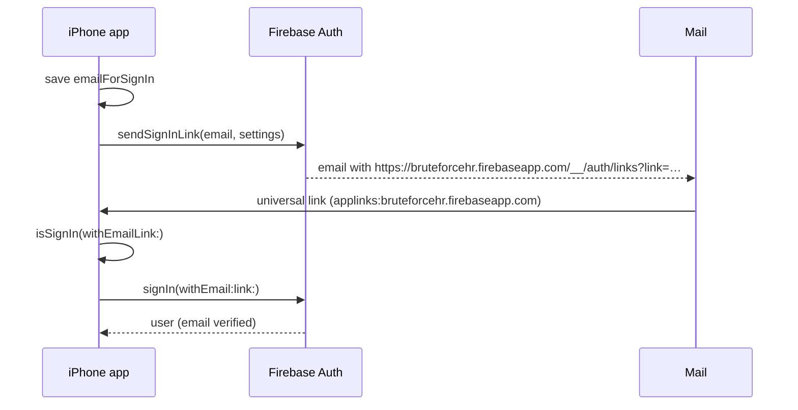
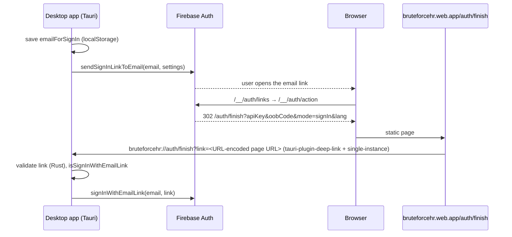

# ADR 0008 — Sign-in with Firebase Authentication email links

- **Status:** Accepted
- **Date:** 2026-10-23
- **Deciders:** Savas (owner), lead engineer agent
- **Supersedes:** [0003-auth-email-otp.md](0003-auth-email-otp.md) (custom emailed one-time code)
- **Related:** [0001-stack.md](0001-stack.md), [0006-hosting-domains.md](0006-hosting-domains.md), [0007-native-ios-tauri-desktop.md](0007-native-ios-tauri-desktop.md), [runbooks/accounts.md](../runbooks/accounts.md), [design/research/onboarding-signin.md](../design/research/onboarding-signin.md)

## Context

- ADR 0003 planned a custom 6-digit email code: Cloud Functions in a separate `auth` codebase, a hashed challenge in `serverOnly/otp/**`, mail through Brevo and `signInWithCustomToken`. It was never deployed because the Brevo account never existed.
- **Owner decision, 2026-10-23: no Brevo and no other third-party mail vendor.** Cloud Functions can't send mail without one, so a custom code is off the table.
- Firebase Authentication has a built-in passwordless **email link** sign-in. Firebase sends the email from its own mailer, the link works once, and completing it verifies the address ([Email link — iOS](https://firebase.google.com/docs/auth/ios/email-link-auth), [Web](https://firebase.google.com/docs/auth/web/email-link-auth)). Project `bruteforcehr` runs Firebase Authentication with Identity Platform.
- Firebase Dynamic Links shut down on 2025-08-25. Current SDKs (iOS 11.8.0+, JS) open email links in apps through **Firebase Hosting** domains; `ActionCodeSettings.linkDomain` selects a _custom_ Hosting domain and `dynamicLinkDomain` is deprecated ([ActionCodeSettings](https://firebase.google.com/docs/reference/js/auth.actioncodesettings), [Dynamic Links FAQ](https://firebase.google.com/support/dynamic-links-faq#impacts-on-email-link-authentication)).
- BRIEF §4.2 still holds: no passwords, no social login (App Review Guideline 4.8).

## Decision

Sign in on iOS and desktop with Firebase Authentication's email link. Nothing of ours sends mail or mints tokens.

### Project configuration (applied 2026-10-23)

Applied through the Identity Toolkit admin API (`PATCH https://identitytoolkit.googleapis.com/admin/v2/projects/bruteforcehr/config`) and the API Keys API. Read-back of the relevant fields:

| Setting                                         | Value                                                                                                                                                          |
| ----------------------------------------------- | -------------------------------------------------------------------------------------------------------------------------------------------------------------- |
| `signIn.email`                                  | `{"enabled": true}` (`passwordRequired` unset = false: email link allowed)                                                                                     |
| `authorizedDomains`                             | `bruteforcehr.firebaseapp.com`, `bruteforcehr.web.app`                                                                                                         |
| `emailPrivacyConfig.enableImprovedEmailPrivacy` | `true` (email enumeration protection)                                                                                                                          |
| `mobileLinksConfig.domain`                      | `HOSTING_DOMAIN`, default site `bruteforcehr` ⇒ links use `bruteforcehr.firebaseapp.com`                                                                       |
| Email templates `senderDisplayName`             | `BruteForceHR` (verify, reset, change, MFA templates). The sign-in email has no editable template; its `%APP_NAME%` is the project name `BruteForceHR`         |
| Sender                                          | `noreply@bruteforcehr.firebaseapp.com` (Firebase default)                                                                                                      |
| Browser API key (`AIzaSyBlJk…`) referrers       | `tauri://localhost/*`, `http://tauri.localhost/*`, `https://tauri.localhost/*`, **`https://bruteforcehr.firebaseapp.com/*`, `https://bruteforcehr.web.app/*`** |
| Blocking function `beforeUserCreated`           | `blockPasswordSignUp` (functions codebase `identity`, `europe-west1`), see Threat model                                                                        |

The two Hosting referrers are required: Firebase's hosted `/__/auth/links` and `/__/auth/action` pages call `getProjectConfig` with the API key embedded in the link. Without them the browser shows "The operation is not valid."

Read it back with:

```sh
curl -s -H "Authorization: Bearer $(gcloud auth print-access-token)" -H "x-goog-user-project: bruteforcehr" \
  https://identitytoolkit.googleapis.com/admin/v2/projects/bruteforcehr/config
```

### Client contract

| `ActionCodeSettings` | Value                                                                                                                                         |
| -------------------- | --------------------------------------------------------------------------------------------------------------------------------------------- |
| `url`                | `https://bruteforcehr.web.app/auth/finish`                                                                                                    |
| `handleCodeInApp`    | `true`                                                                                                                                        |
| `iOSBundleId`        | `com.savas07.bruteforcehr`                                                                                                                    |
| `linkDomain`         | **not set.** The API rejects default domains: `INVALID_HOSTING_LINK_DOMAIN … cannot be a default hosting domain (web.app or firebaseapp.com)` |
| `auth.languageCode`  | the UI language (`en`/`tr`/`de`): localizes Firebase's email and is passed on as `lang`                                                       |

1. The client stores the address (`emailForSignIn`: `UserDefaults` on iOS, `localStorage` in the desktop webview) and calls `sendSignInLinkToEmail`.
2. On return it checks `isSignInWithEmailLink(link)` and calls `signInWithEmailLink(email, link)`.
3. If `emailForSignIn` is missing (link opened elsewhere), it asks for the email again. Firebase rejects a different address (`INVALID_EMAIL … does not match the sign-in email address`).

Behaviour verified against the live project on 2026-10-23: a link works **once** (`INVALID_OOB_CODE` on reuse), and **sending a new link invalidates the previous one**.

### Link shape (observed)

```text
https://bruteforcehr.firebaseapp.com/__/auth/links?link=https://bruteforcehr.firebaseapp.com/__/auth/action?apiKey%3D<key>%26mode%3DsignIn%26oobCode%3D<code>%26continueUrl%3Dhttps://bruteforcehr.web.app/auth/finish%26lang%3Den
```

In a browser, `/__/auth/links` → `/__/auth/action` → `https://bruteforcehr.web.app/auth/finish?apiKey=<key>&oobCode=<code>&mode=signIn&lang=<lang>`.

### iOS: universal link



- Associated Domains: `applinks:bruteforcehr.firebaseapp.com` (the emailed link) and `applinks:bruteforcehr.web.app` (`/auth/finish`).
- Hosting serves one `/.well-known/apple-app-site-association` on both hosts (`apps/web/public/.well-known/`, `Content-Type: application/json` set in `firebase.json`): app ID `67NPXV7CSZ.com.savas07.bruteforcehr`, components `/__/auth/links*`, `/__/auth/action*`, `/auth/finish*`. It replaces the empty file Firebase generated (no Team ID was registered).
- The app also accepts `bruteforcehr://auth/finish?link=…` (same as desktop).

### Desktop: browser hand-off to the deep link



- `/auth/finish` (`apps/web/src/pages/auth/finish.astro`) signs nothing in. If the URL is a sign-in link (`mode=signIn`, `oobCode`, `apiKey`), it wraps its own URL into `bruteforcehr://auth/finish?link=…`, opens it once and shows **Return to BruteForceHR**, "Didn't open? Make sure the app is installed" and "open the link on the device where you asked". Otherwise it says the link isn't complete. Copy follows `lang` (EN, TR with "siz", DE with "du"). Critique: [design/critiques/web/auth-finish](../design/critiques/web/auth-finish/r3.md).
- Rust accepts only `bruteforcehr://auth/finish` with a single `link` whose inner URL is `https` on `bruteforcehr.web.app` (`/auth/finish`) or `bruteforcehr.firebaseapp.com` (`/__/auth/action`, `/__/auth/links` unwrapped once), with `mode=signIn`, `oobCode` and `apiKey`; it hands the canonical action URL to the UI.

### Account data access

`firestore.rules` and `storage.rules` grant user data only when `request.auth.token.email_verified == true` (email-link sign-in always verifies). Proven in `firebase/tests`.

## Threat model

| Threat                                                                                  | Mitigation                                                                                                                                                                                                                                                                                                                                                                                                                                                                                                                                                                                                                                                                                                                                                                                                                                                   |
| --------------------------------------------------------------------------------------- | ------------------------------------------------------------------------------------------------------------------------------------------------------------------------------------------------------------------------------------------------------------------------------------------------------------------------------------------------------------------------------------------------------------------------------------------------------------------------------------------------------------------------------------------------------------------------------------------------------------------------------------------------------------------------------------------------------------------------------------------------------------------------------------------------------------------------------------------------------------ |
| **Link interception / mailbox compromise**                                              | Single use, newest link only, expires (Firebase). Completing it needs the same email address. Anyone who controls the mailbox can sign in; that is inherent to email sign-in and stated in the Terms.                                                                                                                                                                                                                                                                                                                                                                                                                                                                                                                                                                                                                                                        |
| **Link leaks from the landing page** (Referer, logs, history)                           | `/auth/finish` has `Referrer-Policy: no-referrer` (header and meta), `noindex`, no third-party requests and no analytics. The code is single use and invalidated by the next sign-in.                                                                                                                                                                                                                                                                                                                                                                                                                                                                                                                                                                                                                                                                        |
| **Open redirect**                                                                       | `/auth/finish` never navigates to a URL from its query. It only wraps its own URL into the fixed app scheme, and only for sign-in links. The app re-validates hosts, paths and parameters before use. Firebase only continues to authorized domains.                                                                                                                                                                                                                                                                                                                                                                                                                                                                                                                                                                                                         |
| **Cross-device use**                                                                    | Opening the link on another device: Firebase requires the email again (mismatch rejected). Links requested on iPhone carry the iOS-restricted API key, so in a desktop browser Firebase's page stops ("The operation is not valid."); the copy tells people to open the link where they asked.                                                                                                                                                                                                                                                                                                                                                                                                                                                                                                                                                               |
| **Account enumeration**                                                                 | `sendSignInLinkToEmail` answers the same for new and existing addresses; email enumeration protection is on. Our UI never says whether an account exists.                                                                                                                                                                                                                                                                                                                                                                                                                                                                                                                                                                                                                                                                                                    |
| **Account pre-hijacking via password sign-up**                                          | The Email provider also accepts `accounts:signUp` with a password through the public key (verified: token `email_verified=false`). The `beforeUserCreated` blocking function rejects new accounts unless the method is `emailLink` or the email is verified, and rules require `email_verified` (defence in depth). Firebase also removes unverified passwords when the owner completes an email link.                                                                                                                                                                                                                                                                                                                                                                                                                                                       |
| **Strangers signing up and spending the owner's budget** (M6 security review finding 4) | **Invite-only sign-up** (owner decision 2026-10-24): the same `beforeUserCreated` function refuses a new account unless its address is in `serverOnly/signup.allowedEmails` or its domain in `allowedDomains` (exact, case-insensitive; a missing document allows nobody). The refusal is `permission-denied` with `SIGNUP_NOT_ALLOWED` in the message (`@bfhr/core`); the SDKs surface it as a generic blocking-function error (JS `auth/internal-error`, iOS `blockingCloudFunctionError`) and both apps show "BruteForceHR is invite-only for now. Ask the owner to add your email." The gate runs only when an account is created, so existing users always sign in again, and Admin SDK / admin-API `createUser` (smoke scripts, live checks) bypasses it. Per-user quotas and project-wide ceilings (runbooks/limits.md) still apply to invited users. |
| **Custom-scheme hijack on desktop**                                                     | Another local app could register `bruteforcehr://`. It would get a single-use link that still needs the user's email. Local malware is outside this threat model.                                                                                                                                                                                                                                                                                                                                                                                                                                                                                                                                                                                                                                                                                            |
| **Email bombing / cost**                                                                | Firebase rate-limits sending (`TOO_MANY_ATTEMPTS_TRY_LATER`); daily quotas below bound volume. No function of ours runs on send.                                                                                                                                                                                                                                                                                                                                                                                                                                                                                                                                                                                                                                                                                                                             |

## Quotas and cost

Firebase Authentication limits on the Blaze plan ([Authentication limits](https://firebase.google.com/docs/auth/limits)): **25,000 email link sign-in emails/day** (Spark: 5) and 250,000 sign-in links generated/day. Email/link users count toward Identity Platform monthly active users ([pricing](https://cloud.google.com/identity-platform/pricing)); a personal app stays inside the no-cost tier. The blocking function runs once per new account.

## Consequences

- Removed: the `auth` functions codebase (`authRequestCode`/`authVerifyCode`, OTP store, Brevo client, tests), the `OTP_PEPPER` secret (deleted from Secret Manager 2026-10-23), `BREVO_*` params, and the `challenges`/`sendLogs` TTL overrides (indexes deployed 2026-10-23). `serverOnly/**` keeps only mail tokens and other server state.
- No mail vendor account; nothing to rotate. Deliverability depends on Google's shared `firebaseapp.com` sender (no own domain, ADR 0006); messages may land in Spam, so the UI and Support FAQ mention it.
- The sign-in email's wording is Firebase's (localized through `languageCode`), not ours.
- Sign-up is invite-only: the owner manages `serverOnly/signup` with `pnpm --filter @bfhr/functions signup:allow …` ([runbooks/accounts.md](../runbooks/accounts.md)). Only one `beforeUserCreated` function is allowed per project, so the gate lives in `blockPasswordSignUp` (`checkNewUser`); the function name stays, so the Identity Platform registration doesn't change.
- The `identity` functions codebase (`apps/functions/src/identity.ts`) holds the blocking function. Deploying a blocking function reads and writes the Identity Platform config, which the release service account has no role for, so the owner deploys it by hand when it changes ([runbooks/release.md](../runbooks/release.md)). Verified 2026-10-23: password `signUp` returns `BLOCKING_FUNCTION_ERROR_RESPONSE … PERMISSION_DENIED`; email-link sign-up succeeds with `email_verified: true`.
- Hosting carries part of the auth contract: `/auth/finish`, the AASA file and the browser-key referrers.
- Account deletion's re-confirmation becomes a fresh email-link sign-in (recent `auth_time`) instead of a code.

## Alternatives considered

| Alternative                                | Why rejected                                                                                       |
| ------------------------------------------ | -------------------------------------------------------------------------------------------------- |
| Keep the custom code (ADR 0003) with Brevo | Owner declined third-party mail vendors.                                                           |
| Custom code sent through Firebase's mailer | Firebase sends only its own templates (verify, reset, sign-in link); there is no general send API. |
| Identity Platform custom SMTP              | Still needs an SMTP vendor or mailbox credentials.                                                 |
| `linkDomain` on `bruteforcehr.web.app`     | Rejected by the API for default domains; possible later with a custom domain (ADR 0006 migration). |
| Sign in with Apple / Google                | Two providers plus web flows on Windows; email-only stays simplest (BRIEF §4.2, Guideline 4.8).    |
