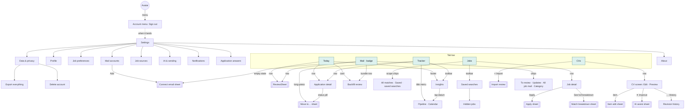
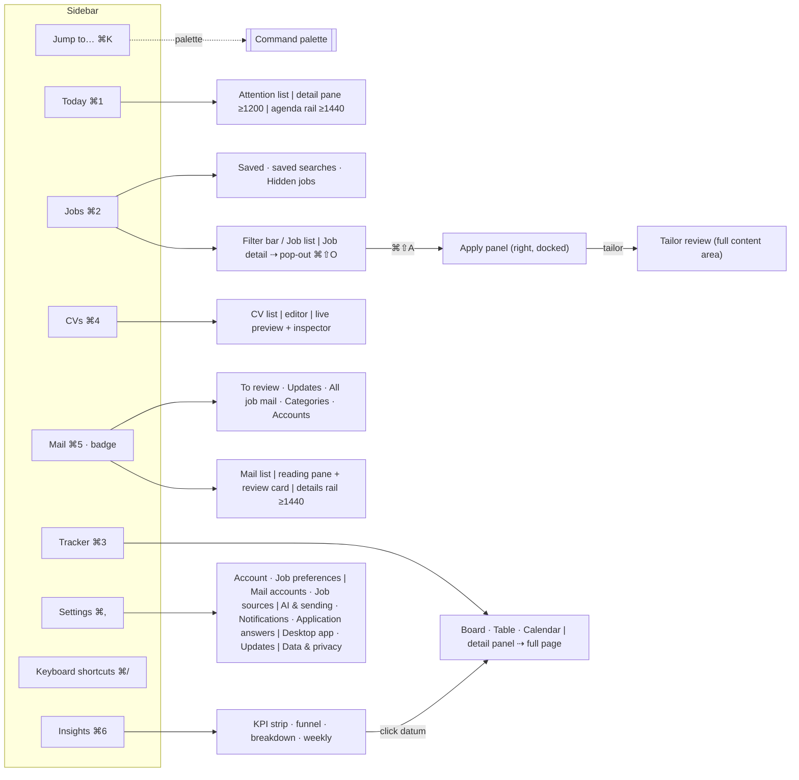

# Information architecture

Status: M0 synthesis, 2026-10-22. Sources: BRIEF §4.1, the 14 research docs in `docs/design/research/`, and [decisions.md](decisions.md), which this doc follows. **Mod** = ⌘ on macOS, Ctrl on Windows.

## Principles

- **Device roles (BRIEF §4.1).** iOS is for quick actions: triage, saving jobs, applying with an existing CV, interview reminders. Desktop is for heavy work: CV editing, tailoring, bulk tracking, insights. Every core action works on both.
- **Same names, platform idioms.** Destinations, objects and verbs have the same names on every platform (table below). Navigation follows each platform's own idiom: native tabs and stacks with sheets on iOS; a sidebar, multi-pane layouts and the keyboard on desktop.
- **One home per object.** Jobs live in Jobs, applications in Tracker, CVs in CVs, job email in Mail. Today only collects what needs attention and links to the object's home. Insights is a read-only view over Tracker.
- **Chrome always renders** (states.md). Sidebar, tab bar, titles and filters stay visible during loading, errors and offline. The only full-screen takeovers are signed-out auth and the `minSupportedVersion` update gate.

## Destinations

| #   | Destination | iOS                                          | Desktop                          | Mod+ | SF Symbol             | Desktop icon (lucide) | TR        | DE            |
| --- | ----------- | -------------------------------------------- | -------------------------------- | ---- | --------------------- | --------------------- | --------- | ------------- |
| 1   | Today       | Tab 1                                        | Sidebar 1                        | 1    | `sun.max`             | `sun`                 | Bugün     | Heute         |
| 2   | Jobs        | Tab 2                                        | Sidebar 2                        | 2    | `briefcase`           | `briefcase`           | İlanlar   | Jobs          |
| 3   | Tracker     | Tab 3                                        | Sidebar 3                        | 3    | `rectangle.split.3x1` | `kanban`              | Takip     | Tracker       |
| 4   | CVs         | Tab 4                                        | Sidebar 4                        | 4    | `doc.text`            | `file-text`           | CV'ler    | Lebensläufe   |
| 5   | Mail        | Tab 5, the only badge (To review count)      | Sidebar 5, the only badge        | 5    | `envelope`            | `mail`                | E-posta   | Mail          |
| 6   | Insights    | Tracker nav-bar button + Today footer link   | Sidebar 6                        | 6    | `chart.bar.xaxis`     | `chart-column`        | İçgörüler | Einblicke     |
| —   | Settings    | Avatar button (top right, every tab) → sheet | Sidebar bottom, menu "Settings…" | `,`  | `person.crop.circle`  | `settings`            | Ayarlar   | Einstellungen |

There are no badges on Today, Jobs, Tracker or CVs (D01). Mail health shows as an amber dot plus text, never red.

## iOS

### Structure

- **Tab bar:** SwiftUI `TabView` built with the iOS 18 `Tab` API ([Tab](https://developer.apple.com/documentation/swiftui/tab), [TabView](https://developer.apple.com/documentation/swiftui/tabview)): Today · Jobs · Tracker · CVs · Mail. Each tab owns a `NavigationStack` with a large title. Reselecting a tab pops to its root, and a second tap scrolls to the top.
- **Avatar** (top-right nav-bar button on every tab root; initials monogram, amber dot when a mail account needs attention) opens the **account menu**: "Signed in as {email}" and **Sign out** (M1, email-link sign-in). **Settings** joins the menu as its first item when the Settings sheet lands (sheet, large detent, "Done"). Nothing else lives behind the avatar.
- **Signed out** (iOS Release builds, and Debug builds without design arguments): the sign-in takeover replaces the tabs (email → "Check your email" → the emailed link opens the app → tabs). Debug design mode (`-BFHRScreen`, `-BFHRDesign`, `-BFHRState`, `-BFHRUpdate`) skips it so fixture screens stay reachable; `-BFHRSignIn <state>` shows a sign-in state. foundation-ios.md, "Sign-in".
- **Sheets:** focused tasks open as sheets over the current tab, so the user never loses their place:
  - Apply (page sheet, large detent, its own stack).
  - ReviewSheet (form sheet, medium / large detents).
  - Move to…, Outcome, filters (medium / large detents).
  - AI assist, item editor, template picker, keyword coverage.
  - Connect email (large detent).
- **Pushes** move to the next level of the hierarchy: Job detail, Application detail, CV screen, Insights, Saved searches, Settings subpages.

### Per-tab contents

| Tab     | Root                                                                                                                                                           | Pushes                                                                           | Sheets                                                                                   |
| ------- | -------------------------------------------------------------------------------------------------------------------------------------------------------------- | -------------------------------------------------------------------------------- | ---------------------------------------------------------------------------------------- |
| Today   | Inset-grouped list in a fixed order: Next up · To review · Follow-ups · Deadlines · New matches. Empty sections are hidden. Footer: "This week in Insights".   | Application detail, Job detail, Insights                                         | ReviewSheet, Snooze menu, Draft follow-up (Apply compose)                                |
| Jobs    | Searchable feed with scope chips (All matches · Saved · saved searches · +), filter chips and a result header                                                  | Job detail, Saved searches → Hidden jobs                                         | Filters, dismiss reason, saved-search editor, Apply, match breakdown, CV picker          |
| Tracker | Title menu Pipeline ▾ / Calendar. Pipeline: scope tabs Active · Closed · All, stage index strip, phase-grouped sections. Toolbar: Insights, filter, sort, Add. | Application detail (timeline), Insights → filtered Pipeline                      | Move to…, Outcome, Log an application (Apply sheet, manual), month picker                |
| CVs     | Base CVs with their variants; filter All / Archived; + menu (Import a file · Start from scratch · From a template)                                             | CV screen (Edit · Preview), revision history → revision viewer, Compare versions | Item editor, AI assist, template picker, keyword coverage, import review, export options |
| Mail    | Title menu: All accounts / each address. Sync line. Chips: To review (n) · Updates · All job mail · Category ▾. Account-health card when needed.               | Backfill review (from the bundle row)                                            | ReviewSheet, Change… pickers, Connect email (empty state)                                |

## Desktop (macOS + Windows)

### Shell

- **Window chrome** ([ADR 0007](../adr/0007-native-ios-tauri-desktop.md); desktop-chrome.md): on macOS, Tauri `titleBarStyle: "Overlay"` with hidden title and the traffic lights over the sidebar (52 px toolbar row, sidebar vibrancy). On Windows, the **native title bar** with native caption buttons and Snap Layouts, plus Mica on Windows 11. Tauri has no Windows title-bar overlay, so the app-name row sits below the native title bar.
- **Minimum window** 480 × 360. Below 640 px the sidebar becomes a 60 px icon rail (D04).
- **Sidebar** (232 px, 32 px rows), top to bottom:
  1. **Jump to…** Mod+K.
  2. Today · Jobs · Tracker · CVs · Mail · Insights. The children of a section appear under it while that section is active:
     - Jobs: Saved, each saved search with its new-match count, Hidden jobs.
     - Mail: To review (n), Updates, All job mail, Categories (collapsible), Accounts (one row per address, health dot).
  3. Pinned at the bottom: the update card (M1), Keyboard shortcuts (Mod+/), Settings (Mod+,).
  4. Footer: the sync line (`SyncStatus`, states.md).
- **Settings** replaces the content area (nav 220 px, content max 720 px). Esc or "← Back" returns.
- **Panes:** list pane (340–440 px) | detail pane (min 480 px). Below 980 px the detail is pushed with a back button. The Apply panel docks on the right (400–640 px, default 480).

### Per-section layouts

| Section  | Layout                                                                                                                                                                                                                     | Notes                                                                                                      |
| -------- | -------------------------------------------------------------------------------------------------------------------------------------------------------------------------------------------------------------------------- | ---------------------------------------------------------------------------------------------------------- |
| Today    | Center column 420–720 px. Detail pane at ≥ 1200 px, inline row expansion below that. Agenda rail (read-only, 7 days) at ≥ 1440 px.                                                                                         | Header: title, date, Open / Later filter.                                                                  |
| Jobs     | Filter bar (one line at ≥ 1200 px) / list (default 400 px) / detail (≥ 480 px). The detail can pop out into its own window.                                                                                                | Detail has a two-column body with a 280 px rail when it's ≥ 760 px wide.                                   |
| Tracker  | Toolbar: Board · Table · Calendar, search, filters, sort, Display. Right detail panel (Enter) or full page (Mod+Enter).                                                                                                    | Board columns 272 px; empty columns collapse to 40 px rails; Closed rail with 5 drop zones while dragging. |
| CVs      | CV list (240–320 px; icons only below 1280 px) / editor (min 420 px) / live preview (a toggle below 1100 px) / inspector (Design · Check · Suggestions · History).                                                         | Template gallery and revision viewer open as large modals. Import review is a full-content stepper.        |
| Mail     | Nested sidebar folders / list (360–440 px) / reading pane with the review card / details rail at ≥ 1440 px                                                                                                                 | Correction popover (cmdk); hint bar on first use                                                           |
| Insights | 12-column grid: KPI strip (5 tiles), funnel, breakdown table, weekly chart. One column below 1100 px.                                                                                                                      | Filters: Source · Channel · CV variant · Market. Every datum drills into a filtered Tracker table.         |
| Settings | Grouped nav: Account (Account, Job preferences) · Connections (Mail accounts, Job sources) · Preferences (AI & sending, Notifications, Application answers) · This computer (Desktop app, Updates) · Data (Data & privacy) | Every setting is a palette entry.                                                                          |

### Native menu (macOS) and command registry

macOS lists every command in the menu bar. Windows shows the same native menu below its native title bar ([ADR 0007](../adr/0007-native-ios-tauri-desktop.md)). The same registry also feeds the palette and the shortcuts sheet (D07). Title case in macOS menus, sentence case everywhere else.

| Menu         | Items                                                                                                                                   |
| ------------ | --------------------------------------------------------------------------------------------------------------------------------------- |
| BruteForceHR | About · Settings… ⌘, · Check for Updates… · Hide ⌘H · Hide Others ⌥⌘H · Quit ⌘Q (the macOS-owned keys stay theirs)                      |
| File         | New Application ⌘N · Add Job from Link… · Import CV… · Export… ⌘E · Close Window ⌘W                                                     |
| Edit         | Undo ⌘Z · Redo ⇧⌘Z · Cut · Copy · Paste · Select All ⌘A · Find ⌘F                                                                       |
| View         | Command Palette… ⌘K · Show/Hide Details ⇧⌘D · Show/Hide Preview ⇧⌘P · Actual Size ⌘0 · Zoom In ⌘= · Zoom Out ⌘- · Enter Full Screen ⌃⌘F |
| Go           | Today ⌘1 … Insights ⌘6 · Back ⌘[ · Forward ⌘]                                                                                           |
| Job          | Save S · Not for Me D · Apply… ⇧⌘A · Open Original O · Open in New Window ⇧⌘O                                                           |
| Application  | Move To… M · Move Forward ⇧⌘→ · Move Back ⇧⌘← · Open Full Page ⌘↩                                                                       |
| Window       | Minimize ⌘M · Zoom · Bring All to Front                                                                                                 |
| Help         | Keyboard Shortcuts… ⌘/ · What's New · Support · Privacy Policy                                                                          |

## Command palette

cmdk inside a Radix Dialog: 560 px wide, 14 vh from the top. Mod+K toggles it. The first result is pre-selected, and the footer reads `↑ ↓ to move · ↵ to open · esc to close` (desktop-chrome).

| Group         | Contents                                                                                                                                                                                                                                                          | When                                             |
| ------------- | ----------------------------------------------------------------------------------------------------------------------------------------------------------------------------------------------------------------------------------------------------------------- | ------------------------------------------------ |
| **Suggested** | Actions for the current selection first ("Move Acme · Frontend Engineer to…", "Apply to Acme…", "Tailor CV for Acme…"), then recent destinations                                                                                                                  | Always, while the query is empty                 |
| **Go to**     | The 6 destinations (Mod+1–6 keycaps) and their sub-views: Jobs › Saved / each saved search / Hidden jobs; Tracker › Board / Table / Calendar; Mail › To review / Updates / All job mail; every Settings page **and every individual setting** (settings-account)  | M0 (destinations), the rest as each screen lands |
| **Search**    | Two-line results: jobs (title · company · band), applications (company · role · status pill), CVs (title · language), saved searches, contacts. Mail matches **company, role and subject only**, never the body.                                                  | M4+                                              |
| **Actions**   | New application (Mod+N) · Add job from link… · Import CV… · New CV · Export… (Mod+E) · Connect email account… · Check for updates · Pause notifications… · Appearance: System / Light / Dark · Copy {answer} (answers library entries, e.g. "Copy notice period") | As features land                                 |
| **Help**      | Keyboard shortcuts (Mod+/) · What's new · Support ↗ · Privacy Policy ↗                                                                                                                                                                                            | M0                                               |

Rules:

- Palette actions are reversible. Irreversible acts never run from the palette; it only navigates to their screen. These are: Send email, Disconnect and delete, Delete account, Import backfill, Restore a CV version.
- Every row shows its shortcut keycaps (one registry: `apps/desktop/src/shared/shortcuts.ts`).
- Choosing a destination moves focus to that section's heading. Choosing an entity opens it in its home section.
- Typing a URL offers "Add job from link…" (BRIEF §4.3 paste-a-URL).

## Keyboard map

One map for both desktop platforms. ⌘ / Ctrl columns differ only in the modifier, except where noted.

### Rules

1. **Single keys** (letters, digits, `/`, `?`) fire only when focus isn't in a text field, an editable cell or a combobox (D28). They match the typed character (`event.key`), so they work on every layout. Mod+digit matches physical keys.
2. **One meaning per key.** `J`/`K` = next / previous item in the focused collection; `Enter` = open; `Esc` = close or go back one level; `M` = move / change status; `D` = not for me / not needed; `H` = later (snooze); `C` = confirm; `O` = open original; `S` = save; `A` = apply (or use suggestion inside Tailor review); `F` = focus filters; `X` = select row.
3. **Never assign** OS- or webview-reserved keys:
   - **macOS:** ⌘H, ⌥⌘H, ⌘M, ⌘Q, ⌘W (except closing our own windows), ⌘Tab, ⌘Space, ⌘\`, ⌃⌘F, ⌃⌘Q, ⇧⌘3/4/5, ⌥⌘Esc.
   - **Windows:** Win+…, Alt+F4, Alt+Space, Alt+Tab, Ctrl+Esc, Ctrl+Shift+Esc, F10, F11, F12.
   - **Webview and browser:** ⌥⌘I / Ctrl+Shift+I (web inspector / DevTools in debug builds), ⌘R / Ctrl+R / F5 (reload).
   - **Print:** ⌘P / Ctrl+P (stays unassigned; there's no print command).
   - **Ctrl+Alt+…** on Windows (that's AltGr on DE/TR layouts).
   - **Bracket and backslash chords** as the only path (AltGr on DE/TR).
4. Every shortcut appears in tooltips, menus and the shortcuts sheet. `?` opens the sheet as well as Mod+/.

### Global

| Action                                                               | macOS                                          | Windows                                 |
| -------------------------------------------------------------------- | ---------------------------------------------- | --------------------------------------- |
| Command palette                                                      | ⌘K                                             | Ctrl+K                                  |
| Keyboard shortcuts                                                   | ⌘/ or `?`                                      | Ctrl+/ or `?`                           |
| Go to Today · Jobs · Tracker · CVs · Mail · Insights                 | ⌘1 … ⌘6                                        | Ctrl+1 … Ctrl+6                         |
| Go-to sequence (Today, Jobs, tRacker, CVs, Mail, Insights, Settings) | `G` then `T` `J` `R` `C` `M` `I` `S`           | same                                    |
| Settings                                                             | ⌘,                                             | Ctrl+,                                  |
| Back / Forward                                                       | ⌘[ / ⌘] (also mouse and trackpad back/forward) | Alt+← / Alt+→ (also mouse back/forward) |
| New application (Jobs: Add job from link…; CVs: New CV)              | ⌘N                                             | Ctrl+N                                  |
| Find in this view                                                    | ⌘F, or `/`                                     | Ctrl+F, or `/`                          |
| Undo / Redo the last action                                          | ⌘Z / ⇧⌘Z                                       | Ctrl+Z / Ctrl+Y or Ctrl+Shift+Z         |
| Export… (format from context: PDF, CSV)                              | ⌘E                                             | Ctrl+E                                  |
| Show / hide details panel or inspector                               | ⇧⌘D                                            | Ctrl+Shift+D                            |
| Show / hide preview (CV editor, email compose; below 1100 px)        | ⇧⌘P                                            | Ctrl+Shift+P                            |
| Open detail in its own window                                        | ⇧⌘O                                            | Ctrl+Shift+O                            |
| Primary action of the focused surface                                | ⌘↩                                             | Ctrl+Enter                              |
| Zoom in / out / reset                                                | ⌘= / ⌘- / ⌘0                                   | Ctrl+= / Ctrl+- / Ctrl+0                |
| Close the focused pop-out window                                     | ⌘W                                             | Ctrl+W                                  |
| Close, cancel, back one level                                        | Esc                                            | Esc                                     |

### Lists, boards and tables (all sections)

| Action                | Keys                                                            |
| --------------------- | --------------------------------------------------------------- |
| Next / previous item  | `J` / `K`, ↓ / ↑                                                |
| Open in detail pane   | Enter                                                           |
| Back to the list      | Esc                                                             |
| Select / deselect row | `X` (Space in checkbox lists)                                   |
| Range / multi-select  | Shift+click, Mod+click                                          |
| Select all            | ⌘A / Ctrl+A                                                     |
| Focus search          | `/`                                                             |
| Focus filters         | `F`                                                             |
| Context menu          | right-click, Shift+F10 / Menu key (Windows), Ctrl+click (macOS) |

### Per section

| Section                   | Action                                                                   | Keys                                                                |
| ------------------------- | ------------------------------------------------------------------------ | ------------------------------------------------------------------- |
| Today                     | Confirm review item                                                      | `C`                                                                 |
|                           | Done / acknowledge                                                       | `E`                                                                 |
|                           | Later (snooze menu; presets 1–4)                                         | `H`                                                                 |
|                           | Not needed / Not for me                                                  | `D`                                                                 |
|                           | Open source (email or job)                                               | `O`                                                                 |
| Jobs and Job detail       | Save / unsave                                                            | `S`                                                                 |
|                           | Not for me / with reason                                                 | `D` / Shift+`D` (`⌫` also hides)                                    |
|                           | Apply                                                                    | `A`, or ⇧⌘A / Ctrl+Shift+A anywhere a job or application is focused |
|                           | Open original posting                                                    | `O`                                                                 |
|                           | Save search                                                              | ⌘S / Ctrl+S                                                         |
|                           | Dismiss reason popover                                                   | `1`–`8` toggle, Enter save, Esc skip                                |
| Apply panel               | Close (draft kept)                                                       | Esc                                                                 |
|                           | Previous / next step                                                     | ⌘↑ / ⌘↓ · Ctrl+↑ / Ctrl+↓                                           |
|                           | Full CV preview (CV step)                                                | Space                                                               |
|                           | Review email → "Send to {address}"                                       | ⌘↩ / Ctrl+Enter (two steps: Review, then Send)                      |
|                           | Undo send (while the countdown runs)                                     | ⌘Z / Ctrl+Z                                                         |
|                           | Copy the n-th answer (kit)                                               | `1`–`9`                                                             |
|                           | Pop out the kit                                                          | ⇧⌘K / Ctrl+Shift+K                                                  |
|                           | "Did you submit?" banner                                                 | `Y` yes · `N` not yet                                               |
| Tailor review             | Next / previous card                                                     | `J` / `K`                                                           |
|                           | Use suggestion · Keep original · Edit                                    | `A` · `R` · `E`                                                     |
|                           | Back to the panel                                                        | Esc                                                                 |
| Tracker                   | Board · Table · Calendar                                                 | `1` · `2` · `3`                                                     |
|                           | Move focus (board)                                                       | ← / → between columns, ↑ / ↓ or `J` / `K` between cards             |
|                           | Move to…                                                                 | `M`                                                                 |
|                           | Move one stage forward / back                                            | ⇧⌘→ / ⇧⌘← · Ctrl+Shift+→ / Ctrl+Shift+←                             |
|                           | Toggle detail panel / open full page                                     | Enter / ⌘↩                                                          |
|                           | Previous / next record ("3 of 12 in Interviewing")                       | `K` / `J` in the record top bar                                     |
| Mail                      | Confirm                                                                  | `C`                                                                 |
|                           | Change… (correction popover: Tab cycles Category → Application → Status) | `M`                                                                 |
|                           | Not job mail                                                             | `N`                                                                 |
|                           | Review later                                                             | `H`                                                                 |
|                           | Open original                                                            | `O`                                                                 |
|                           | To review · Updates · All job mail                                       | `1` · `2` · `3`                                                     |
| Backfill review           | Toggle row · status · select all · import · not now                      | Space · `M` · ⌘A · ⌘↩ · Esc                                         |
| CVs list                  | Duplicate · rename · version history · export PDF · new CV               | ⌘D · F2 · ⇧⌘H · ⌘E · ⌘N                                             |
| CV editor                 | Move item / section                                                      | ⌥↑ / ⌥↓ · Alt+↑ / Alt+↓                                             |
|                           | Add item below / use focused suggestion                                  | ⌘↩ / Ctrl+Enter                                                     |
|                           | AI assist on selection                                                   | ⌘J / Ctrl+J                                                         |
|                           | Next / previous suggestion                                               | F8 / Shift+F8                                                       |
|                           | Keep original (focused suggestion)                                       | Esc                                                                 |
|                           | Find in CV                                                               | ⌘F / Ctrl+F                                                         |
|                           | Preview zoom (preview focused)                                           | ⌘= / ⌘-                                                             |
| Revision viewer · Compare | Next / previous change; pick left / right; save merged                   | `J` / `K`; `1` / `2`; ⌘↩                                            |
| Import review             | Next / previous flagged field; confirm field                             | `J` / `K`; ⌘↩                                                       |
| Insights                  | Range (range control focused)                                            | ← / →                                                               |
|                           | Filters · export CSV                                                     | `F` · ⌘E                                                            |
|                           | Move between bars (chart focused)                                        | ← / →                                                               |
| Settings                  | Search · navigate · toggle switch                                        | `/` · ↑ / ↓ · Space                                                 |
|                           | Close dialog, then leave Settings                                        | Esc                                                                 |
|                           | Delete-account and disconnect dialogs                                    | Focus starts on the safe button. Enter and Esc both cancel.         |
| Sign-in and onboarding    | Submit · use a different email (code step) · Continue · Back             | Enter · Esc · ⌘↩ · ⌘[ / Alt+←                                       |

### iOS gestures and menus

| Row                       | Leading swipe                            | Trailing swipe                   | Context menu (long-press)                                                                          | Haptic                            |
| ------------------------- | ---------------------------------------- | -------------------------------- | -------------------------------------------------------------------------------------------------- | --------------------------------- |
| Today item                | Primary positive (Confirm / Done / Save) | Snooze · Not needed / Not for me | Same + Open application                                                                            | Light on Confirm; none on dismiss |
| Job row                   | Save / Unsave                            | Not for me (full swipe) · More   | Save · Not for me… · Hide all from {company} · Open original · Share                               | Light on save and hide            |
| Tracker row               | Advance to {next stage}                  | Close… (Outcome sheet)           | Move to… (also a VoiceOver custom action) · Open job · Add note                                    | Tick on drag target change        |
| Mail row                  | Confirm                                  | Change… · Not job mail           | Same + Review later · Open in {provider}                                                           | Light on Confirm                  |
| CV row                    | —                                        | —                                | Duplicate · New role variant · New language variant · Rename · Version history · Export… · Archive | —                                 |
| Saved search / scope chip | —                                        | Delete (Undo toast)              | Edit · Alert settings · Delete                                                                     | —                                 |
| Hidden job                | Unhide                                   | —                                | Unhide · Open                                                                                      | —                                 |

Apply is never a swipe action (it needs the Apply sheet). Destructive actions are never full-swipe.

## Deep links

Scheme `bruteforcehr://` (D29). Links only navigate. Unknown or invalid links open Today without an error. `{…}` are Firestore document ids. Query parameters use the same names on both platforms. The desktop route is the hash route (TanStack Router) the link resolves to.

Handling:

- **iOS:** the scheme is registered in the app's URL types, and the root view parses links in `onOpenURL` ([onOpenURL](<https://developer.apple.com/documentation/swiftui/view/onopenurl(perform:)>)). The OAuth return (`bruteforcehr://connected`) is the exception: `WebAuthenticationSession` returns it directly to the awaiting connect flow ([ADR 0006](../adr/0006-hosting-domains.md)).
- **Desktop:** `tauri-plugin-deep-link` with `plugins.deep-link.desktop.schemes: ["bruteforcehr"]`. The UI reads the launch link with `getCurrent()` and later links with `onOpenUrl`. `tauri-plugin-single-instance` (feature `deep-link`) is registered first, so a link opened while the app is running reaches the running window instead of a second instance. Schemes must be in the config ("Dynamic registration at runtime is not supported"), and "deep links are only triggered for installed applications on desktop" ([Deep linking](https://v2.tauri.app/plugin/deep-linking/)). A link can also be faked as a command-line argument, so every link is parsed against this table and anything else opens Today.

| Link                                                                                                                                                                                              | Opens (iOS)                                                                                                                | Opens (desktop)                                                | Used by                                                                          |
| ------------------------------------------------------------------------------------------------------------------------------------------------------------------------------------------------- | -------------------------------------------------------------------------------------------------------------------------- | -------------------------------------------------------------- | -------------------------------------------------------------------------------- |
| `bruteforcehr://today`                                                                                                                                                                            | Today tab                                                                                                                  | `/today`                                                       | Default, notifications summary                                                   |
| `bruteforcehr://jobs`                                                                                                                                                                             | Jobs tab                                                                                                                   | `/jobs`                                                        | —                                                                                |
| `bruteforcehr://jobs/saved`                                                                                                                                                                       | Jobs, Saved scope                                                                                                          | `/jobs?scope=saved`                                            | —                                                                                |
| `bruteforcehr://jobs/searches/{savedSearchId}`                                                                                                                                                    | Jobs scoped to that search                                                                                                 | `/jobs?search={id}`                                            | Saved-search alert push, daily digest                                            |
| `bruteforcehr://jobs/hidden`                                                                                                                                                                      | Saved searches › Hidden jobs                                                                                               | `/jobs/hidden`                                                 | —                                                                                |
| `bruteforcehr://jobs/{jobId}`                                                                                                                                                                     | Job detail (pushed on Jobs)                                                                                                | `/jobs/{jobId}`                                                | Match push, Today rows, palette                                                  |
| `bruteforcehr://jobs/{jobId}/apply`                                                                                                                                                               | Job detail + Apply sheet (draft restored)                                                                                  | `/jobs/{jobId}` + Apply panel                                  | Today "Draft follow-up", "Continue applying"                                     |
| `bruteforcehr://tracker`                                                                                                                                                                          | Tracker, Pipeline                                                                                                          | `/tracker`                                                     | —                                                                                |
| `bruteforcehr://tracker?view=board\|table\|calendar&phase=&status=&source=&channel=&cv=&market=&from=&to=`                                                                                        | Pipeline filtered (iOS ignores `view=table` and shows the filtered Pipeline)                                               | `/tracker?view=…&…`                                            | Insights drill-down                                                              |
| `bruteforcehr://applications/{applicationId}`                                                                                                                                                     | Application detail                                                                                                         | `/tracker/applications/{id}` (full page)                       | Interview, offer, assessment, decision pushes; toast "View"                      |
| `bruteforcehr://applications/{applicationId}/events/{eventId}`                                                                                                                                    | Application detail scrolled to that timeline row (with Undo)                                                               | same, row focused                                              | Auto-change push ("Moved to Interviewing from an email")                         |
| `bruteforcehr://interviews/{interviewId}`                                                                                                                                                         | Application detail at that interview round                                                                                 | same                                                           | Interview reminder, `.ics` URL field                                             |
| `bruteforcehr://cvs`                                                                                                                                                                              | CVs tab                                                                                                                    | `/cvs`                                                         | —                                                                                |
| `bruteforcehr://cvs/import`                                                                                                                                                                       | CVs + import picker                                                                                                        | `/cvs/import`                                                  | Onboarding "Review your imported CV" card                                        |
| `bruteforcehr://cvs/{cvId}`                                                                                                                                                                       | CV screen (Edit)                                                                                                           | `/cvs/{cvId}`                                                  | Today "{n} fields to check" card                                                 |
| `bruteforcehr://cvs/{cvId}/revisions/{revisionId}`                                                                                                                                                | Revision viewer                                                                                                            | `/cvs/{cvId}?revision={id}`                                    | History links, conflict banner                                                   |
| `bruteforcehr://mail`                                                                                                                                                                             | Mail, To review                                                                                                            | `/mail`                                                        | Review-queue push                                                                |
| `bruteforcehr://mail/review/{messageId}`                                                                                                                                                          | Mail + ReviewSheet                                                                                                         | `/mail/review/{messageId}`                                     | Low-confidence item push                                                         |
| `bruteforcehr://mail/updates`                                                                                                                                                                     | Mail, Updates chip                                                                                                         | `/mail/updates`                                                | Auto-change summary                                                              |
| `bruteforcehr://mail/backfill/{mailAccountId}`                                                                                                                                                    | Backfill review                                                                                                            | `/mail/backfill/{id}`                                          | "Your inbox scan is done" push / notification, Today card                        |
| `bruteforcehr://insights?range=4w\|12w\|30d\|90d\|6m\|12m\|all`                                                                                                                                   | Tracker › Insights                                                                                                         | `/insights?range=…`                                            | Today footer link                                                                |
| `bruteforcehr://settings`                                                                                                                                                                         | Settings sheet                                                                                                             | `/settings`                                                    | —                                                                                |
| `bruteforcehr://settings/{page}` with page = `account`, `job-preferences`, `mail-accounts`, `job-sources`, `ai`, `notifications`, `application-answers`, `desktop-app`, `updates`, `data-privacy` | Settings sheet at that page (`desktop-app` and `updates` → desktop only, iOS opens the root)                               | `/settings/{page}`                                             | "Open settings" toast, re-auth push (`mail-accounts`)                            |
| `bruteforcehr://settings/mail-accounts/{mailAccountId}`                                                                                                                                           | Account detail                                                                                                             | `/settings/mail-accounts/{id}`                                 | "Reconnect {address}" push                                                       |
| `bruteforcehr://connected?nonce=&provider=google\|microsoft&intent=read\|send&status=ok\|error&reason=`                                                                                           | Returns from `ASWebAuthenticationSession`, resumes the connect flow (Scanning, or the Review email step for `intent=send`) | Brings the window forward, resolves the browser-handoff screen | `/connect/**` Cloud Function redirect only; accepted only with the pending nonce |
| `bruteforcehr://auth/finish?link=<URL-encoded emailed link>`, and the universal links `https://bruteforcehr.firebaseapp.com/__/auth/links?link=…` / `https://bruteforcehr.web.app/auth/finish?…` (iOS) | Signed out: finishes email-link sign-in (asks for the address when this device didn't ask for the link); signed in: ignored | Same, from the website's `/auth/finish` page                   | The sign-in email (ADR 0003); never switches accounts silently                    |

Push notifications carry exactly one of these links. Notification actions are "Open" only: nothing is confirmed from the lock screen (mail-review).
