# M0 design checkpoint

**Approved by the owner on 2026-10-23.** The taste answers are summarised under [Decisions (2026-10-23)](#decisions-2026-10-23) and recorded in [decisions.md](decisions.md#m0-checkpoint-taste-answers-q1q10).

This is the design checkpoint from [BRIEF §5.6](../BRIEF.md#56-design-gates). Before broad implementation starts, please review the information architecture (IA), the design tokens and the five core screens: Today, Job detail, CV editor, Tracker board and Mail review. Each screen is shown on iOS (native SwiftUI) and on desktop (Tauri 2, macOS and Windows). For each screen you'll find the references it builds on, its critique log and the accessibility result.

**What you're approving**

- The IA: tabs, sidebar, where each object lives.
- The tokens: colour, type, spacing.
- The five screens' layout, wording and behaviour on each platform.

Data wiring isn't part of this review. Every screenshot comes from a design build with fixture data; production builds contain no fixture data.

**How to answer.** Reply with one of the following:

- **Approve.** Every row in [STATUS.md](../STATUS.md) for these screens moves to `approved`.
- **Approve with changes.** List what to change, by screen and platform ("Tracker iOS: …").
- **Not yet.** Say what's missing.

Please also answer the [taste questions](#taste-questions) at the end. A number plus "OK" or your choice is enough. Each question includes my recommendation.

**Contents:** [IA](#information-architecture) · [Tokens](#tokens) · [Today](#1-today) · [Job detail](#2-job-detail--match-explanation) · [CV editor](#3-cv-editor) · [Tracker board](#4-tracker-board) · [Mail review](#5-mail-review-queue) · [Cross-cutting](#cross-cutting) · [Decisions](#decisions-2026-10-23) · [Known limitations](#known-limitations)

## Information architecture

Full detail is in [IA.md](IA.md) (destinations, per-tab contents, keyboard map, deep links) and [flows.md](flows.md) (onboarding, apply, mail intelligence, CV tailoring, tracker move with Undo). Every object has exactly one home, and the other screens link to it. The only badge is the Mail review count.

### iOS: five tabs plus Settings behind the avatar

Today · Jobs · Tracker · CVs · Mail. Each tab has its own navigation stack. Focused tasks such as Apply, ReviewSheet and Move to… open as sheets, so you never lose your place ([IA.md › iOS](IA.md#ios)).

```mermaid
flowchart TB
  subgraph Tabs["Tab bar"]
    T[Today]:::tab
    J[Jobs]:::tab
    R[Tracker]:::tab
    C[CVs]:::tab
    M["Mail · badge"]:::tab
  end
  Avatar(("Avatar")) -->|sheet| S[Settings]
  S --> S1[Profile] & S2[Job preferences] & S3[Mail accounts] & S4[Job sources] & S5[AI & sending] & S6[Notifications] & S7[Application answers] & S8[Data & privacy] & S9[About]
  S8 --> S81[Export everything] & S82[Delete account]
  S3 -->|Add| CE[[Connect email sheet]]

  T -->|row| RS[[ReviewSheet]]
  T -->|row| AD
  T -->|footer| INS
  T -->|card| BR

  J -->|scope chips| J1[All matches · Saved · saved searches]
  J -->|toolbar| SS[Saved searches] --> HJ[Hidden jobs]
  J -->|row| JD[Job detail]
  JD -->|Apply| AP[[Apply sheet]]
  JD -->|See full breakdown| MB[[Match breakdown sheet]]

  R -->|title menu| R1[Pipeline · Calendar]
  R -->|toolbar| INS[Insights]
  R -->|row| AD[Application detail]
  R -->|long-press| MT[[Move to… sheet]]
  AD -->|status pill| MT
  INS -->|tap datum| R1

  C -->|row| CV[CV screen: Edit · Preview]
  C -->|+ Import| IMP[[Import review]]
  CV -->|item| IE[[Item edit sheet]]
  CV -->|✦ Improve| AI[[AI assist sheet]]
  CV -->|… History| RH[Revision history]

  M -->|chips| M1[To review · Updates · All job mail · Category]
  M -->|row| RS
  M -->|bundle row| BR[Backfill review]
  M -->|empty state| CE
  classDef tab fill:#DDF1EE,stroke:#216863,color:#161A22
```

### Desktop (macOS + Windows): sidebar, panes and the keyboard

- The sidebar is 232 px wide. Jump to… (⌘K / Ctrl+K) opens the command palette.
- Sections use list | detail panes. Below 980 px the detail pushes; below 640 px the sidebar becomes an icon rail.
- Window chrome: on macOS the traffic lights sit over the sidebar. On Windows the app uses the native title bar with Snap Layouts.

See [IA.md › Desktop](IA.md#desktop-macos--windows) and the [keyboard map](IA.md#keyboard-map).

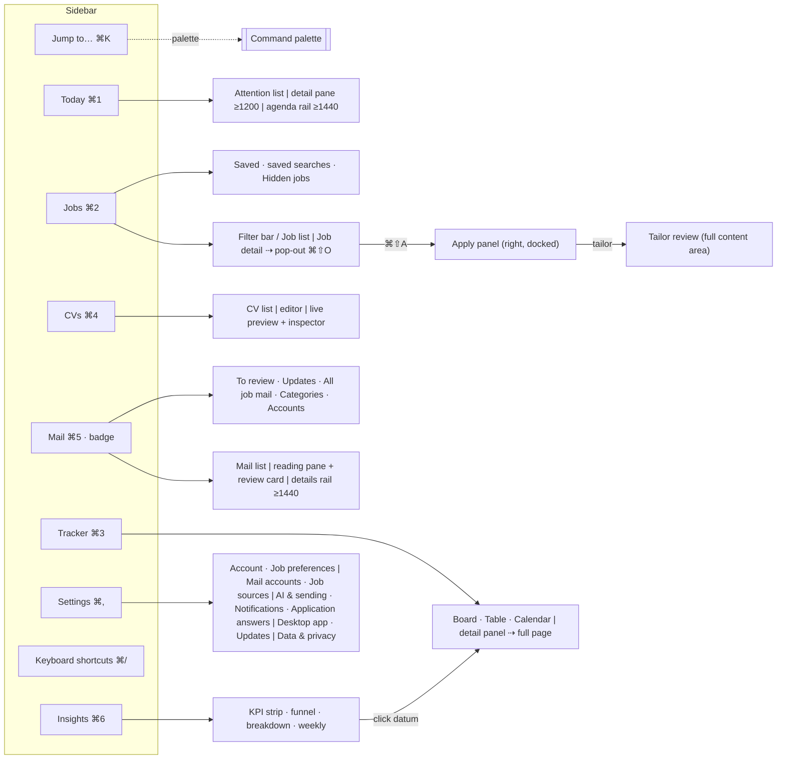

## Tokens

The single source is `packages/ui-tokens/src/color.ts`, `typography.ts` and `scales.ts`. They generate CSS variables and Tailwind for desktop, and an asset catalog plus `Tokens.swift` for iOS. Every text/background pair is contrast-tested in `src/contrast.ts`. Rules and usage are in [system.md](system.md).

### Palette (sRGB hex)

The accent is teal-green (OKLCH hue ≈ 188, U5). Surfaces are neutral, and red is reserved for errors and destructive actions, never outcomes.

| Role            | Token                                                                     | Light                             | Dark                              |
| --------------- | ------------------------------------------------------------------------- | --------------------------------- | --------------------------------- |
| Surface         | `surface.canvas`                                                          | `#F6F7F9`                         | `#0E1014`                         |
|                 | `surface.base`                                                            | `#FFFFFF`                         | `#16191F`                         |
|                 | `surface.sunken`                                                          | `#EFF1F4`                         | `#0A0C0F`                         |
|                 | `surface.elevated`                                                        | `#FFFFFF`                         | `#1E2229`                         |
|                 | `surface.hover`                                                           | `#EBEEF2`                         | `#232730`                         |
|                 | `surface.selected`                                                        | `#E1F3F1`                         | `#0D302D`                         |
| Text            | `fg.primary`                                                              | `#161A22`                         | `#ECEEF2`                         |
|                 | `fg.secondary`                                                            | `#4B5261`                         | `#A8AFBB`                         |
|                 | `fg.tertiary`                                                             | `#5E6573`                         | `#8F97A4`                         |
|                 | `fg.disabled`                                                             | `#A0A6B0`                         | `#5C6370`                         |
|                 | `fg.link`                                                                 | `#1F635D`                         | `#43BEB4`                         |
| Lines           | `line.subtle`                                                             | `#E1E4EA`                         | `#2A2F38`                         |
|                 | `line.control`                                                            | `#7D8492`                         | `#707887`                         |
|                 | `line.focus`                                                              | `#216863`                         | `#43BEB4`                         |
| Accent          | `accent.solid`                                                            | `#216863`                         | `#2B827B`                         |
|                 | `accent.hover`                                                            | `#1B5954`                         | `#277972`                         |
|                 | `accent.subtle`                                                           | `#D3EFEC`                         | `#0D302D`                         |
|                 | `accent.text`                                                             | `#1F635D`                         | `#43BEB4`                         |
| Feedback        | `success.text` / `.subtle`                                                | `#1B7B3C` / `#E0F7E4`             | `#67AA76` / `#152D1A`             |
|                 | `warning.text` / `.subtle`                                                | `#9C5D00` / `#FFEDD7`             | `#C18C4C` / `#34220B`             |
|                 | `danger.text` / `.subtle`                                                 | `#BD3838` / `#FFE7E4`             | `#E1756E` / `#3A1D1B`             |
|                 | `info.text` / `.subtle`                                                   | `#2870A5` / `#DDF3FF`             | `#689ECB` / `#12283B`             |
| Pipeline phases | `phase.shortlist.text`                                                    | `#596D7D`                         | `#899BA9`                         |
|                 | `phase.in_progress.text`                                                  | `#39756F`                         | `#53A59E`                         |
|                 | `phase.closed.text` (also Declined, Not selected, Withdrawn, No response) | `#686C70`                         | `#95999C`                         |
|                 | `status.offer.text`                                                       | `#007973`                         | `#00AAA0`                         |
|                 | `status.accepted.text`                                                    | `#35794B`                         | `#6FA87E`                         |
| Toast           | `toast.bg` / `toast.text` / `toast.action`                                | `#1F232B` / `#F2F4F7` / `#79CDC5` | `#2E333D` / `#F2F4F7` / `#79CDC5` |

The full list (every status's text, subtle and solid values, chart, skeleton and scrim) and the increased-contrast overrides are in [system.md › Color](system.md#color).

### Type scale

The styles are named after the iOS Dynamic Type styles. On iOS each one is the system font at its text style, so it scales all the way to AX5. Desktop uses fixed px sizes, emitted as rem. Fonts are system stacks: SF Pro on Apple platforms and Segoe UI Variable on Windows. Text is sentence case and never all-caps (because of Turkish İ/I), and numbers are tabular. See [system.md › Typography](system.md#typography).

| Style                 | iOS pt (size / line, weight)  | Desktop px (size / line, weight) |
| --------------------- | ----------------------------- | -------------------------------- |
| largeTitle            | 34 / 41, 400 (700 emphasized) | 26 / 32, 600                     |
| title1                | 28 / 34, 400                  | 22 / 28, 600                     |
| title2                | 22 / 28, 400                  | 18 / 24, 600                     |
| title3                | 20 / 25, 400                  | 16 / 22, 600                     |
| headline              | 17 / 22, 600                  | 14 / 20, 600                     |
| body                  | 17 / 22, 400                  | 14 / 20, 400                     |
| callout / subheadline | 16 / 21 · 15 / 20, 400        | 13 / 18, 400                     |
| footnote              | 13 / 18, 400                  | 12 / 16, 400                     |
| caption1 / caption2   | 12 / 16 · 11 / 13, 400        | 12 / 16, 400 · 11 / 14, 500      |

**Spacing, shape and layout**

- Spacing uses a 4 pt grid. Radius steps: `md` 8 (controls), `lg` 12 (cards, toasts), `xl` 16 (sheets, dialogs).
- Focus ring: 2 px `line.focus` with a 2 px offset.
- Hit targets: 44 pt on iOS, 32 px on desktop.
- Desktop breakpoints: 640 / 980 / 1100 / 1200 / 1440 (D04).

## How to read the screens

- **Critique rounds.** Each round is saved in `critiques/<platform>/<screen>/r<N>.md`. The macOS and Windows apps share one desktop folder; the rounds cover both browser engines and, in the final rounds, the real app.
- **Exit criteria** (BRIEF §5.5): the latest round has zero Critical and zero unresolved Moderate findings. All ten screen × platform pairs meet them.
- **iOS captures:** iPhone 17e and iPhone 17 Pro Max, light and dark, the largest accessibility text size (AX5) on the 17e, and the empty state.
- **Desktop captures:** 1280 × 800 CSS px with the locale pinned to en-GB and the time zone to Europe/Istanbul. macOS shows the browser harness in WebKit (≈ WKWebView); a real-app shot is included [under Today](#1-today). Windows shows the real app (WebView2) from CI where available, with caveats listed under [Known limitations](#known-limitations).

---

## 1. Today

**Purpose:** a single attention list that answers "what needs me now?": Next up, To review, Follow-ups, Deadlines and New matches. Each item links to its home object. Nothing here is gamified. Research: [today-home.md](research/today-home.md).

**Key decisions**

1. The sections always come in the same order, and empty sections are hidden. Next up covers interviews in the next 48 hours (D09). There's no greeting (U8).
2. Today has no badge. The review count appears as plain text ("To review · 3"); the only badge in the app is on Mail (D01).
3. Changes made automatically from mail appear in their own group, "Updated automatically · you can undo these". Each row shows its source and offers Undo, which stays available for as long as that change is the latest status move (D11).
4. The verbs are fixed: "Not for me" for matches, "Not needed" for suggestions, "Not job mail" for mail. The word "Dismiss" never appears. Snooze presets: Later today · Tomorrow · Next week · Pick a date… (D19, D27).
5. On desktop, Today is a list | detail layout. The detail pane appears at ≥ 1200 px and the 7-day agenda rail at ≥ 1440 px.

**Mobbin references**

- Swarm, Notifications with a pinned request: https://mobbin.com/screens/efa44766-3426-4bdc-a84a-c70403a705ba. It separates "needs you" from FYI items.
- Rox, "Here's your focus for today": https://mobbin.com/screens/8546b8f5-d6cb-4268-af86-872d540751f2. It shows empty states per card and a done-with-Undo toast.
- Charma, Action Items + Today's Schedule: https://mobbin.com/screens/4eacbfa1-0d16-437a-bffc-ddfbf04bc2b4. It's the desktop pattern for an attention list with an agenda rail.

**Critique rounds**

- **iOS**, 4 rounds:
  - [r1](critiques/ios/today/r1.md): five Moderates fixed:
    - review vs automatic rows are captioned;
    - automatic rows lead with the change and its reason;
    - plain sender text;
    - the ReviewSheet opens large;
    - Next up wraps.
  - [r2](critiques/ios/today/r2.md): one Critical fixed (the monogram squeezed text to one word per line at AX5), plus four Moderates fixed:
    - date subtitle;
    - labelled match actions at AX5;
    - loading avatar;
    - error pane.
  - [r3](critiques/ios/today/r3.md): two Moderates fixed (the Undo column at AX5 and a clipped Prep label).
  - [r4](critiques/ios/today/r4.md): 0 Critical / 0 Moderate across the full 40-capture matrix.
- **Desktop**, 4 rounds:
  - [r1](critiques/desktop/today/r1.md): six Moderates fixed:
    - review rows show the received time, not proposed pills;
    - the "Updated automatically" subgroup;
    - "Offer reply due";
    - relative + absolute due dates;
    - focus after snooze;
    - no Open/Later filter on first run.
  - [r2](critiques/desktop/today/r2.md): three Moderates fixed:
    - toast overlap;
    - heading structure;
    - TR/DE strings.
  - [r3](critiques/desktop/today/r3.md): one Moderate fixed (a layout jump from loading to ready).
  - [r4](critiques/desktop/today/r4.md): one Moderate fixed (the snooze date now uses the app's clock and time zone).

**Accessibility:** pass on both platforms.

- [iOS](critiques/ios/today/accessibility.md): XCUITest audits at the default size and AX5, 6 tests with 0 failures. All token pairs are ≥ 4.5:1.
- [Desktop](critiques/desktop/today/accessibility.md): axe found 0 issues of any severity in all 20 runs (5 states × 2 themes × WebKit + Chromium), and the keyboard pass worked at 640–1920 px and 200 % zoom.

**iOS** — iPhone 17e and iPhone 17 Pro Max, iOS 26 simulator.

| 17e · light                                                                                                    | 17e · dark                                                                                                   | 17 Pro Max · light                                                                                                       | 17 Pro Max · dark                                                                                                      |
| -------------------------------------------------------------------------------------------------------------- | ------------------------------------------------------------------------------------------------------------ | ------------------------------------------------------------------------------------------------------------------------ | ---------------------------------------------------------------------------------------------------------------------- |
| 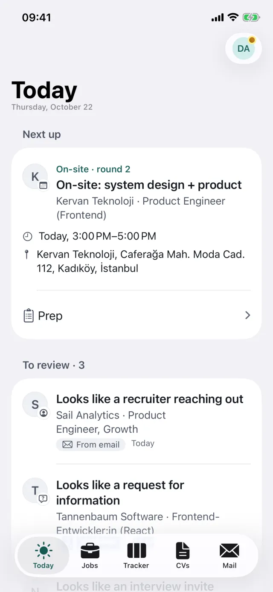 | 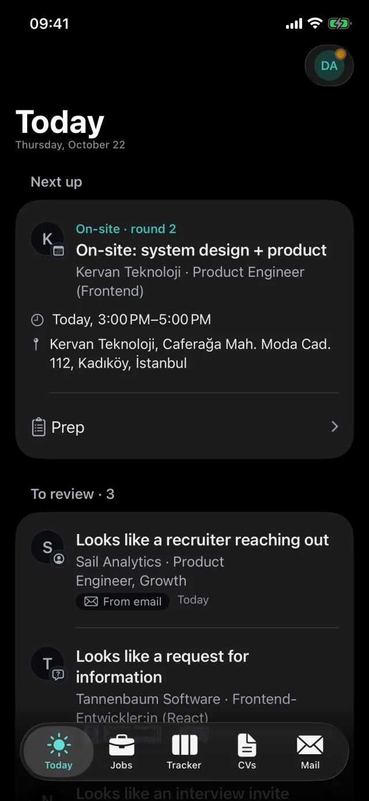 | 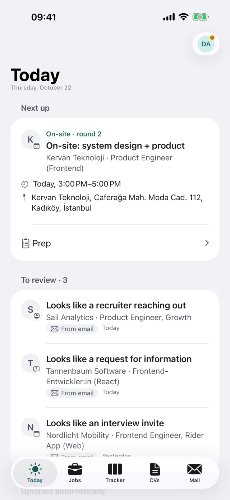 | 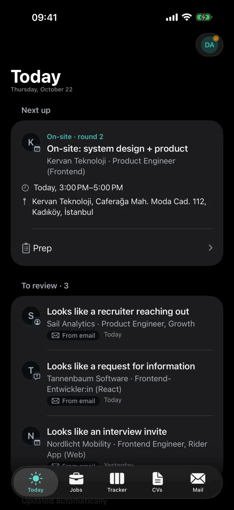 |
| **17e · largest accessibility text (AX5)**                                                                     | **17e · empty**                                                                                              |                                                                                                                          |                                                                                                                        |
| 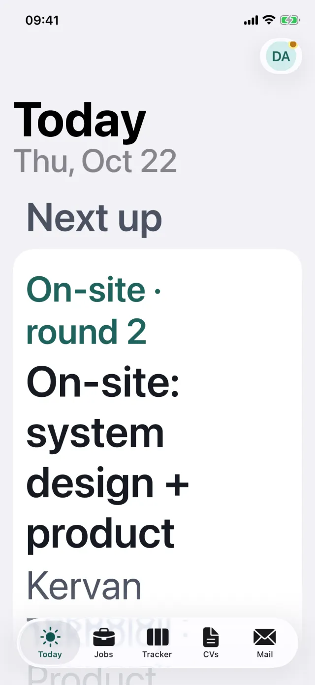               | 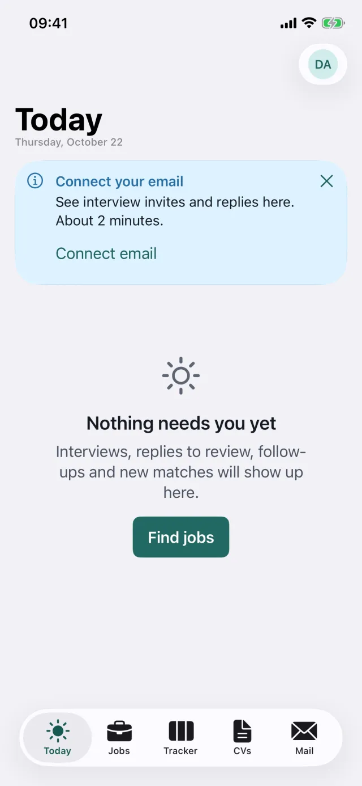       |                                                                                                                          |                                                                                                                        |

**macOS** — 1280 × 800; browser harness, WebKit ≈ WKWebView, en-GB · Europe/Istanbul.

| Populated · light                                                                                           | Populated · dark                                                                                          |
| ----------------------------------------------------------------------------------------------------------- | --------------------------------------------------------------------------------------------------------- |
| 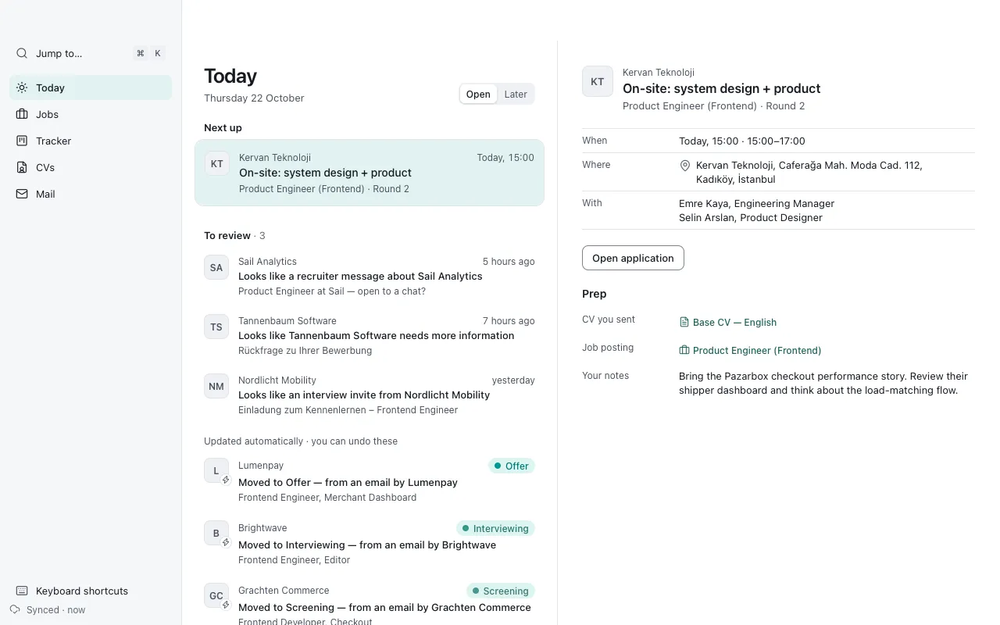 | 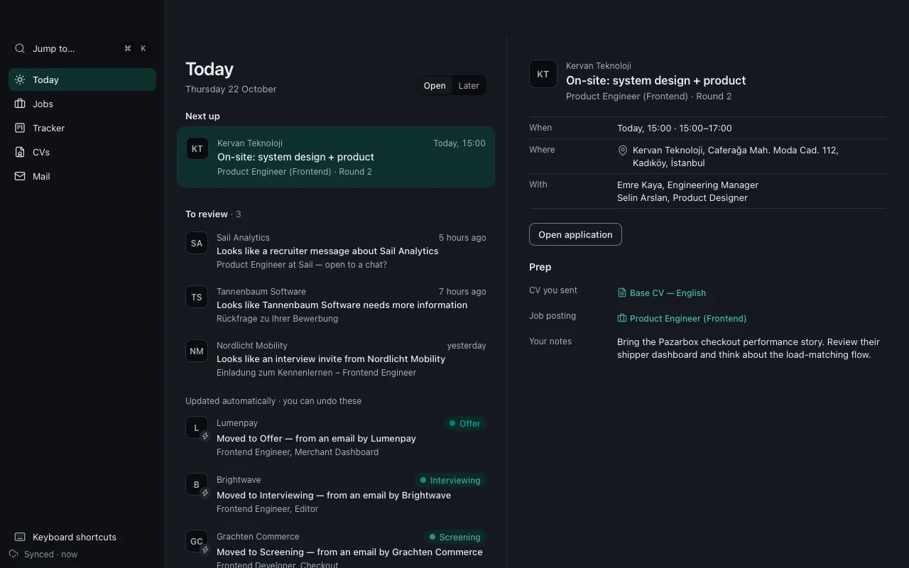 |
| **Empty · light**                                                                                           | **Offline · light**                                                                                       |
| 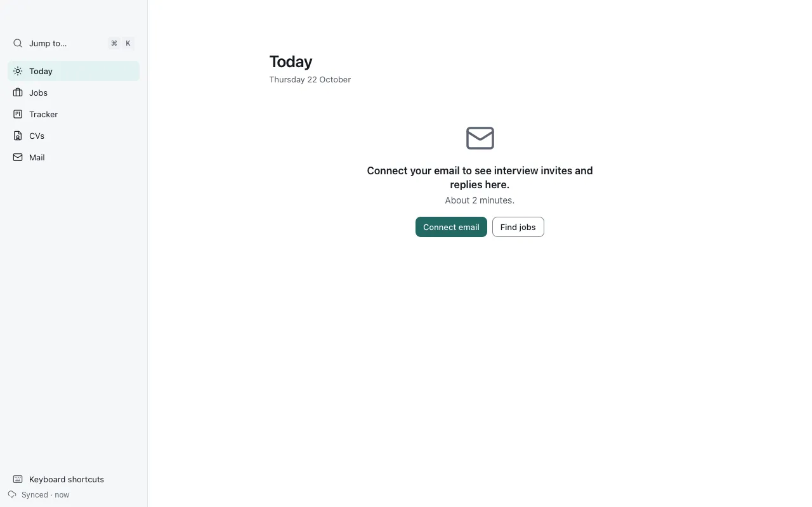         | 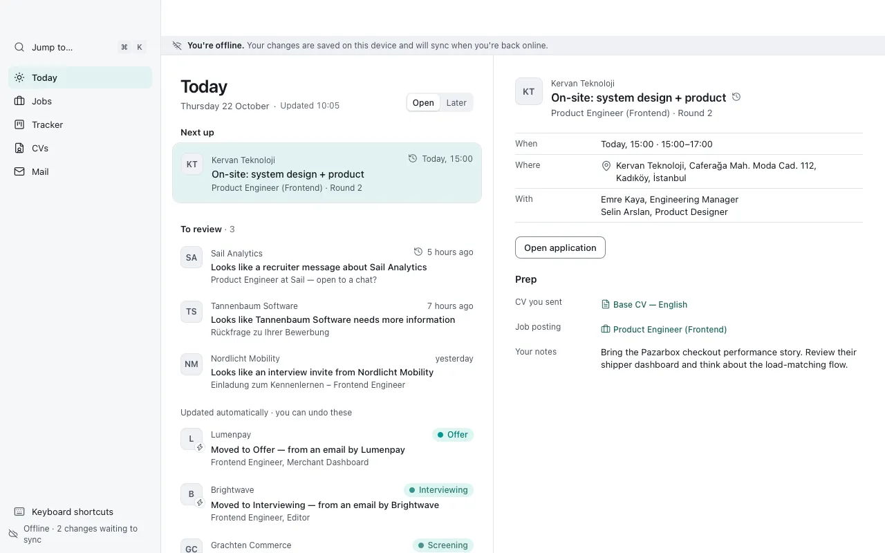   |

**Windows** — 1280 × 800; populated + empty: real app (WebView2) from CI run 39809196140; offline: browser harness, Chromium ≈ WebView2.

| Populated · light                                                                                               | Populated · dark                                                                                              |
| --------------------------------------------------------------------------------------------------------------- | ------------------------------------------------------------------------------------------------------------- |
| 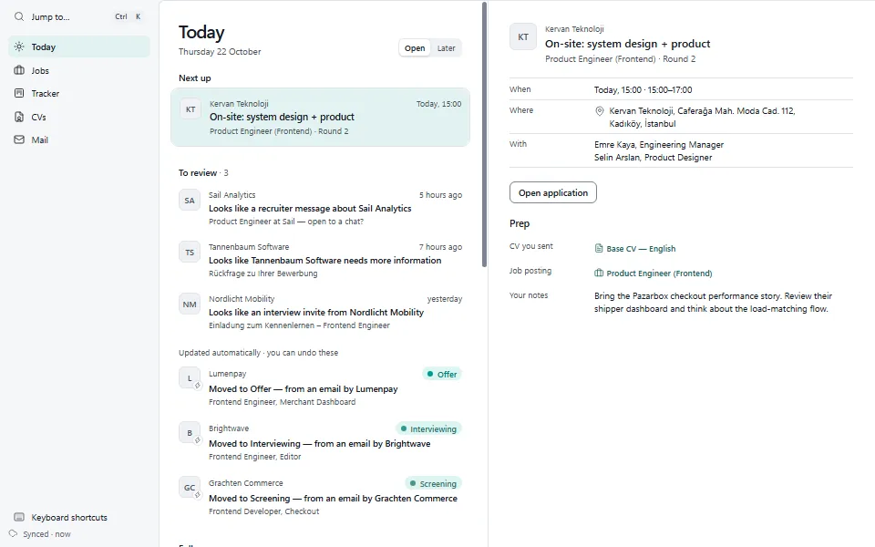 | 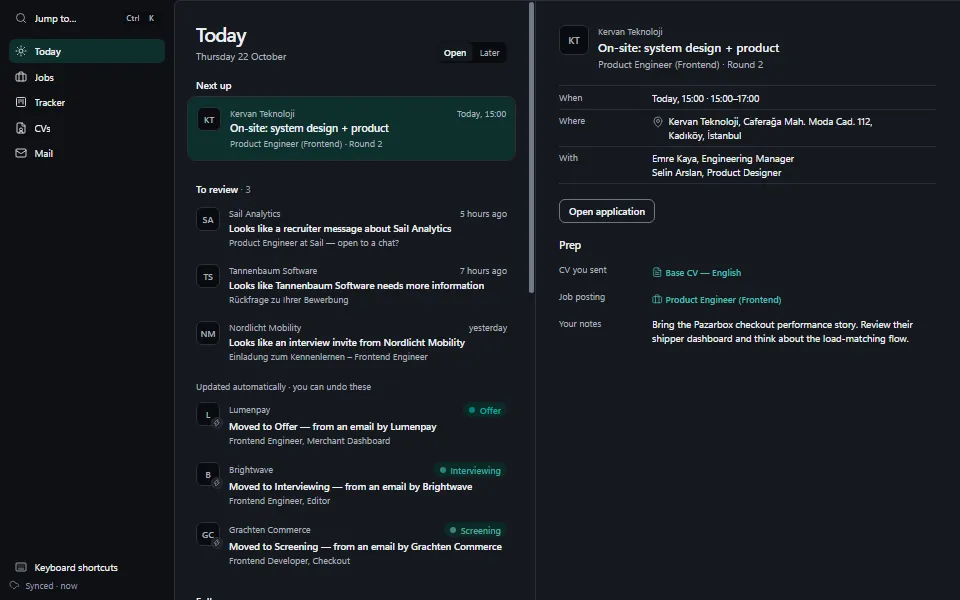 |
| **Empty · light**                                                                                               | **Offline · light**                                                                                           |
| 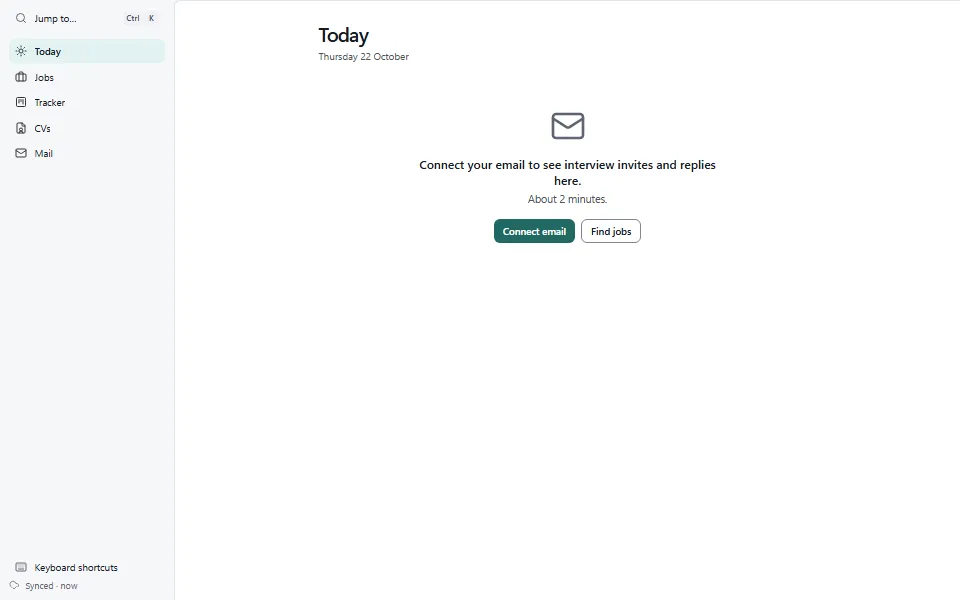         | 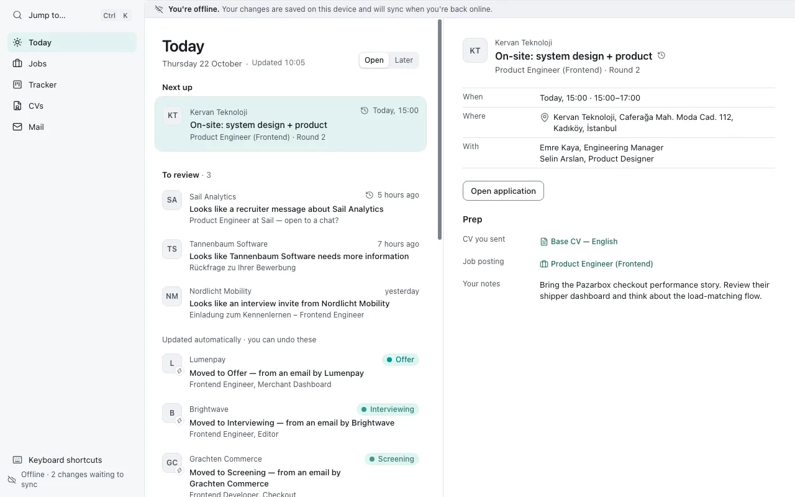   |

**Real macOS app (WKWebView window).** These shots are earlier real-app captures, taken before the snooze-clock fix and before captures were pinned to en-GB (the date reads "Thursday, October 22"). They show that the real window renders the same as the harness.

| Today · light (real app)                                                                                                 | Job detail · dark (real app)                                                                                                     |
| ------------------------------------------------------------------------------------------------------------------------ | -------------------------------------------------------------------------------------------------------------------------------- |
| 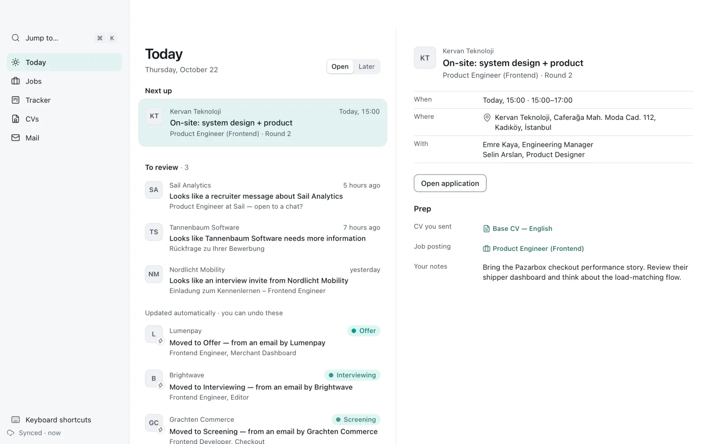 | 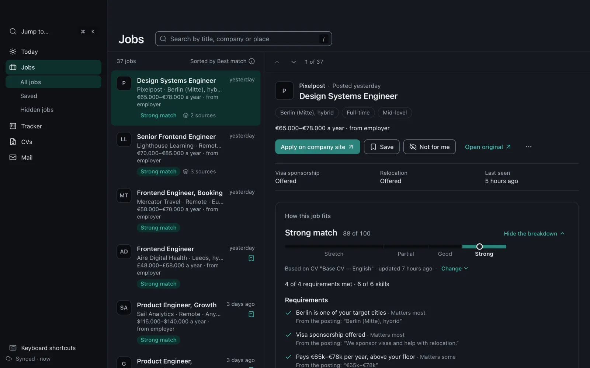 |

---

## 2. Job detail + match explanation

**Purpose:** one job with an honest fit estimate. The band comes first, then the score ("72 of 100"), then reasons, gaps and evidence. The screen also lists every source after deduplication and holds the Apply action. Research: [job-detail.md](research/job-detail.md).

**Key decisions**

1. The band comes first and the number second. The bands are Strong, Good, Partial and Stretch. Scores are never shown as "%", never have decimals and never use a gauge. The band bar is labelled, so colour isn't the only cue. List rows show only the band.
2. Explanations count requirements and quote evidence: "4 of 5 requirements met". "Not stated" is kept separate from a real gap. The AI summary is labelled "AI summary · can be wrong" (D13).
3. Gaps can be corrected. "I have this" adds the skill to your profile and triggers a re-score; "Add to CV…" opens the CV. A job outside your preferences is shown with a notice and is never hidden.
4. The Apply route prefers the direct ATS, then the company site, then an apply email, then an aggregator (D23). "Save" creates a Saved application (D02), and "Not for me" replaces Dismiss.
5. On iOS the detail is a pushed page with a sticky Save + Apply bar and a "See full breakdown" sheet. On desktop it's the right pane, with a 280 px rail at ≥ 760 px and keys A / S / D / O.

**Mobbin references**

- Glassdoor, Job detail panel (desktop): https://mobbin.com/screens/4efa3859-c0dc-4b63-be2d-d329909a99c2. Its layout and the ✓/✕ qualifications checklist were adopted almost directly.
- Chime, Your credit score: https://mobbin.com/screens/99aa4c7c-4b04-4d73-9804-152654f478a1. It pairs a number with its range, a freshness line and a segmented band bar.
- Credit Karma, Credit factors: https://mobbin.com/screens/f219b700-6dda-470f-acba-1f5be7c431c9. Its factor cards, with qualitative impact and evidence, are the model for "why it matches".

**Critique rounds**

- **iOS**, 3 rounds:
  - [r1](critiques/ios/job-detail/r1.md): three Moderates fixed:
    - gap buttons wrapping;
    - raw skill keys;
    - badge spacing.
  - [r2](critiques/ios/job-detail/r2.md): one Critical fixed (at AX5 the Apply bar covered 45 % of the screen; it's now capped at AX1 and uses the Large Content Viewer), plus five Moderates fixed:
    - band legend;
    - monogram;
    - glyph column;
    - sheet detent;
    - "Open original" moved into the toolbar.
  - [r3](critiques/ios/job-detail/r3.md): 0 / 0.
- **Desktop**, 3 rounds:
  - [r1](critiques/desktop/job-detail/r1.md): one Critical fixed (the match was below the fold at 1280; it's now a 3-column facts strip), plus seven Moderates fixed.
  - [r2](critiques/desktop/job-detail/r2.md): one Critical fixed (job links didn't open), plus four Moderates fixed:
    - "I have this" styling;
    - prev/next on unlisted jobs;
    - the toast "Why?";
    - the TR offline header.
  - [r3](critiques/desktop/job-detail/r3.md): 0 / 0.

**Accessibility:** pass on both platforms.

- [iOS](critiques/ios/job-detail/accessibility.md): 5 audit tests with 0 failures; AX5 was audited over 16 scrolled pages plus the sheets.
- [Desktop](critiques/desktop/job-detail/accessibility.md): axe 0/0/0/0 in all 20 runs. The lowest contrast ratio is 4.58:1.

**iOS** — iPhone 17e and iPhone 17 Pro Max, iOS 26 simulator.

| 17e · light                                                                                                              | 17e · dark                                                                                                             | 17 Pro Max · light                                                                                                                 | 17 Pro Max · dark                                                                                                                |
| ------------------------------------------------------------------------------------------------------------------------ | ---------------------------------------------------------------------------------------------------------------------- | ---------------------------------------------------------------------------------------------------------------------------------- | -------------------------------------------------------------------------------------------------------------------------------- |
| 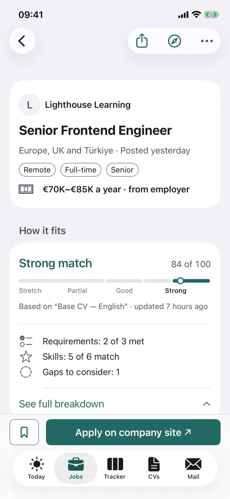 | 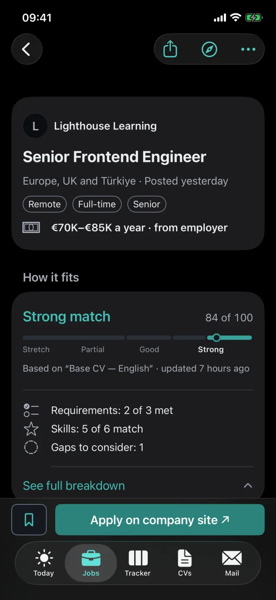 | 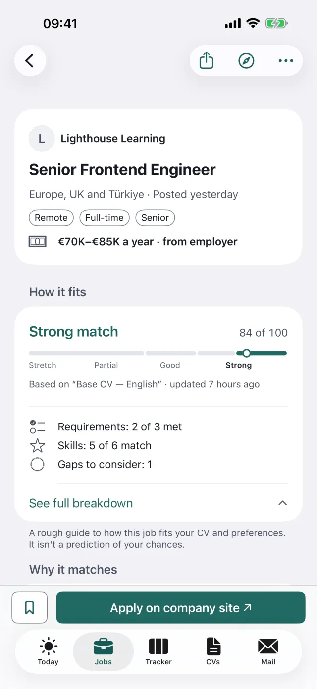 | 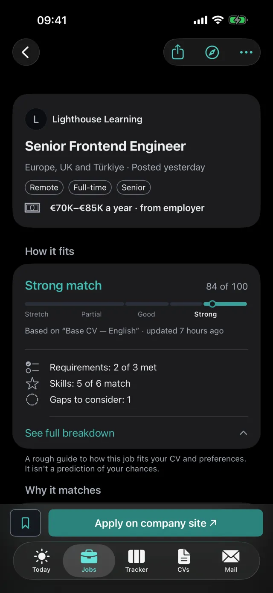 |
| **17e · largest accessibility text (AX5)**                                                                               | **17e · empty**                                                                                                        |                                                                                                                                    |                                                                                                                                  |
| 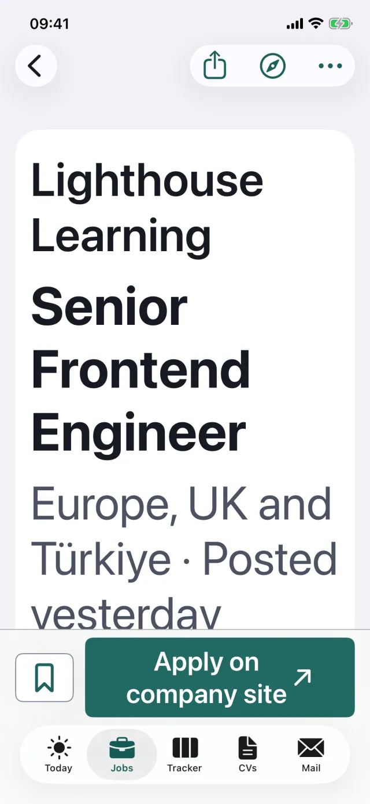               | 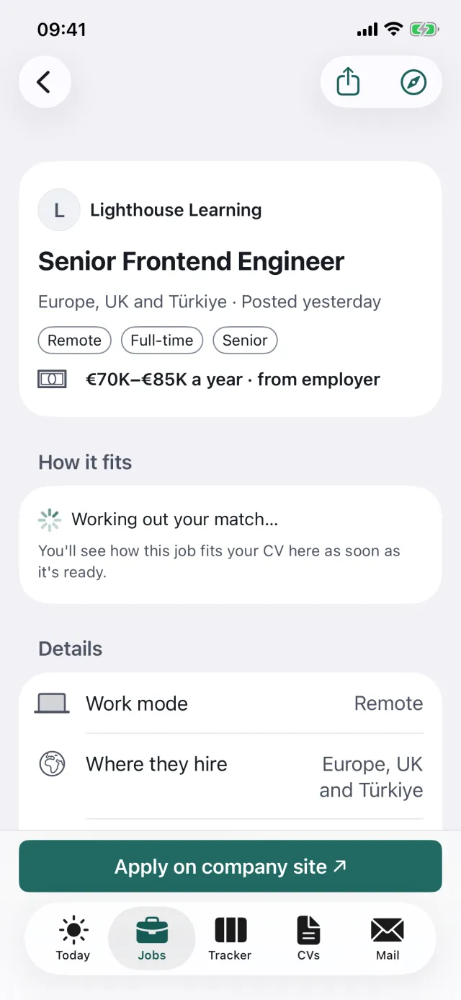       |                                                                                                                                    |                                                                                                                                  |

**macOS** — 1280 × 800; browser harness, WebKit ≈ WKWebView, en-GB · Europe/Istanbul.

| Populated · light                                                                                                     | Populated · dark                                                                                                    |
| --------------------------------------------------------------------------------------------------------------------- | ------------------------------------------------------------------------------------------------------------------- |
| 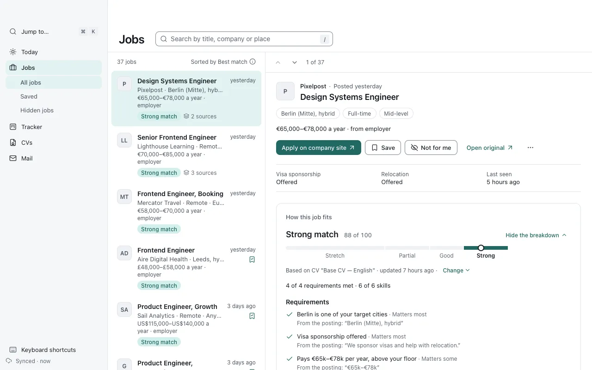 | 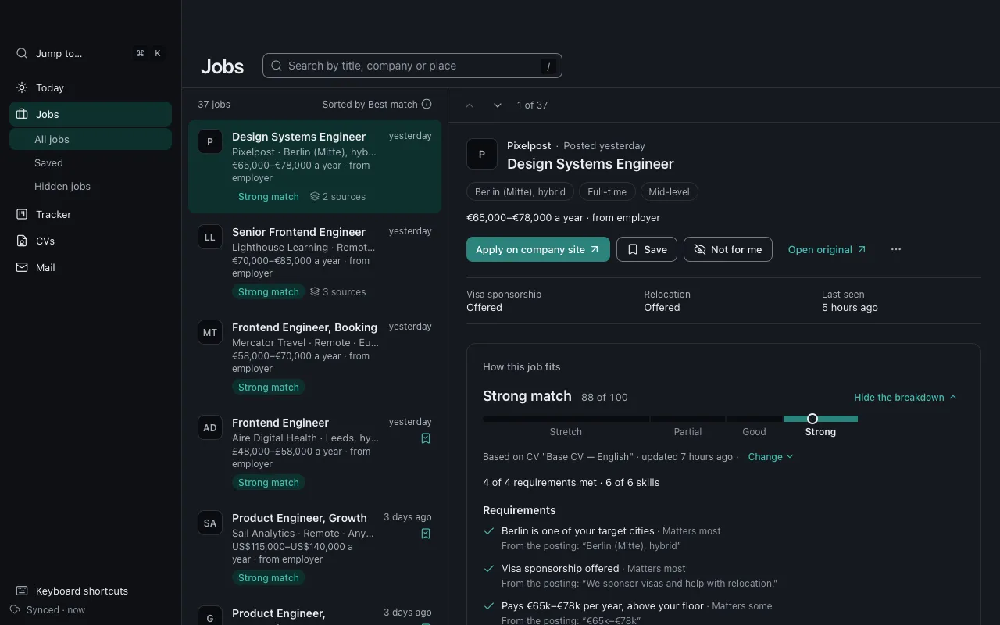 |
| **Empty · light**                                                                                                     | **Offline · light**                                                                                                 |
| 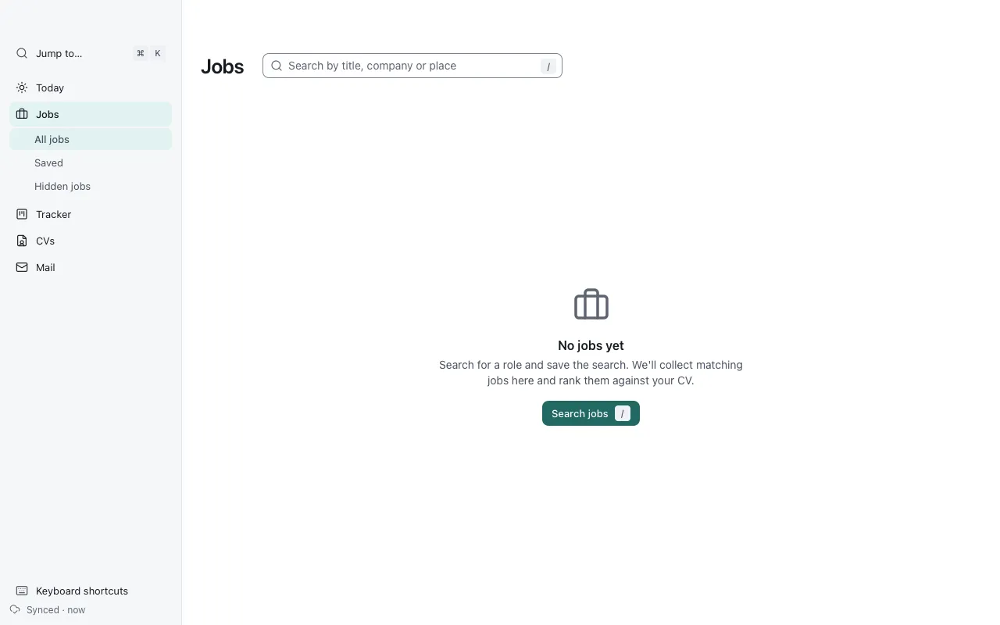         | 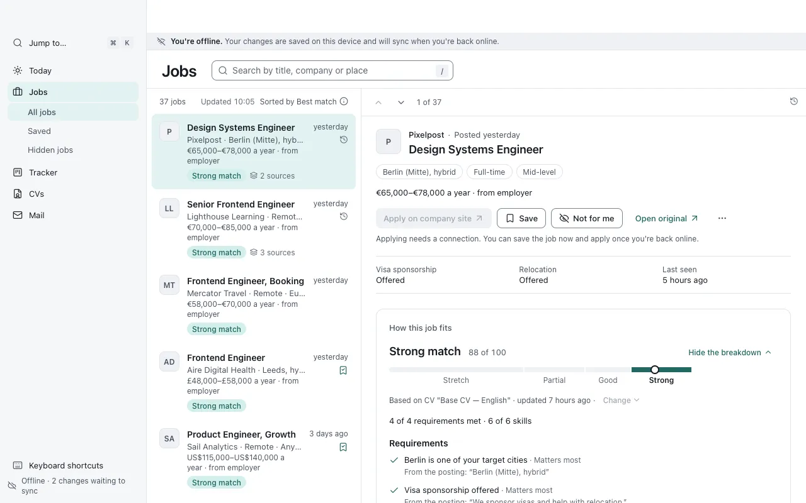   |

**Windows** — 1280 × 800; populated + empty: real app (WebView2) from CI run 39809196140; offline: browser harness, Chromium ≈ WebView2.

| Populated · light                                                                                                         | Populated · dark                                                                                                        |
| ------------------------------------------------------------------------------------------------------------------------- | ----------------------------------------------------------------------------------------------------------------------- |
| 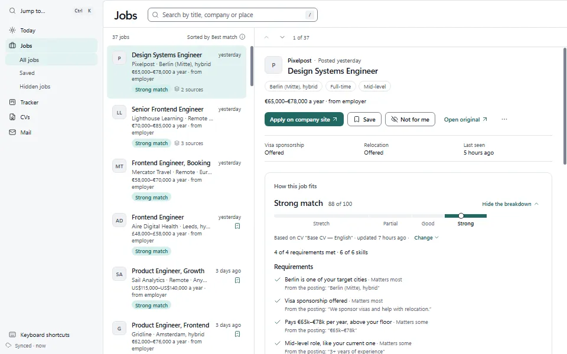 | 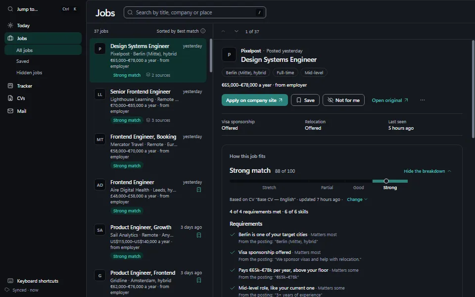 |
| **Empty · light**                                                                                                         | **Offline · light**                                                                                                     |
| 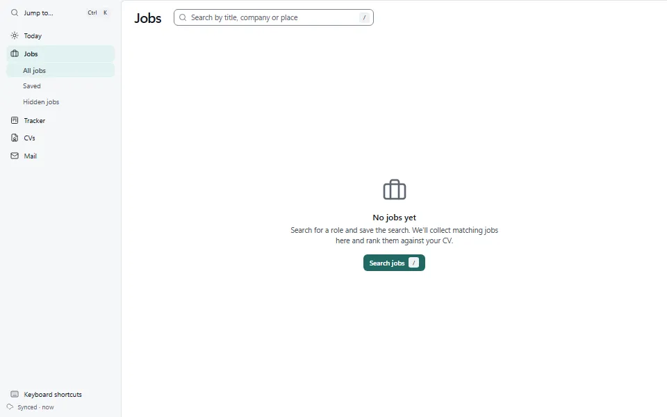         | 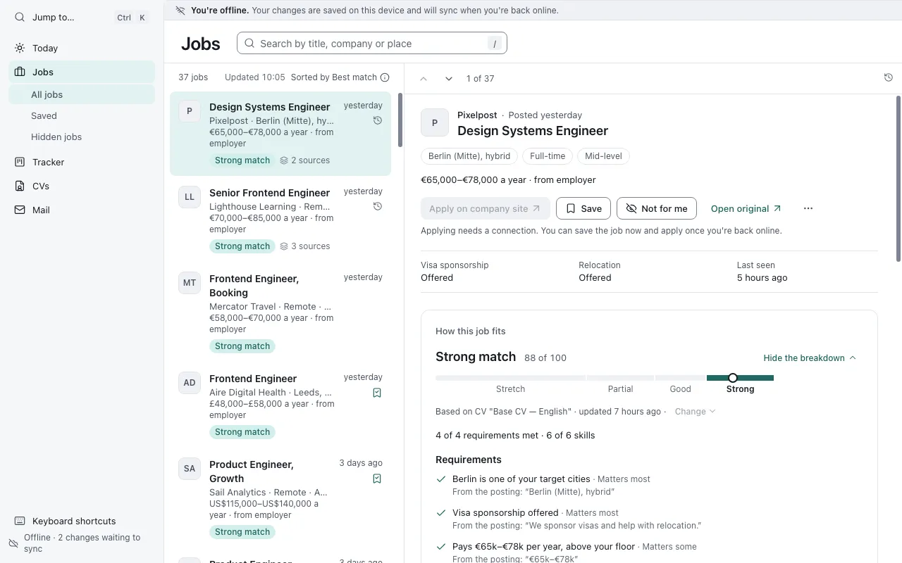   |

---

## 3. CV editor

**Purpose:** structured CV editing (JSON Resume) with a live preview. Revisions are immutable, CVs can have variants, and AI suggestions are decided one at a time. Research: [cv-editor.md](research/cv-editor.md).

**Key decisions**

1. AI content is never accepted in bulk. Each suggestion offers **Use suggestion · Keep original · Edit**, with the disclaimer "Suggested by Claude. Check names, numbers and dates before you use it." (D13).
2. Revisions are append-only, and one editing burst makes one revision. An AI accept, an import, a restore or a template change each make their own revision, and restoring writes a new revision (D14).
3. On iOS, the CV list leads to a CV screen with an **Edit | Preview** toggle and edit sheets. On desktop there are three panes (CV list | editor | live preview) plus an inspector with Design · Check · Suggestions · History tabs. Below 1100 px the preview becomes a toggle.
4. Imported fields with low confidence are marked in amber, never red. Photo and date of birth are opt-in per variant (U6).
5. The preview works offline. PDF export needs a connection and arrives in M2.

**Mobbin references**

- Mercury, Invoice details with live preview (desktop): https://mobbin.com/screens/32882676-91fa-4afb-88e6-7306bfff6dbf. The form sits next to the page.
- Langdock, Canvas with inline suggestion: https://mobbin.com/screens/879416cc-ee0b-42c9-999b-3f829c041b12. Each inline AI change gets its own ✓ / ✕.
- Linear, Version history: https://mobbin.com/screens/6c14e085-9ff5-4e61-9a21-b04f1b0a3433. It shows a diff with restore, and you can navigate it with the keyboard.

**Critique rounds**

- **iOS**, 3 rounds:
  - [r1](critiques/ios/cv-editor/r1.md): one Critical fixed (the ✦ Improve bar covered 70 % of the sheet at AX5), plus two Moderates fixed (single-date items, discard dialog placement).
  - [r2](critiques/ios/cv-editor/r2.md): four Moderates fixed:
    - skeleton;
    - the all-archived state;
    - Try again on the error;
    - header contrast.
  - [r3](critiques/ios/cv-editor/r3.md): 0 / 0.
- **Desktop**, 3 rounds:
  - [r1](critiques/desktop/cv-editor/r1.md): one Critical fixed (suggestions weren't discoverable at 1280; there's now a toolbar "n suggestions" button), plus three Moderates fixed:
    - items collapsed by default;
    - a grouped diff;
    - the queue card header.
  - [r2](critiques/desktop/cv-editor/r2.md): 0 / 0.
  - [r3](critiques/desktop/cv-editor/r3.md): on the real Windows app, two WebView2-only scrollbar Moderates were fixed (the jump bar / inspector tabs, and preview scrollbars with the wrong fit).

**Accessibility:** pass on both platforms.

- [iOS](critiques/ios/cv-editor/accessibility.md): 13 of 13 audits pass on both devices.
- [Desktop](critiques/desktop/cv-editor/accessibility.md): axe found 0 critical and 0 serious issues in all 20 runs. Click-to-locate in the preview has no keyboard equivalent yet; this is logged.

**iOS** — iPhone 17e and iPhone 17 Pro Max, iOS 26 simulator.

| 17e · light                                                                                                            | 17e · dark                                                                                                           | 17 Pro Max · light                                                                                                               | 17 Pro Max · dark                                                                                                              |
| ---------------------------------------------------------------------------------------------------------------------- | -------------------------------------------------------------------------------------------------------------------- | -------------------------------------------------------------------------------------------------------------------------------- | ------------------------------------------------------------------------------------------------------------------------------ |
| 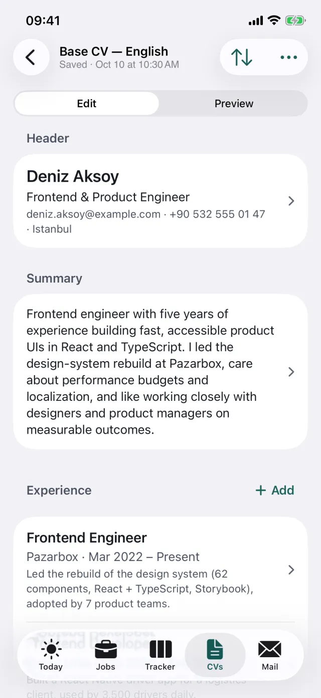 | 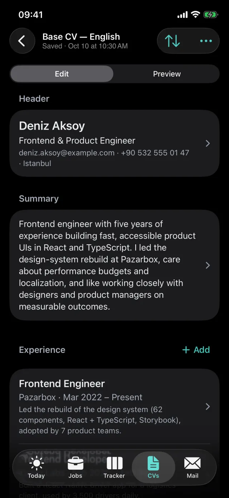 | 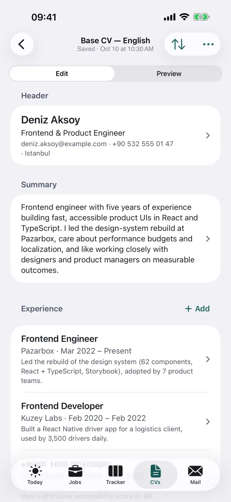 | 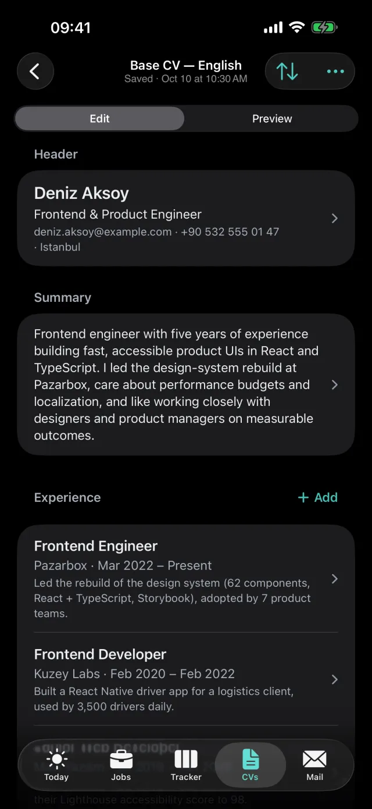 |
| **17e · largest accessibility text (AX5)**                                                                             | **17e · empty**                                                                                                      |                                                                                                                                  |                                                                                                                                |
| 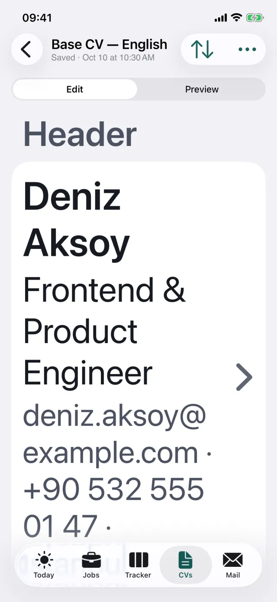               | 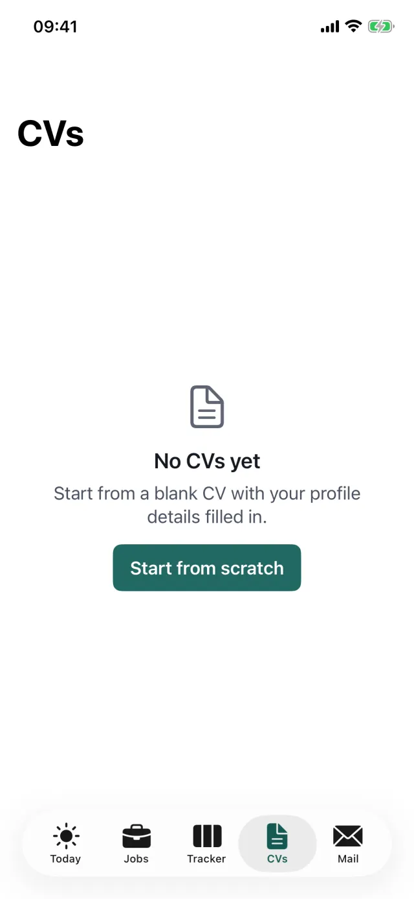       |                                                                                                                                  |                                                                                                                                |

**macOS** — 1280 × 800; browser harness, WebKit ≈ WKWebView, en-GB · Europe/Istanbul.

| Populated · light                                                                                                   | Populated · dark                                                                                                  |
| ------------------------------------------------------------------------------------------------------------------- | ----------------------------------------------------------------------------------------------------------------- |
| 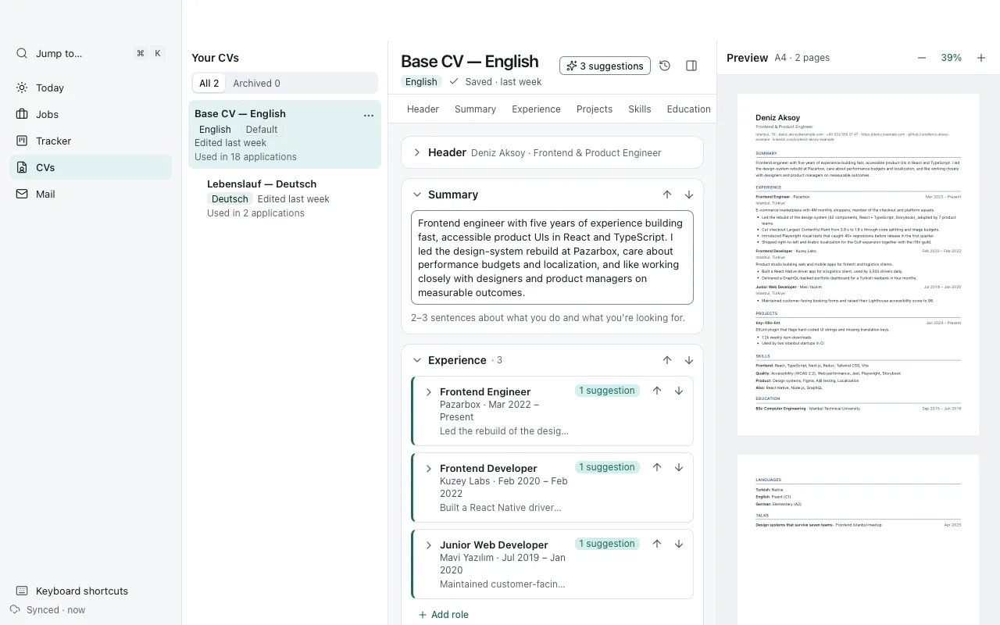 | 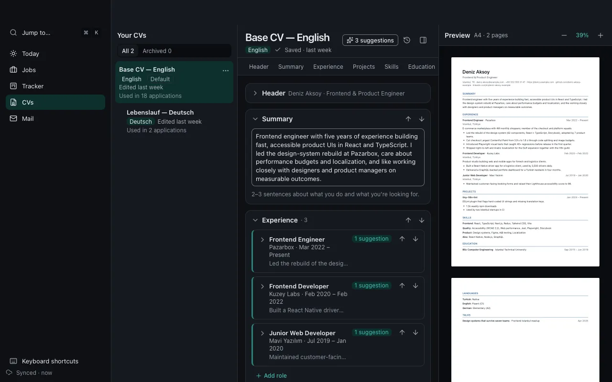 |
| **Empty · light**                                                                                                   | **Offline · light**                                                                                               |
| 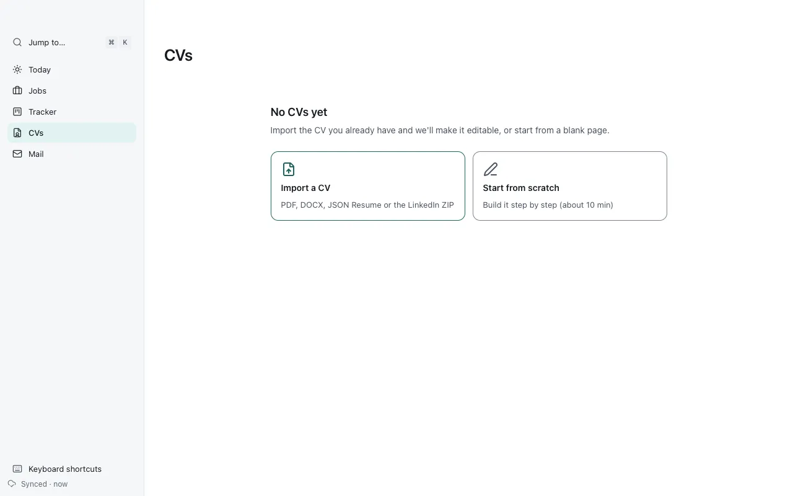         | 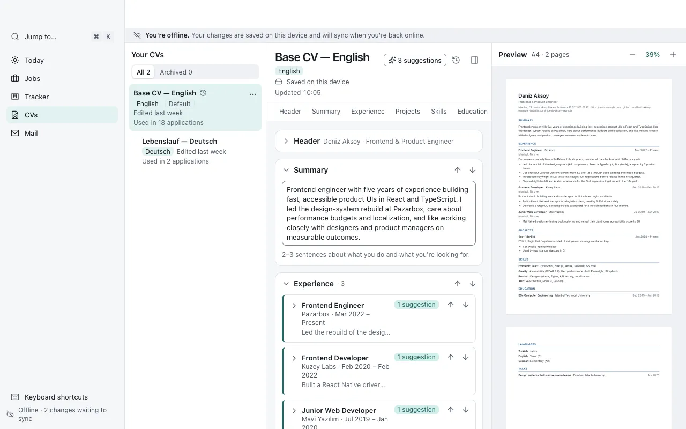   |

**Windows** — 1280 × 800; populated + empty: real app (WebView2) from CI run 39809196140; offline: browser harness, Chromium ≈ WebView2.

| Populated · light                                                                                                       | Populated · dark                                                                                                      |
| ----------------------------------------------------------------------------------------------------------------------- | --------------------------------------------------------------------------------------------------------------------- |
| 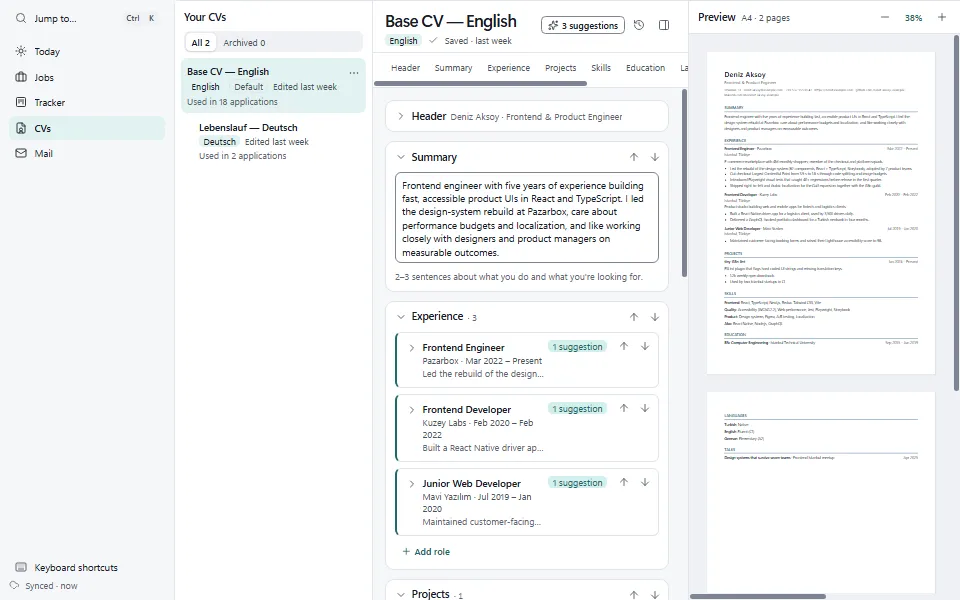 | 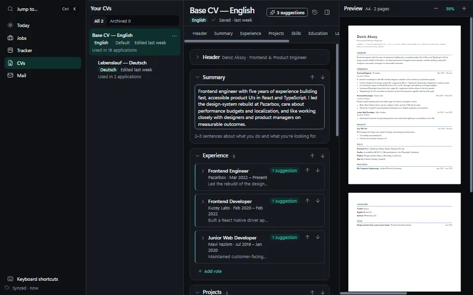 |
| **Empty · light**                                                                                                       | **Offline · light**                                                                                                   |
| 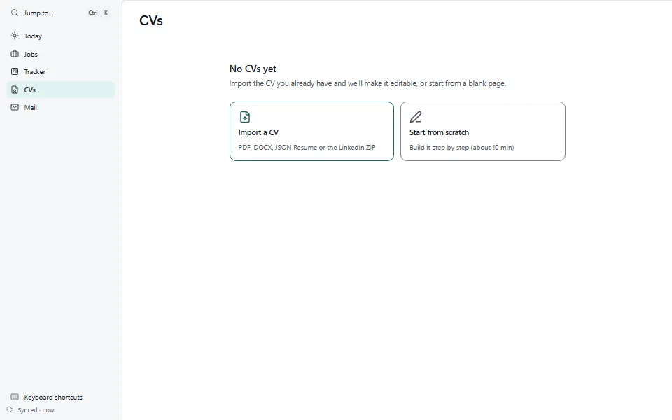         | 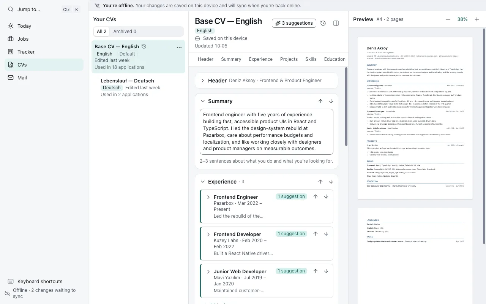   |

---

## 4. Tracker board

**Purpose:** the application pipeline: 12 statuses in 3 phases. iOS shows it as a grouped list. Desktop shows a board (Table and Calendar come later in M3) with a record panel and a timeline where every move can be undone. Research: [tracker.md](research/tracker.md).

**Key decisions**

1. On iPhone the pipeline is a grouped list, not a column pager. It has sticky, collapsible stage sections, Active / Closed / All scopes and a stage strip. In M0 there's no drag on iPhone; you move items with Move to… and swipe (D32). Desktop keeps column drag.
2. Outcomes use calm words. `rejected` is shown as **Not selected**, in the neutral Closed tone and never red (U2). `ghosted` is shown as **No response** (D15).
3. Undo replaces confirmation dialogs. Undo stays available as long as the move is the latest one. The toast lasts 6 s, or 10 s with a screen reader (D11, D12).
4. Moves that aren't allowed show the target greyed out with one reason, for example "Accepted and Declined come after an offer." (D16).
5. On desktop, columns are 272 px. Empty columns collapse to 40 px rails, and the Closed rail opens into drop zones while you drag. Keyboard: ←/→ move between columns and `M` opens Move to… (D27).

**Mobbin references**

- Linear Mobile, Issues grouped by status (iOS): https://mobbin.com/screens/26badb99-f19d-4bd2-bd56-a3ce1e28f63b. It's the grouped-sections pipeline on iPhone.
- Basecamp, Moving a card (desktop flow): https://mobbin.com/flows/78f53db5-3a21-4b6a-b2f6-f465508cba5f. Its slim outcome rails accept drops.
- Attio, Record detail with timeline: https://mobbin.com/screens/297adfeb-8312-496b-8acf-41839a6cf775. It has prev/next within a stage and a date-grouped activity timeline.

**Critique rounds**

- **iOS**, 4 rounds:
  - [r1](critiques/ios/tracker-board/r1.md): one Critical fixed (tapping a row didn't open the detail), plus five Moderates fixed:
    - sticky headers;
    - the Move to… sheet title;
    - AX5 monogram;
    - "Close…";
    - phase grouping.
  - [r2](critiques/ios/tracker-board/r2.md): three Moderates fixed. Drag was still unreliable.
  - [r3](critiques/ios/tracker-board/r3.md): the drag question was raised.
  - [r4](critiques/ios/tracker-board/r4.md): drag was resolved by D32 (no iPhone drag in M0), and the contact clipping was fixed. Result: 0 / 0.
- **Desktop**, 5 rounds:
  - [r1](critiques/desktop/tracker-board/r1.md): one Critical fixed (the window scrolled during a drag), plus six Moderates fixed.
  - [r2](critiques/desktop/tracker-board/r2.md): one Moderate fixed (the refused-zone reason was hidden under the dragged card).
  - [r3](critiques/desktop/tracker-board/r3.md): one Critical fixed (the panel crashed on records with a nudge; there's now a render test over 25 records × EN/TR/DE), plus one Moderate fixed.
  - [r4](critiques/desktop/tracker-board/r4.md): 0 / 0.
  - [r5](critiques/desktop/tracker-board/r5.md): on the real apps, two Moderates fixed (a column edge fade on macOS at 1920; fluid empty columns on Windows).

**Accessibility**

- [iOS](critiques/ios/tracker-board/accessibility.md): pass. The final run after the shared `TimelineRow` / `CompactLabelStyle` fixes (main `5c9e0ca`) is green: Pipeline populated and empty at the default size and AX5, Closed scope, the Move to… sheet, swipe → Undo, Close… → Not selected, and Application detail. Audit issues that don't name an element are logged rather than failed, as in the other screens' audits.
- [Desktop](critiques/desktop/tracker-board/accessibility.md): pass. axe 0/0/0/0 on all 20 pages, and the keyboard sequence was verified in both engines.

**iOS** — iPhone 17e and iPhone 17 Pro Max, iOS 26 simulator.

| 17e · light                                                                                                                    | 17e · dark                                                                                                                   | 17 Pro Max · light                                                                                                                       | 17 Pro Max · dark                                                                                                                      |
| ------------------------------------------------------------------------------------------------------------------------------ | ---------------------------------------------------------------------------------------------------------------------------- | ---------------------------------------------------------------------------------------------------------------------------------------- | -------------------------------------------------------------------------------------------------------------------------------------- |
| 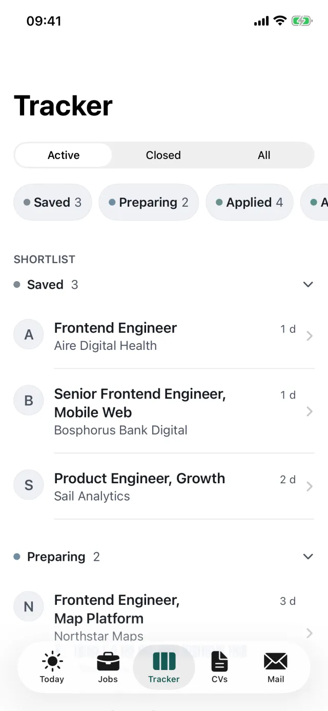 | 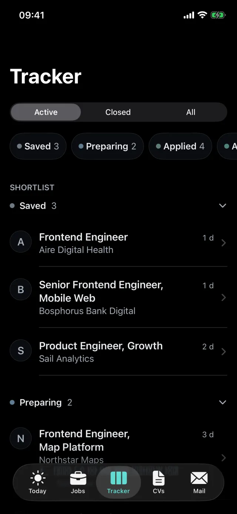 | 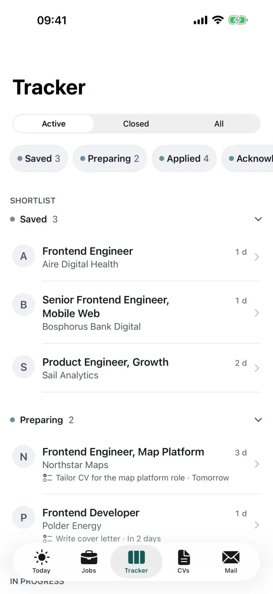 | 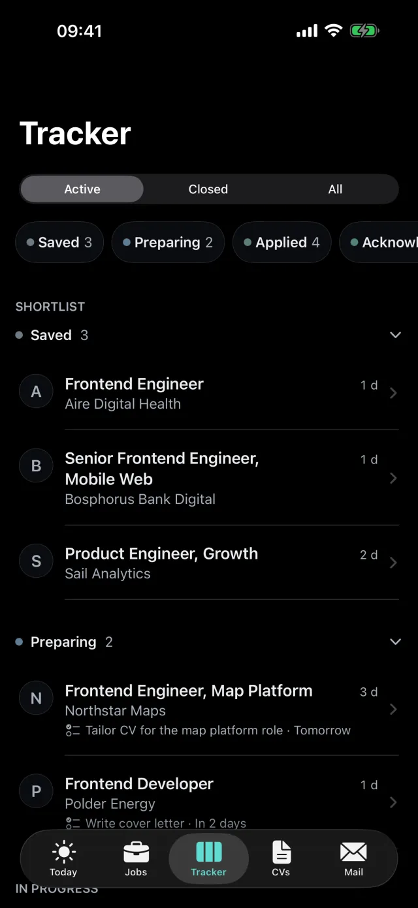 |
| **17e · largest accessibility text (AX5)**                                                                                     | **17e · empty**                                                                                                              |                                                                                                                                          |                                                                                                                                        |
|                |        |                                                                                                                                          |                                                                                                                                        |

**macOS** — 1280 × 800; browser harness, WebKit ≈ WKWebView, en-GB · Europe/Istanbul.

| Populated · light                                                                                                           | Populated · dark                                                                                                          |
| --------------------------------------------------------------------------------------------------------------------------- | ------------------------------------------------------------------------------------------------------------------------- |
|  |  |
| **Empty · light**                                                                                                           | **Offline · light**                                                                                                       |
|          |    |

**Windows** — 1280 × 800; populated + empty: real app (WebView2) from CI run 39809196140; offline: browser harness, Chromium ≈ WebView2.

| Populated · light                                                                                                               | Populated · dark                                                                                                              |
| ------------------------------------------------------------------------------------------------------------------------------- | ----------------------------------------------------------------------------------------------------------------------------- |
|  |  |
| **Empty · light**                                                                                                               | **Offline · light**                                                                                                           |
|          |    |

---

## 5. Mail review queue

**Purpose:** confirm or correct, in one tap, the mail classifications the pipeline wasn't sure about. The screen also lists the changes made automatically, each with its source, reason and Undo. Research: [mail-review.md](research/mail-review.md).

**Key decisions**

1. There's one badge in the whole app, on Mail. It counts pending reviews and leaves out snoozed ones (D01). An inbox scan shows up as a single bundle row (D17).
2. The review card follows the "proposal" pattern:
   - a sentence and a reason;
   - the evidence;
   - three editable fields (Category · Application · Status);
   - **Confirm** / **Change…**, with "Not job mail" as a separate action.

   There's no "Confirm all".

3. Rejections are worded as a **Decision**: "Acme decided not to move forward. We updated the application." There's no red and no "unfortunately", and these notifications can be muted (D18).
4. Automatic changes can be undone from the timeline at any time, and from Mail › Updates for 14 days (D11).
5. iOS uses filter chips (To review · Updates · All job mail · Category) and a ReviewSheet. Desktop shows the folders under the Mail sidebar item, a list, a reading pane with the review card pinned on top, and a details rail at ≥ 1440 px.

**Mobbin references**

- hilos, "Hilo proposes" (desktop): https://mobbin.com/screens/e573bca6-ce45-486a-bc9e-9fe86dff5ea9. Proposal, reason and decision sit in one row.
- Alta, Batch of AI-tagged items (iOS): https://mobbin.com/screens/9e295581-6995-4c42-b494-895d117ec64f. Each guess has its own editable fields.
- Notion Mail, Views + list + reading pane: https://mobbin.com/screens/9d8e58ec-3d37-432d-9af9-76ad8a83fe47. It has three panes, controls under the subject and a bottom-left Undo toast.

**Critique rounds**

- **iOS**, 3 rounds:
  - [r1](critiques/ios/mail-review/r1.md): one Critical fixed (the account scope couldn't be discovered; there's now "All accounts ▾" in the sync line), plus two Moderates fixed.
  - [r2](critiques/ios/mail-review/r2.md): four Moderates fixed:
    - chips while loading;
    - the AX sync line;
    - health card height;
    - "Job alerts (1)".
  - [r3](critiques/ios/mail-review/r3.md): 0 / 0.
- **Desktop**, 2 rounds:
  - [r1](critiques/desktop/mail-review/r1.md): one Critical fixed (a card said "No application found" while the rail showed the linked application), plus three Moderates fixed:
    - popover placement;
    - hover actions;
    - Reconnect while offline.
  - [r2](critiques/desktop/mail-review/r2.md): 0 / 0.

**Accessibility:** pass on both platforms.

- [iOS](critiques/ios/mail-review/accessibility.md): 5 of 5 audits pass (populated and empty, at the default size and AX5, plus the review sheet).
- [Desktop](critiques/desktop/mail-review/accessibility.md): axe 0/0/0/0 in all 20 runs.

**iOS** — iPhone 17e and iPhone 17 Pro Max, iOS 26 simulator.

| 17e · light                                                                                                                | 17e · dark                                                                                                               | 17 Pro Max · light                                                                                                                   | 17 Pro Max · dark                                                                                                                  |
| -------------------------------------------------------------------------------------------------------------------------- | ------------------------------------------------------------------------------------------------------------------------ | ------------------------------------------------------------------------------------------------------------------------------------ | ---------------------------------------------------------------------------------------------------------------------------------- |
|  |  |  |  |
| **17e · largest accessibility text (AX5)**                                                                                 | **17e · empty**                                                                                                          |                                                                                                                                      |                                                                                                                                    |
|                |        |                                                                                                                                      |                                                                                                                                    |

**macOS** — 1280 × 800; browser harness, WebKit ≈ WKWebView, en-GB · Europe/Istanbul.

| Populated · light                                                                                                       | Populated · dark                                                                                                      |
| ----------------------------------------------------------------------------------------------------------------------- | --------------------------------------------------------------------------------------------------------------------- |
|  |  |
| **Empty · light**                                                                                                       | **Offline · light**                                                                                                   |
|          |    |

**Windows** — 1280 × 800; populated + empty: real app (WebView2) from CI run 39809196140; offline: browser harness, Chromium ≈ WebView2.

| Populated · light                                                                                                           | Populated · dark                                                                                                          |
| --------------------------------------------------------------------------------------------------------------------------- | ------------------------------------------------------------------------------------------------------------------------- |
|  |  |
| **Empty · light**                                                                                                           | **Offline · light**                                                                                                       |
|          |    |

---

## Cross-cutting

### Localisation: English, Turkish (siz), German (du)

- **Decision U1:** Turkish uses the formal **siz** and German uses the informal **du**. Formats follow the locale (en-GB / tr-TR / de-DE), with a 24-hour clock in TR and DE.
- **Desktop:** `apps/desktop/src/i18n/` has en, tr and de with the same 1131 keys. `i18n:check` (part of `pnpm test`) fails on stale, invalid or mismatched messages. Each critique round checked the TR and DE layouts; DE strings are budgeted at +35–40 % length and TR at +25 %.
- **iOS:** every screen has a String Catalog. A test requires every key used in code to have en, tr and de values with matching placeholders.
- **Still open:**
  - A native-speaker review of TR and DE. The tracker status labels and Job detail's TR/DE are marked as drafts.
  - The research docs' copy tables still use the informal Turkish "sen"; the shipped strings use siz.
  - The Turkish name for Mail ([taste question 9](#taste-questions)).
  - German on the Tracker board at 1280 px still overflows by 100 px of real content (desktop tracker r5).

### Calm tone

From [BRIEF §5.4](../BRIEF.md) and [system.md › Principles](system.md#principles):

- **Calm.** One accent family and neutral surfaces. Outcomes are never red. The only badge is the Mail review count. No celebration, no streaks, no praise in empty states. Rejections, hides and dismissals make no sound and trigger no haptics.
- **Words.** "Not selected" rather than "Rejected", "No response" rather than "Ghosted", "Not for me" rather than "Dismiss". Rejection mail reads as a Decision with no "unfortunately".
- **Motion** explains a change of place and never decorates: no count-ups, confetti, pulsing badges or animated gauges.

### Automatic changes and Undo

- **The trust rule** (BRIEF §2.6): every automatic change shows its source and reason and can be undone. The same shared components carry it everywhere:
  - `SourceTag`;
  - `ReasonLine`;
  - `AutoChangeRow`;
  - `Toast`.
- **Durable Undo** (D11): a status change can be undone with no time limit while it's the latest move, from the timeline, from Today's "Updated automatically" group and from Mail › Updates. Once it's been superseded, the row says "Can't undo — the status changed since."
- **The toast** (D12) lasts 6 s, or 10 s with a screen reader, long text or several items. It sits above the tab bar on iOS and at the bottom left of the content area on desktop, with ⌘Z / Ctrl+Z. Undo replaces "Are you sure?" dialogs for anything reversible.
- **Flows:** [flows.md §3](flows.md) (mail auto-apply gate) and [§5](flows.md) (tracker move with Undo).

---

## Decisions (2026-10-23)

The owner answered the ten taste questions with the checkpoint approval ([decisions.md › Q1–Q10](decisions.md#m0-checkpoint-taste-answers-q1q10)).

1. **Today: tint on the "Next up" card:** kept as is.
2. **Today: "Updated automatically · you can undo these":** kept as is.
3. **Match bar colour:** the current segment uses the neutral `chart.neutral` tone for Partial and Stretch and the accent for Good and Strong (shared desktop and iOS `MatchBandBar`). Done.
4. **Job list salary:** list rows say "· employer" / "· estimate"; the full wording is in the tooltip and accessible text; job detail unchanged. Done (desktop; iOS has no job list rows).
5. **"AI" twice:** the badge stays; the label is now "Summary · can be wrong" (TR, DE equivalents). Done.
6. **No drag on iPhone (D32):** kept as is; revisit in M3.
7. **iPhone tracker status order:** kept as is (stage order).
8. **Desktop column collapse buttons:** shown only on column hover and keyboard focus, still in the Tab order, no layout shift. Done.
9. **Turkish "Mail":** "E-posta" everywhere, IA.md updated. Done.
10. **Desktop tracker polish (DE header wrap, dimmed columns behind the error card):** scheduled for M3.

## Known limitations

- **Windows captures predate two fixes.** The Windows real-app images come from CI run 39809196140, which ran before the CV editor's scroll-strip fix (desktop CV editor r3 follow-up) and the tracker column fade / fluid empty columns (desktop tracker r5). In the Windows CV editor and Tracker images you may still see the thin scrollbar or the hard column edge. The fixes were verified in the Chromium harness only. Automatic Windows CI is off by the owner's choice, so no new Windows run was made for this checkpoint. The Windows offline images come from the Chromium harness.
- **macOS images come from the browser harness (WebKit).** The real-app capture couldn't run because the Mac's screen was locked, and WKWebView doesn't render frames on a locked screen. The two real-app shots under Today are older captures, taken before the latest fixes and before the locale pin.
- **The iOS simulator runs in en-US**, so iOS captures show "October 22" and "3:00 PM". Desktop captures are pinned to en-GB. In the app itself, dates and times follow the device locale.
- **Fixed while assembling this checkpoint:** the iOS Tracker phase caption was forced to capitals ("SHORTLIST"), which breaks the no-all-caps rule in [system.md › Typography](system.md#typography); it now reads "Shortlist" (AX image above re-captured). In the same pass, the desktop shortcuts sheet's group headings lost their all-caps style, and the iOS CV preview upper-cases section headings with the CV's own language rules ("DENEYİM", not "DENEYIM").
- **No live screen reader on desktop.** No live VoiceOver (macOS) or NVDA (Windows) session has been run on desktop yet; the desktop audits rely on axe and the accessibility tree. On iOS, the Mail review and CV editor audits didn't exercise VoiceOver or Full Keyboard Access.
- **Fixture data only.** Everything shown uses design fixtures. Real data arrives in milestones:
  - M1: walking skeleton;
  - M2: CV Studio, including **PDF/DOCX export**;
  - M3: Tracker, including Table and Calendar;
  - M4: matching;
  - M5: mail intelligence.
- **Out of scope here.** The app icon and wordmark aren't started, and the desktop chrome (sidebar, command palette, shortcuts sheet) hasn't had its own critique yet.
