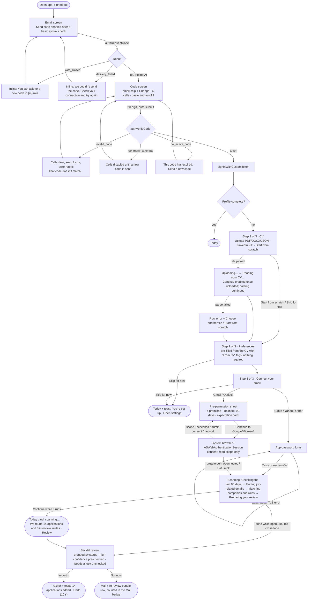
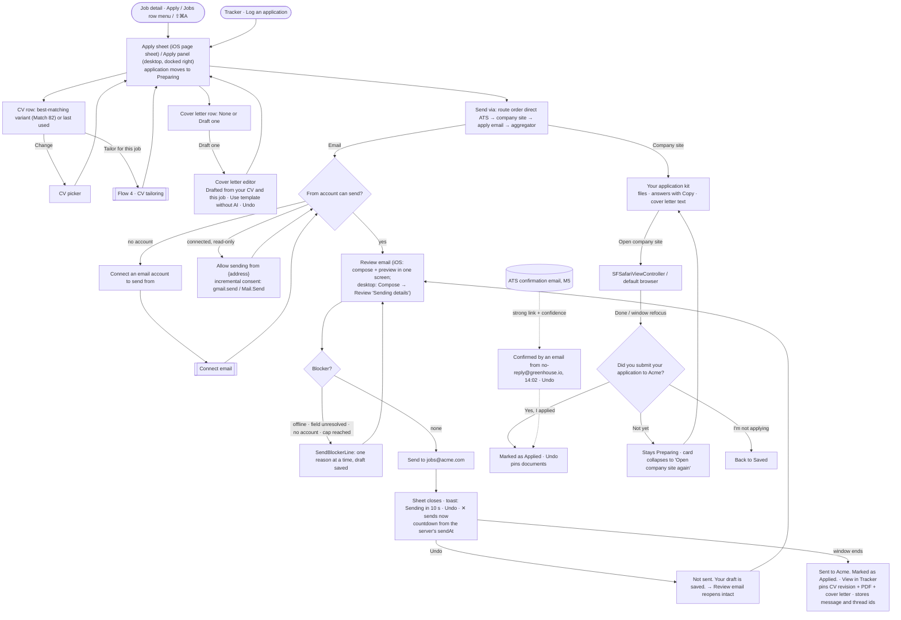
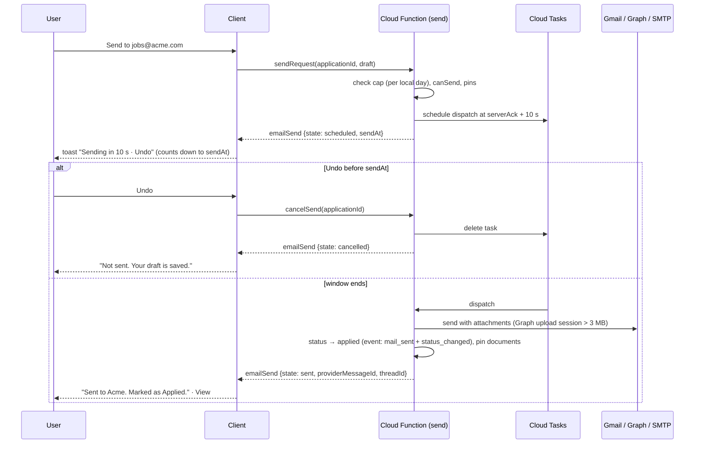
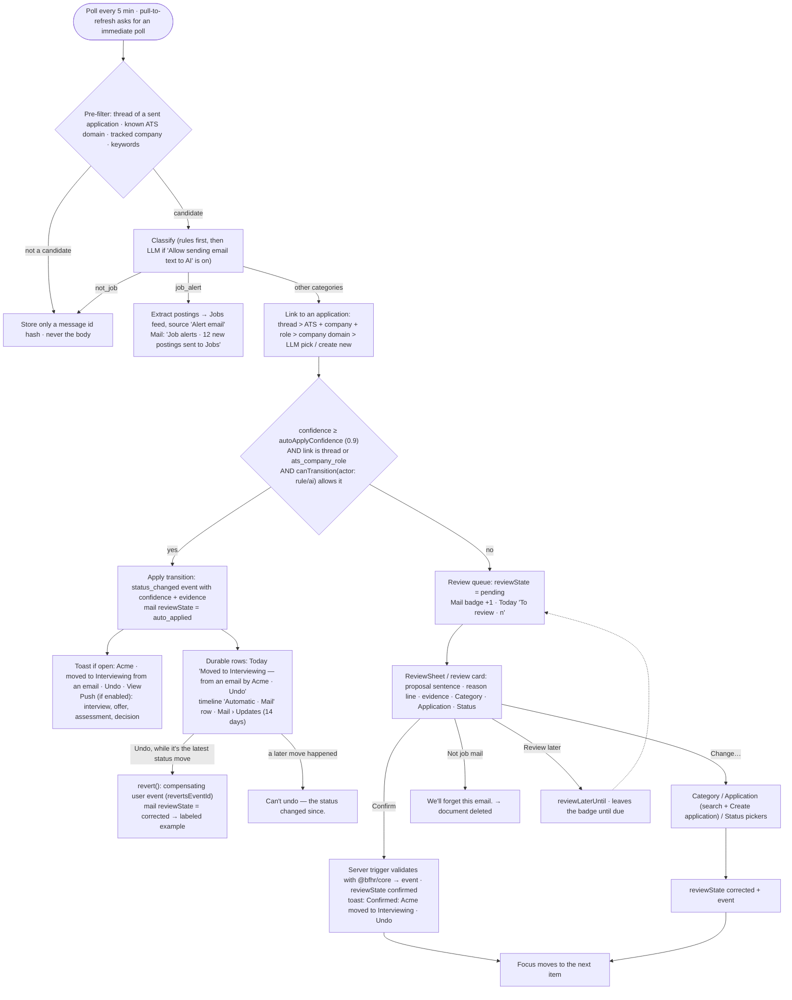
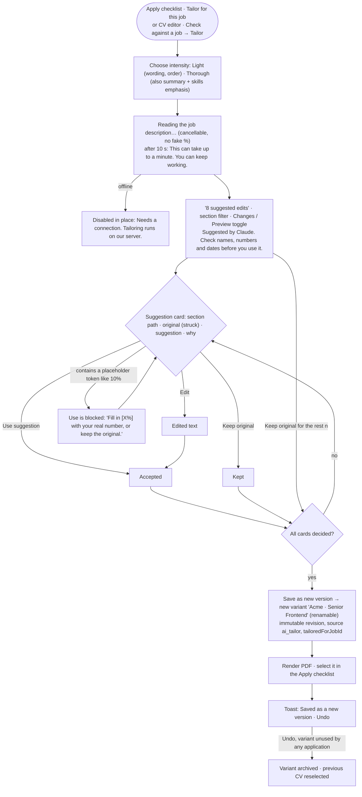
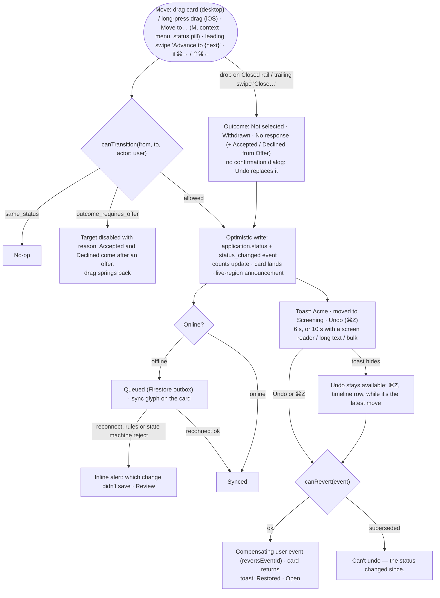

# User flows

Status: M0 synthesis, 2026-10-22. Sources: the research docs named per flow, [decisions.md](decisions.md) and [IA.md](IA.md). Each flow names its trust points (source + reason + Undo) and where it differs per platform. Whole-flow critiques (BRIEF §5.5.7) use these diagrams as their script.

## 1. Onboarding: email code → CV import → preferences → connect mail → backfill review

Sources: onboarding-signin.md, connect-email.md, ADR 0003. Time budget: sign in ≤ 45 s, CV ≤ 30 s, preferences ≤ 60 s, mail ≤ 45 s (≈ 3 min worst case).

Notes:

- One screen serves sign-in and sign-up. The server creates the user on first verify.
- Detailed CV review isn't part of onboarding. Today shows "Review your imported CV · {n} fields to check" (`bruteforcehr://cvs/{cvId}`).
- **Trust:** each imported card carries a "From email" source tag linking to its evidence. Import Undo removes exactly the applications this import created. Already-tracked rows update instead of duplicating ("Already in Tracker · will update to Interviewing").
- **Desktop:** the same steps in a full-window wizard (stepper CV · Preferences · Mail, signed-in email + Sign out). The browser handoff waits for either the deep link or the `mailAccounts` snapshot. After 10 min it says "Still waiting? If you closed the browser tab, open it again." It lands on Tracker if items were imported, otherwise on Today.
- Push permission is asked after the first successful import, never at launch (D25).

## 2. Apply: email and external

Sources: apply.md, job-detail.md, states.md; decisions D02, D11, D21–D23.

Email send timing (the only hard Undo window, D11):

Notes:

- Send needs a connection. Nothing queues offline, so a send can't fire after the user stopped watching.
- There's no bulk apply. The desktop panel's ‹ › stepper moves between saved jobs, and each one is still sent separately.
- iOS: swiping the sheet down asks Keep draft / Discard. Desktop: Esc closes the panel and keeps the draft.

## 3. Mail intelligence: automatic change with Undo vs Review queue

Sources: BRIEF §4.7, mail-review.md, today-home.md, tracker.md, ADR 0002 (status machine, review states); decisions D01, D11, D17.

Notes:

- Automation moves forward or to Rejected only. It never sets Accepted, Declined, Withdrawn or No response, and never moves a closed application (`AUTOMATION_FORBIDDEN_STATUSES`).
- Clients never write `applications` from Mail. They write the four review fields, and a server trigger turns them into events.
- Every automatic change shows its **source** (account, sender, received time), its **reason** ("Same email thread as your application of 3 Oct", "Sent from greenhouse.io and mentions this role", "Sorted by rules (AI is off)") and **Undo**.
- Decisions (rejections) use calm copy ("Acme decided not to move forward. We updated the application."), never red, and their notifications can be muted.
- Offline: the queue stays readable from the cache. Confirm and Change are queued and show "Will sync when you're back online".

## 4. CV tailoring

Sources: apply.md (Tailor review), cv-editor.md (AI assist, revisions, variants); decisions D13, D14.

Notes:

- There's no "Accept all". The AI never adds a skill or number the user doesn't have, and unknowns become visible `[X%]` tokens (BRIEF §2.4).
- On desktop, Tailor review takes over the content area with a 360 px suggestion rail. Keys: `A` use, `R` keep original, `E` edit, `J`/`K` next / previous card, Esc returns to the panel with the new version selected.
- In the CV editor (outside Apply), the same suggestion model runs inline: tracked changes with ✓ / ✕ and a gutter bar on desktop, and the AI assist sheet on iOS. Every accept writes a revision.

## 5. Tracker move with Undo

Sources: tracker.md, states.md, ADR 0002 (`canTransition`, `canRevert`); decisions D11, D12, D16.

Bulk (desktop Table): select rows → Set status writes one event per application, and one Undo covers the batch ("3 applications moved to Applied · Undo").

Suggestions never move anything by themselves:

- At 7 days after Applied: "No reply in 7 days. Send a short follow-up?" with **Draft follow-up** / **Not now**.
- At 21 days: "No reply in 21 days. Mark as no response?" with **Mark as no response** / **Keep waiting**.
- Both thresholds come from `settings.followUpAfterDays` and `settings.ghostedAfterDays`.
