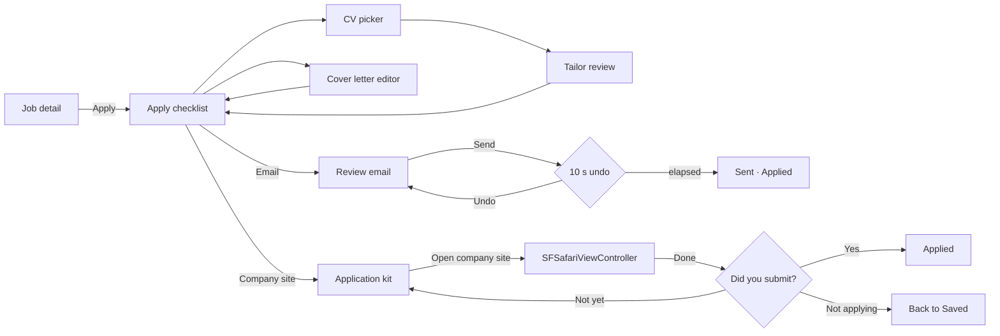

# Apply: design research

Research date: 2026-10-22. Sources: Mobbin MCP `search_flows` and `search_screens` (`task_intent`: "Design a cross-platform job search, CV builder and application tracker app", `output_destination: "code"`). The user's saved Mobbin collections only hold website sections (see kickoff), so none apply to this area. Every reference below was judged from its screenshots, not its metadata. No images are committed; open the `mobbin_url` to view.

## Scope

Brief §5.3 row **Apply** (iOS: flow *job application*, *email compose*, *attachment picker*; Desktop: *email compose*, *side panel*), covering the §4.4 requirements: CV variant picker, "Tailor for this job" diff review (accept/reject each AI edit), cover letter editor with templates, channel choice (email vs. external link), email preview with explicit Send and a 10-second undo, the external-apply copy-ready kit (files + answers library) and the "Did you submit?" return prompt.

| Platform | Matrix entry / sub-screen | Queries run (mode) | Examined | Kept |
|---|---|---|---|---|
| iOS | flow: job application | flow "job application" (standard) | 8 | 3 |
| iOS | CV variant picker | "resume selection screen for a job application" (standard) | 8 | 4 |
| iOS | Tailor diff review | "AI suggested edits review with accept and reject for each change" (deep); "text comparison showing original and rewritten version with highlighted changes" (deep); Deel from the return-prompt query | 17 | 7 |
| iOS | Cover letter templates / tone | "message template picker list" (deep) | 8 | 4 |
| iOS | email compose | "email compose screen with attachments" (standard) | 8 | 4 |
| iOS | Send + undo | "email sent confirmation toast with undo button" (deep) | 8 | 4 |
| iOS | attachment picker | "attachment picker sheet for choosing a document file" (deep) | 8 | 4 |
| iOS | External kit (copy rows) | "saved details list with copy buttons for each field" (deep) | 8 | 4 |
| iOS | "Did you submit?" + after-apply | "prompt asking whether the user applied to the job after returning from the employer website" (deep); Handshake flow from the first query | 7 | 4 |
| Desktop (`web`) | job application flow | flow "job application" (standard) | 6 | 4 |
| Desktop (`web`) | email compose | "email compose window with attachments and from account" (standard) | 8 | 5 |
| Desktop (`web`) | Send + undo | "message sending toast with undo and countdown" (deep) | 8 | 4 |
| Desktop (`web`) | side panel | "side panel sliding over a list with record details and actions" (deep) | 8 | 4 |
| Desktop (`web`) | Tailor diff review | "document editor showing AI suggested edits with accept and reject for each suggestion" (deep) | 8 | 3 |
| Desktop (`web`) | Cover letter editor + templates | "cover letter editor" (deep) | 8 | 3 |
| Desktop (`web`) | Answers library | "saved text snippets library with copy to clipboard" (deep) | 8 | 4 |
| Desktop (`web`) | "Did you submit?" return prompt | "banner asking if the user finished applying on the external site with yes and no buttons" (deep) | 8 | 3 |

Product requirements that shape every decision: §2.3 **never send without explicit confirmation of that specific message** (recipient, subject, body, attachments) and no bulk auto-apply; §2.4 **never fabricate CV content** (unknowns are visible `[X%]` placeholders the user must fill); §2.5/§4.11 **no automated submission of third-party forms** (the external kit is copy/paste and drag only); §2.6 every automatic change is explained and reversible; §4.4.4 each application **pins the exact CV revision, PDF and cover letter** (immutable). UX principles: calm, trust (source + reason + Undo), speed (optimistic UI, keyboard-first desktop), progressive disclosure.

## References

### iOS: flow — job application

| App | Flow | `mobbin_url` | What we borrow | Why |
|---|---|---|---|---|
| LinkedIn | Applying for a job (Easy Apply, 15 screens) | https://mobbin.com/flows/e0fc1122-ed3b-4ef9-b3f2-7ff89b8abbbc | Resume step as a single selected file row with a radio and "Upload resume" secondary (screen 5). Final review screen lists every answer with a per-section **Edit** link before one full-width submit (screen 12). After submit, the job detail shows "Application status · Application submitted · View resume" (screen 15). | The review-everything-then-submit shape is exactly §2.3. "View resume" on the job maps to our pinned CV revision. |
| Handshake | Applying to a job (external, 5 screens) | https://mobbin.com/flows/66fa8042-d234-47a0-bfa3-5c18209d1347 | "Apply externally" primary on the job (screen 1). On return, an inline card on the job: "Did you apply to this job? You started an application on the employer's website. Yes / No" (screens 3, 5), plus a sheet explaining where to find your documents when the employer's form asks to "choose file" (screen 3). | The only domain example of the return prompt and of guiding file upload on a third-party form. It's the core of our external channel. |
| Glassdoor | Applying for a job (Easy Apply, 23 screens) | https://mobbin.com/flows/ebc631ea-67ad-4ff4-bca0-5327c480670c | "Add a resume for the employer" with the last-used file preselected (filename + "Uploaded Mar 4") and a clear alternative card (screen 7). Review screen groups answers and shows "Supporting documents · No cover letter… (optional) · Add" (screen 18). Job title + company stay pinned at the top of every step. | Keeping the job in view while applying reduces "which job was this?" errors. The optional cover-letter row shows how to present an empty optional step without nagging. |

### iOS: CV variant picker

| App | Screen | `mobbin_url` | What we borrow | Why |
|---|---|---|---|---|
| LinkedIn | Apply › Resume | https://mobbin.com/screens/f7a4a57e-758e-4775-9674-6c7b2f6995ea | One row per file: PDF badge, name, download glyph, trailing radio; "Upload resume" below. | The simplest selection row. We extend it with variant name, language and match score. |
| Glassdoor | Resume preview inside apply | https://mobbin.com/screens/98b18270-ffee-494b-a33f-8ff5bda6a446 | Inline paged PDF preview ("2 / 4" page stepper, ← →) with a "Resume options" button under it. | Lets the user check the actual pages they're about to send without leaving the flow. |
| Linktree | Full-screen PDF viewer | https://mobbin.com/screens/0e964697-af87-4788-93d1-95eccfb3d594 | Full-screen document with only the filename and a close / download control in the header. | Quick Look-style preview for "tap the thumbnail to inspect". |
| Docusign | Add documents with "AI-Assisted" label | https://mobbin.com/screens/0b951f71-029b-421e-9c39-5a5a630b0d7a | Plain-text status line "Field suggestions are turned on." with an "AI-Assisted" chip, and a document row with page count. | A calm, always-visible label that AI is involved. We use it on the "Tailor for this job" row and on tailored variants. |

### iOS: Tailor diff review

| App | Screen | `mobbin_url` | What we borrow | Why |
|---|---|---|---|---|
| Deel | "Edit general information · Edits summary (2)" | https://mobbin.com/screens/24e6701c-9308-4db6-81b8-fa1fc94c65f2 | One card per edit: field label, **new value** emphasized, "Previous: …" below in secondary text, trailing remove; footer "Step 2 of 2 · Confirm & update". | The cleanest mobile old→new card. It fits CV fields (summary, bullet, skill) one per card. |
| Speak | AI "Correction" cards | https://mobbin.com/screens/c7abdc8b-c155-424c-b22c-ac79535784e0 | Stacked cards: original line, corrected line in a different color, then a one-paragraph **why**, plus Retry. | Each AI edit must carry its reason ("Mirrors 'stakeholder management' from the job"). Retry maps to "Suggest another wording". |
| Duolingo | "Replaced: ~~son~~ → petit" explanation | https://mobbin.com/screens/4557361a-579e-4ace-9c83-ec4d5c1591fa | Compact inline diff label: struck-through old word → new word, then explanation. | For word-level edits (a skill renamed, a verb swapped) the inline strike → new form is shorter than two full lines. |
| Manus | Diff / Original / Modified segmented control | https://mobbin.com/screens/6834fa59-ee3a-4969-a6cc-c27bb0c9ad56 | A three-way segmented control above a document: see the diff, the original, or the result. | After reviewing cards the user wants to read the whole tailored CV once. A "Changes / Preview" toggle covers that. |
| Structured | AI plan with per-item Add / Edit / Discard | https://mobbin.com/screens/2e36f6e3-a873-400a-a2ee-2a32c508290a | Per-item three actions (Add / Edit / Discard) and a disclaimer above results: "The AI may make mistakes… Be sure to check important tasks." | Per-item Edit is essential: the user often wants the suggestion *mostly*. The disclaimer wording is a good base. "Accept All" is not borrowed (see Decision). |
| Spark Mail | Template inserted "with some text alterations by +AI" toast | https://mobbin.com/screens/776c7236-d0fb-456c-9bea-b089ca3bdb5c | Toast that says what the AI changed, with a link "Use the original template without +AI" and **Undo**. | The trust pattern for AI-generated text: explain, offer the non-AI original, allow Undo. Reused for the cover letter draft. |
| GoFundMe | "Our suggestions" sheet | https://mobbin.com/screens/ee4b5ef1-a4b8-4497-a9d2-5985d893abe1 | Sheet intro "We read your story and made some changes for you to review", change-type chips (spelling, tone, word choice, structure), a segmented "Enhanced / Spell check only", and Cancel / "Use this story". | Change-type chips become our filter by CV section. The two-level intensity toggle maps to the tailoring intensity choice (light / thorough). |

### iOS: cover letter templates and tone

| App | Screen | `mobbin_url` | What we borrow | Why |
|---|---|---|---|---|
| Notion | "Select Instructions" templates sheet | https://mobbin.com/screens/05b9a158-e0a7-4679-a403-6105e6a3d57f | Short preset list with an icon, name and one-line description ("Minimalist — Brief and concise responses"). | The tone picker for generation: Warm / Direct / Formal, each with a one-line description so the user knows what they'll get. |
| Jira Cloud | Select template (grouped, with descriptions) | https://mobbin.com/screens/773944d1-2dae-474c-9e6f-42ee55d1cd31 | Inset-grouped sections, each row title + description + "Learn more", checkmark on the current one. | Templates grouped as "Your templates" and "Starter templates", with the selected one checked. |
| Revolut Business | Select template | https://mobbin.com/screens/3d84d5ad-a4bb-4567-9733-875cc338e79a | Minimal list plus "+ New" in the header and the hint "Edit and manage templates in settings". | Picking stays fast; management lives in Settings and is one link away. |
| Evernote | Choose a template (with thumbnails) | https://mobbin.com/screens/3e20709a-665e-49a9-bc0e-631b5ade7aa6 | Each template row shows a small content preview next to its title and description; full-width Confirm. | For cover letters, a two-line text excerpt (not a picture) does the same job: you see the opening before choosing. |

### iOS: email compose

| App | Screen | `mobbin_url` | What we borrow | Why |
|---|---|---|---|---|
| Jobber | "Email invoice" | https://mobbin.com/screens/a7401b17-cbff-406d-8f96-bb2a889b3c3f | A templated business email as a form: Subject and Message as labeled fields, an **Attachments** section with file tiles and "+", and a single full-width "Send Email" at the bottom. | The closest structural match: templated message + pinned document attachment. A form layout is easier to review than a free-form mail composer. |
| Apple Mail | Compose sheet with attach menu | https://mobbin.com/screens/c53c7452-e27e-48fa-bcf5-9222456ba933 | Sheet presentation with grabber, collapsed "Cc/Bcc, From" row that expands, attach menu (Attach File / Scan / Photo Library). | Native iOS conventions; the collapsed From row keeps the common case short while staying explicit. |
| Docusign | "Email a copy" | https://mobbin.com/screens/25fcf01d-2e4d-413f-91ed-4f382c00b0be | From shown as "Alex Smith via Docusign", a "Send yourself a copy" toggle, and a character-limit footnote. | We send from the user's own account, so From shows the real address. "Send yourself a copy" (Bcc self) is useful proof of what was sent. |
| Notion Mail | Compose with From row and attach menu | https://mobbin.com/screens/0705912e-7b04-4ba0-b380-57c22b93a896 | "From" as its own first row above To/Cc/Bcc; attach menu with "Attach file". | From must be the first thing the user sees when several mail accounts are connected (§4.4 from-account picker). |

### iOS: Send + undo

| App | Screen | `mobbin_url` | What we borrow | Why |
|---|---|---|---|---|
| Notion Mail | "Email sent · Undo" toast | https://mobbin.com/screens/10cf09ea-b1cf-42b4-b096-db6e9f37c011 | Dark pill toast floating above the bottom toolbar with a text-button Undo. | Position and contrast for the undo window on iOS. |
| Gmail | "Sent. · Undo" snackbar | https://mobbin.com/screens/4884b902-af81-4c68-9cbf-0d6f6e80c9d0 | Full-width snackbar at the bottom edge, Undo right-aligned in the accent color. | The best-known undo-send pattern; users already understand it. |
| Quicken | "Refund tracking created. Undo ✕" | https://mobbin.com/screens/3b0b5c12-410f-4afe-9eec-552cc5532376 | Toast with both Undo and a close ✕. | Lets the user dismiss early without undoing (equivalent to "Send now"). |
| Klarna | "Unlinked from purchase · Undo" + source note | https://mobbin.com/screens/ac043613-ee27-4614-9bdc-cc0380e5b411 | Success toast with Undo, and a separate info line "Delivery events provided by UPS". | Pairing the action with its source: after sending we show "Marked as Applied · from your email to jobs@acme.com". |

### iOS: attachment picker

| App | Screen | `mobbin_url` | What we borrow | Why |
|---|---|---|---|---|
| Fabric | "Add link to related files" sheet | https://mobbin.com/screens/114f20bf-ce42-4001-b581-a45731e78538 | Sheet with search field and a list of the user's own files (PDF icons, names). | Most attachments come from *our* rendered files (CV PDFs, cover letters), not the Files app. A searchable list of them is the main picker. |
| Shopify | Select files with "3 selected" tray | https://mobbin.com/screens/fe4c261c-8197-4870-b362-a4156979d55c | Multi-select with checkmarks and a bottom tray showing the selection and a single "Add". | Adding e.g. a portfolio PDF and a certificate in one pass. |
| Fi | "Add documents" two-option sheet | https://mobbin.com/screens/85873190-10ce-4079-8267-c09316bfb393 | Two large option cards with a one-line explanation each ("Upload files — Select documents from your phone…"). | Clear split between "From BruteForceHR" and "From Files…" when the list is empty. |
| Telegram | File source sheet with size note | https://mobbin.com/screens/56cff18a-985d-4572-8b83-df9fa5e318ec | Grouped source rows (Gallery / Files / Scan Document) and a plain size-limit note at the bottom. | Size limits must be visible up front (mail providers cap attachments; Graph needs an upload session over 3 MB). |

### iOS: external kit (copy rows)

| App | Screen | `mobbin_url` | What we borrow | Why |
|---|---|---|---|---|
| N26 | "Bank Transfer" copy sheet | https://mobbin.com/screens/b7a79288-da79-44c7-b615-6983ee8fae41 | Title + one-sentence purpose ("Copy these… to send money…"), labeled rows with a copy icon, a help link, and one primary action at the bottom. | Same job as our kit: copy values into someone else's form. The primary becomes "Open company site". |
| Wise | Card details with "Copy" pills | https://mobbin.com/screens/6213349c-e296-4e77-96ad-57224a930cef | Label above value, a text "Copy" pill per row (larger target than an icon). | Labeled text buttons are clearer and meet 44 pt more easily than bare icons. |
| Public | "Brokerage account number copied" | https://mobbin.com/screens/f384500c-9a39-42c6-a348-322bf6e7a3f0 | Confirmation toast that names the copied item. | When copying several answers in a row, naming the item ("Notice period copied") confirms the right one. |
| Cleo AI | Direct deposit details | https://mobbin.com/screens/704b470c-0db7-4ece-a2da-f52ee4c06758 | Copy rows grouped in one card, with a secondary "different setup method" path. | The kit needs a quiet escape hatch ("This job takes email applications instead"). |

### iOS: "Did you submit?" and after-apply

| App | Screen | `mobbin_url` | What we borrow | Why |
|---|---|---|---|---|
| Handshake | Job after returning from the employer site (flow screens 3 and 5) | https://mobbin.com/flows/66fa8042-d234-47a0-bfa3-5c18209d1347 | Inline card at the top of the job: question, context line ("You started an application on the employer's website"), Yes / No. It stays on the job until answered. | Inline, not a modal: it doesn't block if the user isn't done yet. |
| LinkedIn | "Your application was sent" | https://mobbin.com/screens/fd00d963-9544-4c86-8bf4-656ee445a0c8 | Confirmation that says where to track it ("You can keep track… in the Applied tab"). The "open to work" upsell below is not borrowed. | Tell the user where the application lives now (Tracker), then get out of the way. |
| Mercury | "Your application is in review" timeline | https://mobbin.com/screens/ec7b66ef-59c2-495b-9872-7f17f40c5c52 | Vertical mini-timeline: "Application sent · Submitted on June 4" → "In review · Approximately 2–4 days" → next step. | The post-apply state on the job: what happened and what typically comes next, without pressure. |
| Revolut | "Your application is being reviewed" sheet | https://mobbin.com/screens/012bcd63-af08-450a-be52-f5ff2e49e1a3 | Calm expectation copy ("This normally takes up to 48 hours… We'll contact you…") with one "Got it". | Tone reference: set expectations, no celebration. |

### Desktop (`web`): job application flow

| App | Flow | `mobbin_url` | What we borrow | Why |
|---|---|---|---|---|
| Glassdoor | Applying a job (web, 11 screens) | https://mobbin.com/flows/ee9d4a81-850e-4f33-8dda-ea10dc0facb3 | Two-column apply: the form on the left, a job summary card on the right for the whole flow; review step with per-section "Edit". | Desktop has room to keep the job visible. Our side panel does this by leaving the job detail beside it. |
| Deputy | Submitting an application (21 screens) | https://mobbin.com/flows/39b243dd-d98c-4a7b-aa0a-53598cee249f | Vertical step list on the left (Contact details / Your Resume/CV / Working rights / Additional questions / Review) with the current step highlighted. | A vertical step list scales to longer labels (TR/DE) and allows jumping back to any step. Its jokey headlines and confetti end screen are not borrowed. |
| Contra | Applying a job (9 screens) | https://mobbin.com/flows/287401eb-e111-4356-8a94-9634f92eeae7 | Cover note editor with a character counter (865/1500) in the apply dialog, Cancel / Submit application, then the job moves to an "Applied" tab with the action disabled. | The applied job visibly changes state in the list, so it's clear it's done. |
| Braintrust | Applying for a job (12 screens) | https://mobbin.com/flows/06fe98c4-06f1-428c-a482-ab109dec378a | Sticky header with company + role and "Go back" / "Send application"; drag & drop resume zone with limits ("max 10 MB, PDFs only"). | Sticky context and primary action; drag & drop for adding extra attachments on desktop. |

### Desktop (`web`): email compose

| App | Screen | `mobbin_url` | What we borrow | Why |
|---|---|---|---|---|
| Xero | "Send email" with live preview | https://mobbin.com/screens/c9763dbd-e365-4b73-870c-d089e748229f | Split view: form on the left (To, **Email template** dropdown, Subject, Message with "Add placeholders", "Files included", "Send myself a copy"), live preview on the right with tabs **Invoice email / Invoice PDF**; Cancel / Send email bottom right. | The closest desktop match: a templated email with a PDF attachment, previewed exactly as the recipient sees it, and the PDF itself one tab away. |
| Attio | Compose with variable chip and fallback | https://mobbin.com/screens/87876e8b-ba55-4ce3-bbeb-bc3d35d04e9d | Merge field rendered as an inline chip ("Name › Full") with a popover to set a **fallback** value; primary button is **Review**, not Send. | Merge fields need visible tokens and a defined fallback. "Review" as the compose primary enforces §2.3. |
| folk | New message with template variables and Templates menu | https://mobbin.com/screens/88ed83f7-bd0c-4e1c-ada6-239531e6ec33 | Variables as chips inside the subject and body, a "Templates" menu in the toolbar with search, "New template" and **"Save message as template"**; "Saved" state + "Review" in the header. | Saving a good message as a template from where it was written is how the template library grows. |
| Front | Scheduled send banner on a draft | https://mobbin.com/screens/19572002-c8db-4063-b7f6-1a1b859c4614 | Banner on the message: "Send later · This message will be sent in 2 hours · Cancel"; attachment tile with size. | A pending message shows its state and a cancel action right on the message. Used for the in-flight state in the Tracker detail. |
| Proton | Compose with From dropdown and "Saved at" | https://mobbin.com/screens/c2b13451-3827-4da6-a688-c0b3c901cb4d | From address as a dropdown on the first line; "Saved at 3:22 PM" next to Send. | Draft autosave reassurance, and the from-account picker placement. |

### Desktop (`web`): Send + undo

| App | Screen | `mobbin_url` | What we borrow | Why |
|---|---|---|---|---|
| Loops | "Sending in 2 seconds" toast + Sending details | https://mobbin.com/screens/5c1a0e89-4583-402a-888c-cc47856e964a | Toast with a live countdown, the subject, and **Send now / Cancel Send**; the page above is a read-only "Sending details" card (Subject, From, Reply-to) + "Email preview". | The exact undo-window pattern, plus a read-only review layout before sending. |
| Todoist | "Date updated to Tomorrow 17:00 · Undo ✕" | https://mobbin.com/screens/75c4093b-73e7-4344-b2e7-54e90d94e58c | Bottom-left dark toast that states the change concretely, with Undo and close. | Desktop toast position (bottom-left, away from the right-hand panel) and specific wording. |
| Wrangle | Scheduled email list + "Email Cancelled" | https://mobbin.com/screens/5abdd0f7-426f-46b9-9ddf-4d322886b3a8 | After cancel: confirmation toast "The scheduled email has been successfully cancelled", the email remains with **Edit Email / Cancel Email**. | Undo must land the user back on an editable draft, never lose content. |
| Quicken | "Transaction created. Undo ✕" | https://mobbin.com/screens/e9042731-b020-4b97-b8b7-b5ad5a97db06 | Compact bottom-left toast with Undo and ✕. | Confirms the compact desktop toast size for the post-send status change toast. |

### Desktop (`web`): side panel

| App | Screen | `mobbin_url` | What we borrow | Why |
|---|---|---|---|---|
| Twenty | Record side panel beside a table | https://mobbin.com/screens/601f66eb-0efb-4e92-a88e-38d29a5f9608 | Non-modal right panel: the table stays usable on the left; panel tabs; collapsible field groups; footer with keyboard-hinted actions ("Options ⌘O", "Open ⌘↵"). | Apply opens next to the job so the description stays visible and the list stays navigable. Keyboard hints in the footer fit our keyboard-first desktop. |
| Maze | Session details panel with Export section | https://mobbin.com/screens/98c5699d-743b-49c3-9523-f3f3511c0962 | Rows with a title, a one-line description and a trailing "Download" button ("Transcript — Download the TXT transcript of this session"). | The file rows of the desktop kit (CV PDF, cover letter PDF) with a short explanation per file. |
| Gumloop | Detail panel with stepper and footer actions | https://mobbin.com/screens/bf54bbb1-692f-4dfd-91d4-536284b7990f | "7 / 7 ⌃ ⌄" record stepper and "Copy link / Open" footer actions. | Moving to the next saved job without closing the panel (batch preparing applications, each still sent individually). |
| Unify | Person details panel with copy affordance | https://mobbin.com/screens/0d1f60e6-1856-472d-af53-ee99d9431402 | Panel header with up/down navigation, inline copy icon next to the email, tabs below. | Inline copy next to values, reused in the answers section. |

### Desktop (`web`): Tailor diff review

| App | Screen | `mobbin_url` | What we borrow | Why |
|---|---|---|---|---|
| WRITER | Suggestions rail with old → new | https://mobbin.com/screens/86221de5-38b0-48df-965e-9adbd7b302ac | Right rail of suggestion cards; the open card shows ~~old~~ → **new** and a reason ("Use sentence case for headlines"), with accept ✓ and dismiss; per-category counts. | The desktop diff-review layout: document in the center, one card per edit on the right, each with reason and its own decision. |
| Grammarly | Review suggestions panel | https://mobbin.com/screens/352b524f-4bb8-44a4-84a7-b58f5556cf1b | Category tabs with colored underlines and a count; each card names the category, explains in plain words, and highlights the location in the document. | Clicking a card scrolls and highlights the bullet in the CV, so the user judges each edit in context. |
| Confluence | AI result with Discard / Refine / Insert below / Replace | https://mobbin.com/screens/048344a5-3f3c-4740-b41f-c8ca1e34b23f | Four explicit outcomes, feedback thumbs, "Tell AI what to do next", footer "Uses AI. Verify results." | "Refine" maps to "Suggest another wording"; the footer is the AI disclosure line. |

### Desktop (`web`): cover letter editor and templates

| App | Screen | `mobbin_url` | What we borrow | Why |
|---|---|---|---|---|
| Employment Hero | Letter template editor + Variables panel | https://mobbin.com/screens/7b3b1303-1703-4ae9-9f48-031e8d55c4aa | Letter editor on the left, a searchable **Variables** panel on the right (Name, Type, "Use"), "Save and Preview". | Merge fields for cover letters (company, role, hiring manager, job source) should be insertable from a list, not typed from memory. |
| Aboard | Letter editor with variable chip and save bar | https://mobbin.com/screens/88c5f02b-88fc-49e4-b51c-212946e8aa13 | A clean document page, a variable shown as a highlighted chip ("start-date"), and a floating bar "not yet published · Cancel · Save". | Unsaved state is explicit; variables are visually distinct from typed text. |
| Zoho CRM | Compose with "Insert Template" + Writing Assistant | https://mobbin.com/screens/90e02b40-5853-4c96-8a3d-af284a0b4768 | "Insert Template" in the compose header; a quality panel where most rows say "Nothing here. Great job…" in a friendly tone. | Template insertion from the editor; the quality checks show how to report "nothing to fix" calmly (we keep checks minimal: unresolved fields, length). |

Also used (from other rows): Xero's **Email template** dropdown and folk's **"Save message as template"** (email compose above).

### Desktop (`web`): answers library

| App | Screen | `mobbin_url` | What we borrow | Why |
|---|---|---|---|---|
| Superhuman Mail | Snippets list + detail pane | https://mobbin.com/screens/7cfbd651-0716-4d32-838b-d5b25836ad34 | Dense list (name + preview) with a right-hand detail showing the full text, Modified, Last sent, and keyboard shortcuts for using it. | Answers library management in Settings: list + detail, keyboard-first. |
| Plain | Snippets grouped, with merge fields | https://mobbin.com/screens/ff5d2083-55f9-4aa0-82fe-58cb30fac482 | Grouped list (title + one-line preview), merge fields shown inline (`{{customer_name}}`), ⋯ menu with Edit / Delete, short purpose line under the title. | Groups map to our answer categories (Work authorization, Availability, Compensation, Links, Q&A). |
| WRITER | Snippets table with description and tags | https://mobbin.com/screens/da218faf-3198-498d-be74-b7e53e966d8a | Each snippet has content, a one-line description of when to use it, and tags. | Tags carry country/language (e.g. "DE", "EU work permit") so the kit can show the right answer for the job. |
| Heidi | Expandable snippet cards | https://mobbin.com/screens/1209b810-75df-4876-a153-274fea75dead | Card shows name + label + full text when expanded, "Collapse" link, bulk upload. | Long Q&A answers ("Why do you want to work here?") need expand/collapse in the kit. |

### Desktop (`web`): "Did you submit?" return prompt

| App | Screen | `mobbin_url` | What we borrow | Why |
|---|---|---|---|---|
| Monarch | "Were you able to connect all your finances?" | https://mobbin.com/screens/99b6ce6f-19ae-40c4-95b4-b066f81c260b | Yes / No as two equal options, a reassuring sentence ("Monarch can still give you advice if…"), and a third low-emphasis "I don't know". | Three honest answers (applied / not yet / not applying) with no wrong answer. |
| Care.com | "Did you find a caregiver?" with status banner | https://mobbin.com/screens/742cbad2-90d1-4faf-bc4d-5c441a520731 | A status banner above a single direct question with radio answers and Continue. | Keep the question short and literal; state what already happened above it. |
| Wrangle | "You left the meeting · Rejoin / Back to Wrangle" | https://mobbin.com/screens/e4604025-0266-4bf6-802f-4944595a065f | Return state offering to resume the external activity or continue in the app. | "Not yet" must offer "Open the site again" so the user can finish. |

## Examined but rejected

| App | `mobbin_url` | Reason |
|---|---|---|
| Handshake (iOS, "Job applications" web view) | https://mobbin.com/flows/dc7145ea-b10b-48b1-86df-56bf235487f9 | A web page wrapped in an in-app browser with a time-zone modal. No native pattern to borrow. |
| Public (iOS, employment status) | https://mobbin.com/flows/590239e7-a132-4bbc-9acd-3996df3e8142 | A finance KYC form; nothing apply-specific. |
| Handshake (iOS, add work experience) | https://mobbin.com/flows/de5f5abb-4062-4c69-b3e7-38c61c08323c | Profile editing; belongs to CV Studio research. |
| LinkedIn (iOS, Jobs home) | https://mobbin.com/flows/8b6c9e80-fe9a-475a-a535-120707ee4d1f | Job feed, not the apply flow (covered by Jobs research). |
| Dave (iOS, view a job → "Apply now") | https://mobbin.com/flows/0ca09344-33fc-45b0-9786-5fdba13001c0 | Opens the employer site in a web view with no kit and no return prompt; the user is left alone with a cookie banner. |
| Handshake (iOS, Add resume form) | https://mobbin.com/screens/707c7dc4-7ee7-4a10-802e-ec73a05eb93c | Bare title + file field. Adds nothing over LinkedIn's row. |
| Upwork (iOS, add your resume) | https://mobbin.com/screens/a8c4278d-c645-474f-a9e8-caf60194d4e8 | Onboarding upload, not selection among variants. |
| Cleo AI (iOS, time to upload) | https://mobbin.com/screens/96dc99b0-c24b-4121-ab81-8d31a6bd9378 | Document-verification upload with photo tips; wrong job. |
| Google (iOS, AI summary of a resume) | https://mobbin.com/screens/227cf86e-70db-40ef-a900-1fe97d18f0e8 | Chat answer, no selection or review pattern. |
| Alta (iOS, AI item review) | https://mobbin.com/screens/de433cf4-0b86-4e9f-986b-5d243f1bf498 | Per-item Add/Retry is fine, but "Add All" is the dominant top-right button. Bulk accept of AI edits conflicts with §2.4. |
| Google Photos (iOS, AI image) | https://mobbin.com/screens/6128f275-6747-4884-a0d0-52447965b439 | Image generation; no text diff. |
| Deepstash (iOS, AI rewrite) | https://mobbin.com/screens/d2c545ec-d0e0-45df-b2e4-307d0f2b661b | One "Apply" for the whole rewrite with no visible diff. Exactly what we must not do. |
| Universe (iOS, "Improve" alert) | https://mobbin.com/screens/bc722c5a-f46d-4fab-9b4f-f986dd574696 | A system alert with a free-text prompt; no review step. |
| Craft (iOS, "Continue writing") | https://mobbin.com/screens/9a1e6066-99e8-4b6d-8a95-de973748565e | "Insert" of generated text with no diff against existing content. |
| GitHub (iOS, files changed) | https://mobbin.com/screens/fd243541-6028-43b5-b70d-e5664601d2b7 | Line-numbered code diff; far too dense for prose on a phone. |
| Expedia (iOS, compare) | https://mobbin.com/screens/2feecb06-ae6a-4429-b43a-11ed7e7b6ecc | Side-by-side product comparison columns; not a text diff. |
| Google Gemini (iOS, double-check legend) | https://mobbin.com/screens/3c708786-b2c1-4716-aa33-8e2362afdfe8 | Color legend for fact-checking; colors alone carry meaning (a11y issue). |
| v0 (iOS, code editor) | https://mobbin.com/screens/387b80a1-3873-4ddd-b9ae-0d2365cfa9f9 | Code editor; no review affordance. |
| Wabi (iOS, chat with version chips) | https://mobbin.com/screens/fd8cb6af-b1ce-4a3e-aab2-1bb2a43cf988 | Changes buried in a chat transcript with version chips. Edits must be reviewable as a list. |
| GitHub (iOS, choose template) | https://mobbin.com/screens/8317356d-1429-4d39-aece-56a45ec7d023 | A one-row list with a search field at the bottom; no descriptions. |
| monday.com (iOS, choose a template) | https://mobbin.com/screens/45899a82-c889-49b7-973c-3e6c7f9c8823 | "Used by 1.6M teams" social-proof counters and a big marketing card. |
| Deel (iOS, work-scope templates) | https://mobbin.com/screens/30d6a2ca-ec6a-4e17-9456-bdeaddb48e50 | Dense cards with a "Use template" button, badge and chevron each; too heavy for a quick pick. |
| Linktree (iOS, form templates) | https://mobbin.com/screens/6433b13f-5e10-4853-86a3-155b893ae467 | Form-type picker with a yellow tip banner; unrelated. |
| OpenPhone (iOS, new message) | https://mobbin.com/screens/d22fd7df-d2af-4e0d-8f79-3756fd559e91 | SMS composer: no subject, no attachments section. |
| Shopify (iOS, chat with attachment) | https://mobbin.com/screens/2045607e-a07a-41d4-8431-1ff8d4e46ac7 | Chat composer; attachment above a one-line input. |
| Microsoft Outlook (iOS, attach action sheet) | https://mobbin.com/screens/995203b8-fd44-411d-b949-cc890cd66ac4 | Legacy full-width action sheet covering the message. Apple Mail's menu is the current iOS pattern. |
| Gmail (iOS, attach menu) | https://mobbin.com/screens/8098efa1-dabc-440e-90ed-39c8bae6709a | Same idea as Apple Mail's menu; adds nothing. |
| Microsoft Outlook (iOS, "Deleted · Undo") | https://mobbin.com/screens/7c7da4f4-820f-428f-9b3e-da79c4a6007e | Light-blue toast with low text contrast. |
| CVS Health (iOS, "1 notification was deleted") | https://mobbin.com/screens/f8dca081-488d-4e7c-b79f-9f9281222c3a | Fine toast, but redundant with Gmail/Notion Mail. |
| LinkedIn (iOS, "Conversation archived. Undo") | https://mobbin.com/screens/4c80128a-b28d-407d-863b-5d6df3100157 | Toast at the top of the screen, under the status bar: far from the thumb and hidden by the Dynamic Island area. |
| Notion Mail (iOS, inbox "Email sent") | https://mobbin.com/screens/15a6db2d-2dd8-4a70-9ac2-f9c78eaf0918 | Duplicate of the kept Notion Mail toast. |
| Craft (iOS, choose an image) | https://mobbin.com/screens/b8ab5b7b-edb4-48a5-b1ef-032adfe9695a | Image picker (Unsplash/Shuffle); no documents. |
| Perplexity (iOS, options sheet) | https://mobbin.com/screens/15765ce4-1d67-4797-a218-e2537550236f | Mixes attachments with model/mode settings in one sheet. |
| v0 (iOS, add to chat) | https://mobbin.com/screens/e3a09d77-f1fb-4ee3-8dd4-67cd0aeae80f | Same mixing of attachments and unrelated settings. |
| Claude (iOS, add to chat) | https://mobbin.com/screens/b5f09526-d0a5-41ba-b25b-e385ff3bbe08 | Attachments plus tool toggles; camera-first ordering doesn't fit documents. |
| LARQ (iOS, product details) | https://mobbin.com/screens/6827e513-be99-4b07-b813-4ad47b797c9a | Tiny "COPY" chips inside a value column; small targets. |
| Zopa Bank (iOS, card details) | https://mobbin.com/screens/8efc4538-cc4b-4f78-940f-31354b6390fe | Underlined "Copy" links; same as Wise with weaker affordance. |
| Starling (iOS, card details) | https://mobbin.com/screens/d45e7927-2e51-401f-a64b-1ee28e3ae588 | Icon-only copy buttons without labels. |
| CLEAR (iOS, vault) | https://mobbin.com/screens/d8c36d77-b0a8-46ec-8c48-ccafae14c653 | Dark gradient background with a floating yellow "Copied" tooltip; contrast and placement issues. |
| Glassdoor (iOS, "You did it!") | https://mobbin.com/screens/d5a03300-1d19-4c30-822c-10271314b591 | Celebratory illustration plus two long legal consent checkboxes on the success screen. |
| Lemonade (iOS, consent) | https://mobbin.com/screens/9faecb0d-de4b-4ba6-8ab0-afa4e8d8ea88 | Chat-style consent step; unrelated. |
| DoorDash Dasher (iOS, agent review) | https://mobbin.com/screens/27919063-dbc0-49df-99c0-cb5dbabb7778 | Large illustration for a verification wait; tone reference only, Revolut covers it. |
| Crypto.com (iOS, "We're on it") | https://mobbin.com/screens/9087c97d-49d0-4435-a541-2b52c91d117c | 3D illustration, dark theme, no action. |
| 7shifts (web, applying for a job) | https://mobbin.com/flows/0254fd4e-48a3-4a1f-8ecc-d74903b2dde1 | One question per full page with a centered form, ending in a confetti "You're all done!". Slow and celebratory. |
| Perplexity (web, careers) | https://mobbin.com/flows/23e26daa-66b2-49c3-8046-2a0d6224daff | A careers page, not an application flow. |
| Loops (web, campaign compose) | https://mobbin.com/screens/eba219ba-3076-4668-a0f9-0b0bbf64409d | Marketing email builder (image blocks, steps rail). Wrong genre for a personal application email. |
| Salesforce (web, email modal) | https://mobbin.com/screens/a34ffec0-4ea4-453d-9fff-db8b51a85032 | Dated rich-text toolbar with font and size dropdowns; noisy for a short email. |
| Cloaked (web, new email) | https://mobbin.com/screens/7c9b8cdd-c199-493b-a7d3-d2c4bab0105e | Minimal floating composer with an icon-only send; no review step. |
| Reddit (web, send a message) | https://mobbin.com/screens/87cc4b39-c47f-459b-85de-603a32df3bb1 | "Message sent" toast without Undo. |
| Gamma (web, "Deleted card · Undo") | https://mobbin.com/screens/c757ea3f-1183-4d0d-bbb7-9f8c73c35e67 | Top-center toast; on desktop our panel and title bar sit there. Todoist's bottom-left is better. |
| AutoSend (web, campaign almost live) | https://mobbin.com/screens/305e4f89-9a51-490f-aa09-7b9dff264b37 | Blocking modal for the undo window ("ABORT CAMPAIGN") with a playful stamp; a toast is enough and doesn't block. |
| Flodesk (web, "Woohoo!") | https://mobbin.com/screens/94233a75-bd22-4a9a-b864-2e7eadbdb915 | Celebratory modal; the undo is a faint link "Oops! Undo my send quick". Undo must be prominent. |
| Airwallex (web, card details drawer) | https://mobbin.com/screens/a792b853-020e-4b4f-b80a-a895de09cb89 | Modal drawer with a dimmed page; the list can't be used while it's open. |
| Care.com (web, center drawer) | https://mobbin.com/screens/a3926265-3195-4311-94ec-a7c2e3626ec0 | Drawer covering most of the screen with tabs; the list behind is blocked. |
| Navattic (web, visitor panel) | https://mobbin.com/screens/79a31934-4ca2-4700-86a5-c180fa735404 | Deprecation banner and analytics stats; noisy. |
| Neon (web, user details) | https://mobbin.com/screens/99207d7b-1120-484d-a1a8-e4cf16213d3d | Raw JSON panel; developer tool. |
| Obvious (web, AI action menu) | https://mobbin.com/screens/1f36e597-7677-4b85-a4bb-9a3825820cec | Rewrite menu (Rephrase / Shorten / …) without any review of the result. |
| Strut (web, AI Edit menu) | https://mobbin.com/screens/b62c8642-7dab-41c1-b03f-826c38c567a3 | Same: actions without a diff review. |
| Semrush (web, AI chat) | https://mobbin.com/screens/6282021b-3048-4fe4-b515-5e2c7d23799a | Generated text in a chat bubble with "Paste at editor cursor": no diff, easy to overwrite. |
| Wix (web, Content AI) | https://mobbin.com/screens/8bfea558-6c3d-4c1f-92a0-cdc9856b01bf | Action menu with a disclaimer; nothing for per-edit review. |
| Fibery (web, AI commands) | https://mobbin.com/screens/d868ebec-3f34-4390-b8ae-73ed3d956de4 | Slash-command menu with emoji; no review. |
| PandaDoc (web, document editor) | https://mobbin.com/screens/4906d15c-d3be-4a16-bc46-580afe2d0314 | Onboarding tooltip and a maintenance banner on top of a block editor; contract tool density. |
| Gusto (web, policy editor) | https://mobbin.com/screens/e33304e2-b69a-48da-ae12-8c2e90645042 | A legal policy text box; nothing letter-specific. |
| Cake Equity (web, variables) | https://mobbin.com/screens/e49d48d6-cb01-490c-8480-a63acfe10675 | Every variable in a different saturated color; reading the letter becomes hard. |
| Craft (web, document styles) | https://mobbin.com/screens/bc106449-e2ed-4ced-b08f-cf89cbea7d93 | Visual styling panel (backdrops, washi tape); cover letter looks are owned by the CV templates. |
| Coda (web, doc) | https://mobbin.com/screens/c5df4cba-69a5-48f1-8633-247d187e6f2b | Generic doc toolbar; nothing to borrow. |
| HubSpot (web, snippets) | https://mobbin.com/screens/f737eb3b-466d-4052-b8d2-d6ac6d887ee3 | Upgrade upsell and a "1 out of 3 snippets" quota banner. |
| Kit (web, snippets) | https://mobbin.com/screens/261f2197-4c5f-44c6-8e0a-2ee285817e0e | Cards with titles only; you can't see the content you'd copy. |
| Grammarly (web, snippets table) | https://mobbin.com/screens/ed8104b4-1584-42db-886a-6cba378b0971 | Spreadsheet with usage counters; Superhuman's list + detail is calmer. |
| Notion Mail (web, snippets settings) | https://mobbin.com/screens/304f3c51-b111-4409-8b49-056ed52f3f87 | Snippets inside a settings modal; the kit must be usable alongside other work. |
| Airtasker (web, "LET'S GO") | https://mobbin.com/screens/25bb6c8a-4ba3-440c-83c6-bd44a93616e9 | Loud celebratory modal plus an app-download push. |
| Stripe (web, install successful) | https://mobbin.com/screens/5c924bfa-190e-4910-8e54-6a420a87c218 | Generic success modal; doesn't ask anything. |
| Cursor (web, "You're all set!") | https://mobbin.com/screens/e36057e5-cf98-4b08-a261-785cf44e31a3 | Full-page end state; no question. |
| Charma (web, "Meeting Adjourned!") | https://mobbin.com/screens/68f47474-4f03-4b97-9647-a637c26e8ad6 | Illustrated celebration card. |
| Employment Hero (web, "Congratulations!") | https://mobbin.com/screens/9658feb9-a572-4509-b2a6-564f9c5d7c6a | Celebratory copy for a routine action. |

## Decision — iOS

**Entry points:** "Apply" on Job detail (primary button), "Apply" in the Jobs row context menu, and "Log an application" (manual entry, no job) from Tracker. All open the same **Apply sheet**: an expo-router modal presented as a page sheet (large detent, grabber, swipe-down asks to keep or discard the draft). The job's company + role stay pinned in the sheet's navigation header on every step (Glassdoor).

**Shape: a review-first checklist, not a 5-page stepper.** The sheet's root is one scrolling screen with three rows, each showing the current choice, pre-filled with the best default (LinkedIn review screen, Glassdoor "Supporting documents"):

1. **CV**: default = the variant with the highest match score for this job, else the last-used one. Row shows variant name, language, "Match 82" and a page thumbnail.
2. **Cover letter**: default "None" if the job doesn't ask for one; otherwise "Draft one". Row shows the first line of the letter when present.
3. **Send via**: default from the job: `apply_email` → Email, `apply_url` → Company site. If both exist, Email is preselected and the row shows the source ("jobs@acme.com · from the job posting"). Manual entry asks.

The bottom button changes with the channel: **"Review email"** or **"Get application kit"**. Each row pushes its own screen inside the sheet's stack; Back returns to the checklist. This is shorter than LinkedIn's 5 pages for the common case (one tap if defaults are right) and still shows everything before the final action.

**CV picker** (LinkedIn rows + Glassdoor/Linktree preview): list of CV variants, each a row with name, language tag (EN/TR/DE), last edited, match score for *this* job and a trailing radio. Tapping the thumbnail opens a full-screen paged PDF preview (Quick Look style, page "2 / 3"). At the top, a distinct row **"Tailor for this job"** with a sparkle icon and the Docusign-style "AI-assisted" chip, subtitle "Suggests edits based on the job description. You review each one." Below the variants: "Import a CV…" (goes to CV Studio import).

**Tailor review** (Deel + Speak + Duolingo cards, Manus toggle, Structured actions, GoFundMe intro):
- Before generating, a small choice: **Light** (wording, ordering) or **Thorough** (also summary + skills emphasis), as GoFundMe's two-level segmented control. Loading state: "Reading the job description…" with a cancellable progress indicator, no fake percentage.
- Header: "8 suggested edits" and a filter chip row by CV section (Summary · Experience · Skills). Segmented **Changes / Preview** (Manus): Preview renders the CV with only the accepted edits applied.
- One card per edit: section path ("Experience · Acme · bullet 2"), the original in secondary text with strikethrough, the suggestion in primary text, then a **Why** line ("Mirrors 'stakeholder management' from the job"). Word-level edits use the compact `old → new` form (Duolingo). Buttons: **Accept**, **Keep original**, and an **Edit** button that opens the suggestion in an inline text field (Structured).
- Placeholders: any `[X%]` / `[number]` token is highlighted. A card containing one **can't be accepted until the user replaces it** ("Fill in [X%] with your real number, or keep the original"), enforcing §2.4.
- **No "Accept all".** Bulk *keeping the original* is allowed ("Keep original for the rest (3)") because it can't introduce content; bulk acceptance can. "Save as new version" enables when every card is decided.
- Disclosure line under the header (Structured/Confluence): "AI suggestions. Check every change before saving."
- Saving writes an immutable revision under `users/{uid}/cvs/{cvId}/revisions/{revId}` (new variant "Acme · Senior Frontend" by default, rename inline), renders the PDF, selects it in the checklist, and shows a toast "Saved as a new version · Undo" (Undo deletes the variant only if it hasn't been used in an application yet).

**Cover letter editor** (Spark Mail banner, Notion tone presets, Jira/Revolut templates, Evernote excerpts):
- Full-screen text editor (sheet stack) with a toolbar above the keyboard: **Template**, **Tone**, **Language**, **Insert field**, **Regenerate**.
- "Draft one" generates from CV + job + tone, then shows a dismissible banner: "Drafted from your CV and this job. Edit anything." with **Use template without AI** and **Undo** (Spark Mail). Generated text follows the same no-fabrication rule; unknowns appear as placeholders that block the "Done" button until filled or removed.
- **Tone** sheet: Warm / Direct / Formal, each with a one-line description (Notion). **Template** sheet: inset-grouped "Your templates" and "Starter templates", each row with name + two-line excerpt + checkmark; "+ New" in the header and "Manage templates in Settings" link (Revolut/Jira/Evernote).
- Merge fields (company, role, hiring manager, job source, my name) appear as inline tokens; unresolved tokens are outlined and listed above the keyboard.
- Character/word count in the toolbar (Contra's counter), and a soft hint above 400 words (no hard limit).
- "Save as template" in the ⋯ menu (folk). The letter itself is saved to `coverLetters/{id}` and pinned to the application on send/confirm.

**Review email** (Jobber form + Apple Mail/Notion Mail rows + Docusign "send yourself a copy"):
- One screen that is both the editable compose and the final review. Order: **From** (first row; account picker with avatar + address; when no send-capable account exists, the row says "Connect an email account to send" and links to Settings), **To** (prefilled; secondary line names its source "from the job posting"/"you entered"), Cc/Bcc collapsed, **Subject** (from the email template), **Message** (template body with merge fields resolved), **Attachments** section (pinned CV PDF + cover letter PDF tiles with sizes, "+" opens the attachment picker; total size line), toggle "Send me a copy" (Bcc self), toggle "Put cover letter in the message instead of attaching it".
- **Preview** button in the nav bar renders the email exactly as sent (HTML/plain, attachments listed) in a read-only page; attachment tiles open Quick Look.
- The bottom primary is **"Send to jobs@acme.com"**, full width, naming the recipient (§2.3). It is disabled, with the reason in a line above it, when: offline ("You're offline. Your draft is saved."), an unresolved merge field remains ("Fill in {field} before sending"), no From account, or the daily cap is reached. The daily cap is shown only when 5 or fewer sends remain ("You can send 3 more emails today"); it's never a progress bar.

**Send + undo** (Gmail/Notion Mail toast, Quicken ✕, Klarna source line):
- On Send the sheet dismisses immediately (optimistic) and a bottom toast appears above the tab bar: **"Sending in 10 s · Undo"** with a decreasing number, and ✕ (= send now). The toast survives navigation and stays visible for the full window.
- Undo reopens the Review email screen with everything intact (Wrangle): "Not sent. Your draft is saved."
- After the window: second toast "Sent to Acme. Marked as Applied." with "View" (opens the Tracker detail), plus the source on the application's timeline event ("Email to jobs@acme.com, 14:02"). The application pins CV revision, PDF and cover letter at this moment.
- Mechanism (for the backend task, recorded here because it defines the UI states): the client writes the send request; the server schedules dispatch at `serverAck + 10 s` via a Cloud Tasks task-queue function; Undo calls a cancel function. The countdown starts from the server ack, so the window is real. Send needs connectivity (button disabled offline) so an offline-queued write can't fire after the user has stopped watching.

**Attachment picker** (Fabric + Shopify + Fi + Telegram): a medium-detent sheet. Top: search field. Section "Your files": rendered CVs and cover letters (name, language, date, size) with multi-select checkmarks and a bottom tray "2 selected · Add". Section "Other sources": **From Files…** (system document picker) and **Scan document**. Footer note: "Up to 20 MB in total. Large files may take longer to send." (actual limit per provider; see open questions). Empty state uses the Fi two-card layout.

**External channel: application kit** (N26 sheet + Wise pills + Public toast + Cleo escape hatch, Handshake document guidance):
- Screen title "Your application kit", intro "Copy what the form asks for, then come back here." Sections:
  1. **Files**: CV PDF and cover letter PDF rows with **Save to Files** (exports into the app's folder exposed in Files › On My iPhone › BruteForceHR, so the employer form's "Choose file" finds them, as Handshake explains) and **Share**. A one-line hint repeats where the files are.
  2. **Answers** for this job, picked from the answers library by job country/language/currency: Work authorization, Notice period, Salary expectation, Links (LinkedIn, GitHub, portfolio), and saved Q&A. Each row: label, value (2 lines, expandable), **Copy** pill. Copy shows a toast that names the item ("Notice period copied").
  3. **Cover letter text**: Copy (for forms with a text box instead of an upload).
- Primary: **"Open company site"** (shows the domain in the button's subtitle). Secondary text link: "This job takes email applications" (switches channel, Cleo).
- Opening uses **SFSafariViewController** (in-app Safari per §4.4). When the user taps Done, they land back on the kit, which now shows the return prompt at the top; the kit stays available for another round trip.

**"Did you submit?"** (Handshake inline card, Monarch three answers, Revolut tone):
- Inline card at the top of the kit and of the Job detail (never a blocking alert): "Did you submit your application to Acme?" with **Yes, I applied** (primary), **Not yet**, and a text button **I'm not applying**.
- Yes → status Applied, pins CV revision/PDF/cover letter, toast "Marked as Applied · Undo".
- Not yet → status stays Preparing; the card collapses to "In progress · Open company site again" (Wrangle). It's asked again the next time the job is opened, never via push.
- I'm not applying → back to Saved, no event noise beyond the transition.
- If an ATS confirmation email arrives (M5), the card is replaced by "Confirmed by an email from no-reply@greenhouse.io, 14:02" with Undo (§2.6), whether or not the user answered.

**After applying** (LinkedIn + Mercury): the Job detail shows an "Application" block: status, "Sent 22 Oct · by email" or "Applied on the company site", what was used (CV version link, cover letter link), and a quiet "What usually happens next" line. No confetti, no upsell.

**Accessibility:** all buttons ≥ 44 pt; toasts are announced via VoiceOver (`announceForAccessibility`) including the countdown start, with the Undo action reachable via the rotor; the diff relies on text labels ("Original", "Suggestion"), not only strike/color; Dynamic Type up to AX5 with cards wrapping, never truncating values.

## Decision — Desktop (macOS + Windows)

**Container: non-modal right side panel** (Twenty). "Apply" (shortcut `⌘⇧A` / `Ctrl+Shift+A`) on a job in Jobs, Job detail or Tracker opens a panel of 480 px (resizable 400–640 px) docked right; the job description and the list stay usable on the left, keeping the job in view (Glassdoor web). Panel header: company + role, ‹ › stepper to the next/previous saved job (Gumloop; each application is still sent individually), close (`Esc`, draft kept). Footer shows the primary action with its shortcut (`⌘↵` / `Ctrl+Enter`).

**Panel body: vertical step list as an accordion** (Deputy): CV · Cover letter · Send via · Review. Completed steps collapse to a one-line summary with "Change"; same defaults as iOS. `Tab`/`Shift+Tab` move through fields; `⌘[` / `⌘]` (`Ctrl+[`/`]`) jump between steps.

**CV step:** the same variant rows as iOS plus hover preview (a popover of page 1 at readable size; `Space` toggles Quick Look-style full preview). "Tailor for this job" opens **Tailor review**.

**Tailor review: full content area** (the panel is too narrow for a document diff). Layout (WRITER + Grammarly): CV rendered in the center at A4/Letter width; a 360 px suggestion rail on the right with section filter tabs and counts. Each card: section path, ~~original~~ → **suggestion**, Why line, **Accept** (`A`), **Keep original** (`R`), **Edit** (`E`), **Suggest another wording** (Confluence "Refine"). `J`/`K` move between cards; the focused card highlights and scrolls to its location in the document (Grammarly). Placeholder rule, no Accept-all, "Keep original for the rest", the disclosure "AI suggestions. Check every change before saving." and "Save as new version" are identical to iOS. `Esc` returns to the panel with the new version selected.

**Cover letter step:** opens a **Compose view** in the content area (same split as the email compose below, minus email headers): editor on the left with a **Variables** side list (Employment Hero; click or `⌘K` "Insert field…"), template dropdown and tone menu in the toolbar (Xero dropdown, Zoho "Insert Template"), live PDF preview on the right. Unsaved state bar "Not saved · Cancel · Save" (Aboard) and autosave "Saved 14:02" (Proton). "Save as template" in the template menu (folk).

**Email compose: split view in the content area** (Xero, opened from the panel's Review step):
- Left (min 440 px): **From** dropdown first (Proton/Notion Mail), To with source hint, Cc/Bcc, **Template** dropdown, Subject, body with merge-field chips and fallback popovers (Attio/folk), **Attachments** (pinned CV + cover letter chips with sizes; drop zone "Drop files or browse" with limits, Braintrust), "Send me a copy", "Put cover letter in the message".
- Right: **live preview** with tabs **Email · CV PDF · Cover letter PDF** (Xero). Below 1100 px window width the preview becomes a toggle (`⌘⇧P`).
- Primary at the bottom right is **"Review"** (Attio), which switches the left side to a read-only "Sending details" card (From, To, Subject, Attachments with sizes; Loops) above the rendered message, with **Edit** and **"Send to jobs@acme.com"** (`⌘↵`). Two deliberate steps on desktop because compose and send otherwise sit one keystroke apart.
- Disabled-send reasons, offline rule and daily-cap line are the same as iOS.

**Send + undo** (Loops + Todoist + Wrangle): bottom-left toast (away from the right panel): **"Sending to jobs@acme.com in 10 s"** with a live number, **Undo** (`⌘Z` / `Ctrl+Z` while the toast is visible) and **Send now**. Undo returns to the compose view with everything intact and toast "Not sent. Your draft is saved." When sent: "Sent to Acme. Marked as Applied. · View in Tracker". While the window is open the application's Tracker detail shows Front's banner "Sending in 7 s · Cancel".

**External channel: kit in the panel** (Maze file rows, Superhuman/Plain answers, Unify inline copy):
- **Open company site** uses the system default browser (`shell.openExternal`), so the user's password manager and existing ATS logins work.
- **Files**: CV PDF and cover letter PDF rows with a description, **drag handle** (drag the file straight from the panel into the browser's upload field via Electron `webContents.startDrag`), **Reveal in Finder / Show in Explorer**, Copy file.
- **Answers**: grouped (Work authorization, Availability, Compensation, Links, Q&A), each with value and Copy; long answers expand (Heidi). With the panel focused, `1`–`9` copy the n-th visible answer (hints shown next to each row).
- **Pop out kit** (`⌘⇧K` / `Ctrl+Shift+K`): detaches the kit into a compact always-on-top utility window (macOS floating panel, Windows tool window) so it sits next to the browser while the user fills the form. Closing it docks the kit back into the panel.

**"Did you submit?"**: when the app window regains focus after "Open company site" (and on the next open of that job), the panel shows an inline banner at the top: "Did you submit your application to Acme?" with **Yes, I applied** (`Y`), **Not yet** (`N`), **I'm not applying** (Monarch three answers, Care.com directness). Outcomes, ATS-email auto-confirmation and Undo are identical to iOS. Not yet keeps "Open company site again" (Wrangle).

**Answers library management** lives in Settings → "Application answers": list + detail (Superhuman), groups (Plain), each answer with per-language values (EN/TR/DE) and tags for country/currency (WRITER tags), e.g. Work authorization "DE" vs "UK". The kit picks values by job country and language and falls back to the profile language.

**Platform chrome:** panel and toasts use the shared tokens; macOS uses ⌘ glyphs, Windows shows Ctrl (shared `KeyboardHint`). Every action is also in the panel's context menu and the ⌘K palette ("Apply to…", "Tailor CV for…", "Copy notice period").

## Components needed

| Component | Platforms | Notes |
|---|---|---|
| `ApplySheet` (iOS page sheet + stack) / `ApplyPanel` (desktop docked panel with job stepper) | iOS / desktop | Root checklist / accordion; pinned job header; draft persists on close. |
| `ApplyChecklistRow` (title, current choice, thumbnail/excerpt, chevron or "Change") | both | Three instances: CV, Cover letter, Send via. |
| `CvVariantRow` (name, language tag, last edited, match score, radio, thumbnail) | both | Shared with CV Studio list. |
| `PdfPreview` (paged, full-screen / hover popover) | both | Quick Look on iOS; in-app viewer on desktop. |
| `AiBadge` ("AI-assisted") + `AiDisclosureLine` | both | Shared wherever AI text appears. |
| `TailorIntensityPicker` (Light / Thorough) | both | Segmented control. |
| `SuggestionCard` (section path, original struck, suggestion, why, Accept / Keep original / Edit / Another wording) | both | Placeholder tokens block Accept. Desktop: keyboard A/R/E, focus ring, link to document location. |
| `SuggestionReview` (filter by section, Changes/Preview toggle, "Keep original for the rest", Save as new version) | iOS screen / desktop full-area mode with `SuggestionRail` | No Accept-all by design. |
| `PlaceholderToken` (`[X%]` highlight, inline fill) | both | Shared with CV editor (§2.4). |
| `CoverLetterEditor` (toolbar: Template, Tone, Language, Insert field, Regenerate; word count) | both | Desktop adds Variables list + live PDF preview. |
| `TemplatePicker` (grouped, excerpt, checkmark, New, manage link) | both | Used for cover letter and email templates. |
| `TonePicker` (Warm / Direct / Formal with descriptions) | both | |
| `MergeFieldChip` (+ fallback popover; unresolved state) | both | Shared by email and cover letter. |
| `AiDraftBanner` ("Drafted from… · Use template without AI · Undo") | both | |
| `ChannelChoice` (Email vs Company site, each with source line) | both | |
| `FromAccountPicker` | both | Shows "Connect an email account" when none can send. |
| `EmailCompose` (iOS form) / `EmailComposeSplit` (desktop form + live preview tabs) | iOS / desktop | Includes Bcc-self and "cover letter in message" toggles. |
| `SendReview` (read-only Sending details + rendered message + named Send button) | both | Desktop step; on iOS merged with compose + Preview page. |
| `SendBlockerLine` (offline, unresolved field, no account, cap) | both | Shows exactly one reason at a time. |
| `AttachmentTile` (icon, name, size, remove) + `AttachmentPicker` (your files, multi-select tray, other sources, size note) | both | Desktop: drop zone instead of the sheet. |
| `UndoSendToast` (countdown, Undo, Send now/✕) | both | Extends the app-wide `UndoToast`; announces to VoiceOver/screen readers. |
| `ApplicationKit` (files with Save to Files / drag, answers with Copy, cover letter text, Open company site, switch channel) | both | Desktop: pop-out always-on-top window. |
| `CopyRow` (label, value, expandable, Copy pill; numbered hint on desktop) + `CopiedToast` naming the item | both | |
| `SubmitPrompt` (inline card: Yes, I applied / Not yet / I'm not applying; auto-confirmed variant with source + Undo) | both | Shared with Job detail and Tracker detail. |
| `ApplicationSummaryBlock` (status, channel, date, CV version + cover letter links, "what usually happens next") | both | Shared with Tracker detail. |
| `AnswersLibrary` (Settings: grouped list + detail, per-language values, country/currency tags) | both | iOS: list → detail push; desktop: list + detail. |

## Copy notes

Tone: calm, specific, no pressure, no celebration. Name the company and the recipient. "Reject" is avoided as a button label in the tailoring review (it echoes job rejection); we use "Keep original". TR uses informal "sen", DE informal "du", as proposed in today-home.md (pending the ux-copy pass).

| Key | EN | TR | DE | Note |
|---|---|---|---|---|
| Sheet title | Apply to Acme | Acme'ye başvur | Bei Acme bewerben | |
| Tailor row | Tailor for this job | Bu ilana göre uyarla | Auf diese Stelle zuschneiden | DE ~+40 %; row wraps to 2 lines. |
| Tailor subtitle | Suggests edits based on the job description. You review each one. | İlan metnine göre düzenlemeler önerir. Her birini sen onaylarsın. | Schlägt Änderungen auf Basis der Stellenbeschreibung vor. Du prüfst jede einzeln. | |
| Tailor loading | Reading the job description… | İlan metni okunuyor… | Stellenbeschreibung wird gelesen… | |
| Review header | 8 suggested edits | 8 önerilen düzenleme | 8 vorgeschlagene Änderungen | ICU plural. |
| Accept | Accept | Kabul et | Übernehmen | |
| Keep original | Keep original | Orijinali koru | Original behalten | Replaces "Reject". |
| Keep original for the rest | Keep original for the rest (3) | Kalanlarda orijinali koru (3) | Für die übrigen das Original behalten (3) | DE ~2× EN; full-width button on iOS. |
| Placeholder blocker | Fill in [X%] with your real number, or keep the original. | [X%] yerine gerçek rakamını yaz ya da orijinali koru. | Ersetze [X %] durch deine echte Zahl oder behalte das Original. | DE uses a space before %. |
| AI disclosure | AI suggestions. Check every change before saving. | Yapay zekâ önerileri. Kaydetmeden önce her değişikliği kontrol et. | KI-Vorschläge. Prüfe jede Änderung vor dem Speichern. | |
| Save tailored | Save as new version | Yeni sürüm olarak kaydet | Als neue Version speichern | |
| Cover letter draft banner | Drafted from your CV and this job. Edit anything. | CV'nden ve bu ilandan taslak oluşturuldu. İstediğin her şeyi düzenleyebilirsin. | Aus deinem Lebenslauf und dieser Stelle entworfen. Du kannst alles bearbeiten. | |
| Use template without AI | Use template without AI | Şablonu yapay zekâsız kullan | Vorlage ohne KI verwenden | |
| Channel: email | Email · jobs@acme.com · from the job posting | E-posta · jobs@acme.com · ilandan alındı | E-Mail · jobs@acme.com · aus der Stellenanzeige | Source always shown. |
| Channel: site | Company site · boards.greenhouse.io | Şirket sitesi · boards.greenhouse.io | Unternehmenswebsite · boards.greenhouse.io | |
| Review CTA | Review email | E-postayı gözden geçir | E-Mail prüfen | |
| Send CTA | Send to jobs@acme.com | jobs@acme.com adresine gönder | An jobs@acme.com senden | Long addresses truncate in the middle, never the verb. |
| Undo toast | Sending in 10 s · Undo | 10 sn içinde gönderiliyor · Geri al | Wird in 10 s gesendet · Rückgängig | Number updates; screen readers hear it once. |
| Undone | Not sent. Your draft is saved. | Gönderilmedi. Taslağın kaydedildi. | Nicht gesendet. Dein Entwurf ist gespeichert. | |
| Sent | Sent to Acme. Marked as Applied. | Acme'ye gönderildi. Başvuruldu olarak işaretlendi. | An Acme gesendet. Als „Beworben" markiert. | Status names from the shared dictionary. |
| Offline | You're offline. Your draft is saved. | Çevrimdışısın. Taslağın kaydedildi. | Du bist offline. Dein Entwurf ist gespeichert. | |
| Unresolved field | Fill in {field} before sending. | Göndermeden önce {field} alanını doldur. | Fülle {field} vor dem Senden aus. | |
| Cap near | You can send 3 more emails today. | Bugün 3 e-posta daha gönderebilirsin. | Du kannst heute noch 3 E-Mails senden. | Only when ≤ 5 left. |
| Cap reached | Daily limit reached. Your draft is saved, and you can send it tomorrow. | Günlük sınıra ulaşıldı. Taslağın kaydedildi, yarın gönderebilirsin. | Tageslimit erreicht. Dein Entwurf ist gespeichert, du kannst ihn morgen senden. | |
| No account | Connect an email account to send from. | Göndermek için bir e-posta hesabı bağla. | Verbinde ein E-Mail-Konto zum Senden. | |
| Kit title | Your application kit | Başvuru kitin | Dein Bewerbungs-Kit | |
| Kit intro | Copy what the form asks for, then come back here. | Formun istediklerini kopyala, sonra buraya dön. | Kopiere, was das Formular verlangt, und komm dann hierher zurück. | |
| Files hint (iOS) | Your CV and cover letter are in Files › On My iPhone › BruteForceHR. | CV'n ve ön yazın Dosyalar › iPhone'umda › BruteForceHR klasöründe. | Lebenslauf und Anschreiben liegen in Dateien › Auf meinem iPhone › BruteForceHR. | Use the system's localized Files path names. |
| Open site | Open company site | Şirket sitesini aç | Unternehmenswebsite öffnen | |
| Copied | Notice period copied | İhbar süresi kopyalandı | Kündigungsfrist kopiert | Names the item. |
| Submit prompt | Did you submit your application to Acme? | Acme'ye başvurunu gönderdin mi? | Hast du deine Bewerbung bei Acme abgeschickt? | |
| Yes | Yes, I applied | Evet, başvurdum | Ja, beworben | |
| Not yet | Not yet | Henüz değil | Noch nicht | |
| Not applying | I'm not applying | Başvurmuyorum | Ich bewerbe mich nicht | Text button; no judgement. |
| Auto-confirmed | Confirmed by an email from no-reply@greenhouse.io, 14:02 · Undo | no-reply@greenhouse.io adresinden gelen e-postayla onaylandı, 14:02 · Geri al | Bestätigt durch eine E-Mail von no-reply@greenhouse.io, 14:02 · Rückgängig | Source + time + Undo (§2.6). |
| Switch channel | This job takes email applications | Bu ilan e-postayla başvuru kabul ediyor | Für diese Stelle kann man sich per E-Mail bewerben | |

Layout rules from length expansion: no fixed-width buttons; iOS full-width buttons allow 2 lines at accessibility sizes; desktop panel min width 400 px is set by the longest DE button ("Für die übrigen das Original behalten (3)") at 13 px; email addresses truncate in the middle; times and dates via `Intl.DateTimeFormat` (24 h for TR/DE).

## Open questions

1. **Where do templates and answers live?** The kickoff Firestore layout has `coverLetters/{id}` but no path for email templates, cover letter templates, or the answers library. Options: `users/{uid}/templates/{id}` (kind: email | coverLetter) and `users/{uid}/answers/{id}`, or fields on `users/{uid}`. *Recommendation:* the two subcollections (lists grow; per-language values), added via an ADR before M4.
2. **Pending email send state**: store it on `applications/{id}` (e.g. `emailSend: { state, sendAt, messageId, threadId }`) or in a separate `users/{uid}/outbox/{id}`? *Recommendation:* on the application doc (one source of truth for the Tracker banner), with the Cloud Task name kept server-only.
3. **Daily send cap value**: the brief requires a cap but no number. Proposed default 20/day, user-configurable up to 50 in Settings, counted per user per local day.
4. **Attachment limits**: proposed UI limit 20 MB total. Gmail allows 25 MB, Graph needs an upload session over 3 MB (§4.4), custom SMTP varies. Confirm per-provider limits during M4 integration research.
5. **iOS files for external forms**: exposing the app's Documents folder in Files (`UIFileSharingEnabled` + `LSSupportsOpeningDocumentsInPlace`) vs. a File Provider extension. The first is simple but shows the whole Documents folder; confirm with the iOS shell owner.
6. **SFSafariViewController vs. in-app WKWebView with a kit sheet over it**: SFSafariViewController (per brief) keeps Safari autofill and privacy, but the kit can't be visible while the site is open. Is round-tripping via Done acceptable, or should we revisit in an ADR?
7. **Desktop pop-out kit window**: always-on-top utility windows behave differently on Windows (focus stealing, Snap). Needs a quick prototype in the desktop shell before committing.
8. **"Tailor" intensity levels**: are two levels (Light / Thorough) enough, and which CV sections may "Thorough" touch (reordering experience entries vs. only bullets)? Needs the `packages/ai` prompt spec (M2).
9. **Undo of "Save as new version"**: proposed only while the version isn't used by any application (revisions are immutable once pinned). Confirm with the CV Studio research.
10. **Cover letter in body vs. attachment default**: proposed default = short intro in the body + cover letter PDF attached; region norms differ (DE often expects an attached Anschreiben; UK/US recruiters often read the body). Should the default depend on the job's country?
