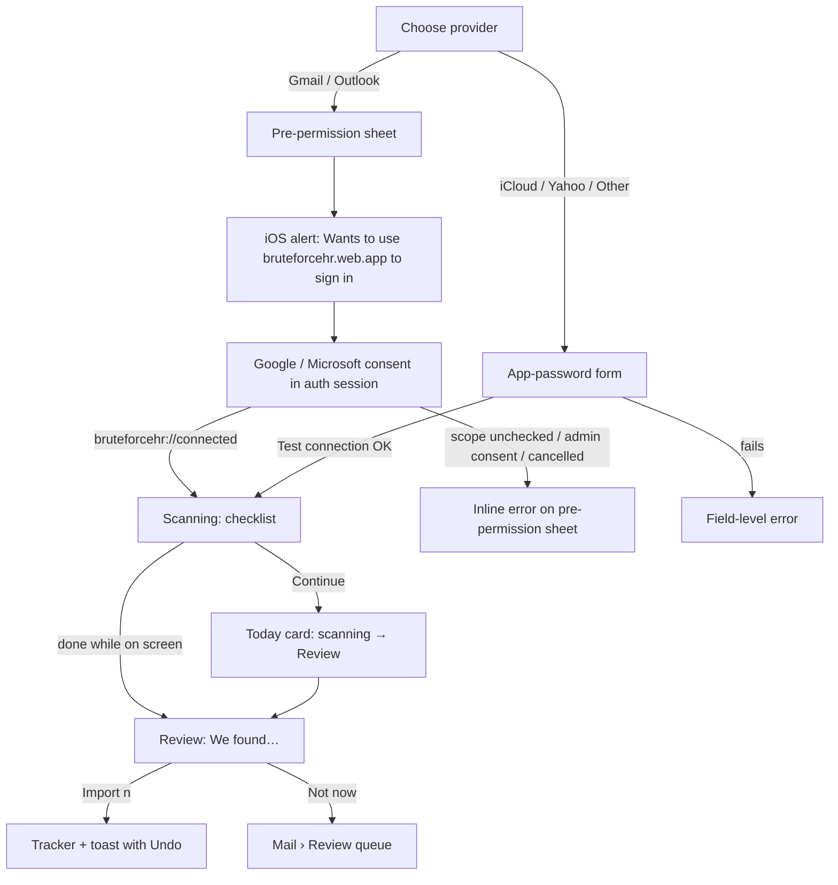

# Research: Connect email account, permissions and backfill

Status: research complete (M0). Feeds the IA, the flow diagrams, the tokens and the component inventory (brief §5.4). Critique rounds start once the screens are built (brief §5.5).

## Scope

Research matrix row (brief §5.3):

| Row | iOS | Desktop (`web`) |
|---|---|---|
| Connect email account / permissions | flow: connect account; permission request screen | same |

The covered surfaces:

- **Connect account flow.**
  - Gmail (Gmail API) and Outlook / Microsoft 365 (Graph, authority `common`) use an OAuth handoff. The client opens `https://bruteforcehr.web.app/connect/{google|microsoft}?nonce=…` in the system browser (on iOS, an `ASWebAuthenticationSession` via `expo-web-browser`). A Cloud Function runs authorization code + PKCE, stores the tokens encrypted server-side, and redirects to `bruteforcehr://connected` (brief §6.4, kickoff).
  - iCloud, Yahoo and custom domains use an **IMAP + app password form**. The credentials go over TLS once, get tested, and are then stored encrypted.
- **Permission request screen:** our own pre-permission screen, plus the provider consent screens we can't control but must prepare the user for.
- **Backfill result** (§4.2 step 4): scan the last 90 days (configurable), then show "We found 14 applications and 3 interview invites" for one-tap import with the correct status.
- **Entry points:** onboarding step 3/3 (see [`onboarding-signin.md`](./onboarding-signin.md)), the Mail tab empty state, and Settings › Mail accounts (connect, re-auth, disconnect + purge, brief §4.9).

**Acceptance (§4.2):** a new user with a CV and a Gmail or Outlook account reaches a populated tracker without typing application data by hand.

Every reference was judged from its screenshots. All Mobbin calls used `task_intent: "Design a cross-platform job search, CV builder and application tracker app"` and `output_destination: "code"`. The user's saved collections hold website sections only (kickoff), so none of them apply here.

## References — iOS

### Connect account flow (`search_flows` "connecting an email account", ios). Examined 6, kept 4

| App | Screen / flow | mobbin_url | What we borrow | Why |
|---|---|---|---|---|
| Shop | Connect to a Gmail account (3 screens) | https://mobbin.com/flows/3d1f4110-721a-44e8-b35d-be4c015a9e03 | A "+ Connect an account" row opens a sheet with provider rows (Gmail / Hotmail or Outlook, each "Connect account" with +). The pre-permission page shows a **logo pair** (Google ⋯ Shop), the title "Connect Gmail account", a 3-item promise list (what we track / what we scan / disconnect any time), and the primary **Continue to Google** | The closest match to our need: a consumer app that scans a mailbox for structured events. The promise list is the trust device we need |
| Fetch | Connecting an email (3 screens) | https://mobbin.com/flows/5e0d97b4-6f5b-47a1-beea-4b4de26317dc | A provider tile grid with a green ✓ on connected providers, the iOS system alert "… Wants to Use '…' to Sign In", and a success sheet "Your Gmail account is linked." with **Scan now** / **Scan later** | Shows the exact `ASWebAuthenticationSession` system alert our handoff triggers, plus a success state that hands off to scanning |
| Spark Mail | Adding an email account (11 screens) | https://mobbin.com/flows/0dd49192-7612-4b30-89e8-75489c02e39a | The generic "Log in" form shows only Email + Password, with server fields hidden behind **Advanced Settings**. After adding, it shows an account detail with name and notification settings | Progressive disclosure for IMAP: most users never need host and port |
| Microsoft Outlook | Adding another account (10 screens) | https://mobbin.com/flows/c3ece351-82b3-4f18-b88c-aa5366b1fd5d | One field "Enter your work or personal email" from which the provider is detected | We use domain detection to pre-select the provider and pre-fill IMAP presets |

### IMAP / app-password form (`search_screens` "IMAP email account settings form…", ios, deep, + "mail server settings screen", ios, standard). Examined 12, kept 4

| App | Screen / flow | mobbin_url | What we borrow | Why |
|---|---|---|---|---|
| Gmail | Add account → Set up email | https://mobbin.com/screens/3765b413-df30-4442-b086-b72bc64725e9 | A plain provider list with logos: Google · iCloud · Outlook, Hotmail, and Live · Office365 · Yahoo · Other (IMAP) | The canonical provider chooser on iOS. "Other (IMAP)" is the familiar label |
| Spark Mail | Adding account HUD | https://mobbin.com/screens/7e398e1b-a548-40e3-9b6d-5221494f3567 | An inline "Adding account" HUD with a spinner over the form while credentials are tested | The test-connection moment needs a visible, blocking but brief state |
| Matter | Connections | https://mobbin.com/screens/82646b07-aad4-48bd-8260-521e6372f4c9 | A "Connect Gmail — Connected" row with the caption "Recommended way to sync", followed by an alternative path explained in a caption | Tells the user which path is recommended (OAuth) and keeps the fallback path (IMAP) visible but secondary |
| Flighty | Add Flights via Email | https://mobbin.com/screens/d8e40e8e-933c-493a-a943-dcad6c75212f | A trust footer with a shield icon: "Flighty retains zero email data — only if necessary…", plus a per-address status line ("Check your inbox to verify") | A privacy statement anchored at the bottom of a mail-connection screen. A per-account status line under the address |

### Permission request screen (`search_screens` "permission request screen explaining access to email inbox", ios, deep). Examined 7, kept 4

| App | Screen / flow | mobbin_url | What we borrow | Why |
|---|---|---|---|---|
| Notion Mail | Connect Gmail address + system alert | https://mobbin.com/screens/57dd4258-fc95-4698-a16f-545fe03d8c83 | Our own pre-permission screen ("Connect Gmail address" + one-line value + **Continue with Gmail**), followed by the iOS system alert "… Wants to Use 'accounts.google.com' to Sign In" | Confirms the order: explain first, then the system alert, then the provider consent |
| Spark Mail | Google consent in the auth session | https://mobbin.com/screens/2b3a49b3-2f6b-48bb-bd47-8cc8d735dcda | What Google shows for mail scopes: "Read, compose, send and permanently delete all your email from Gmail", inside an in-app browser sheet | Shows the alarming provider wording our pre-permission copy must defuse ahead of time |
| Microsoft Outlook | Microsoft consent "Let this app access your info?" | https://mobbin.com/screens/fa68f0b1-ef31-40b0-8293-46ddb43e57c3 | The Microsoft consent layout: a permission list with icons, the item "Maintain access to data you have given it access to" (= `offline_access`), Accept / Deny | What Outlook users see. We pre-explain "keep access" as background sync every few minutes |
| Amie | "Amie wants additional access" | https://mobbin.com/screens/c92b85da-01ac-4edc-9d81-4d7daaaf4a88 | **Incremental consent**: a later, separate request for one more scope ("Read, compose, and send emails") with "Amie already has some access" | A model for asking for send permission only when the user first applies by email (see Open questions) |

### Backfill progress (`search_screens` "progress screen while scanning connected account data", ios, deep). Examined 6, kept 3

| App | Screen / flow | mobbin_url | What we borrow | Why |
|---|---|---|---|---|
| Origin | Fetching accounts | https://mobbin.com/screens/0a3297f4-b800-471a-a2bc-8236974a31ac | A sheet with a logo pair, the copy "Connecting to Chase Bank and syncing data. Hang tight.", and rotating stage pills (Loading balances → Fetching transactions → Updating spending data) | Named stages make a multi-minute wait feel like progress |
| Monarch | Sync checklist | https://mobbin.com/screens/33fc9bf6-cf4c-46f2-be9d-6373759dc721 | A vertical checklist where finished stages get ✓ and the current one is bold | A checklist is more accessible than rotating pills: VoiceOver can read all stages |
| Cleo AI | Connecting your debts | https://mobbin.com/screens/7bd61f30-7a54-48e3-b134-22bb48d64595 | A logo pair with ⇄ and "securely synced through…" | A short security reassurance during the wait |

### Backfill result (`search_screens` "import review screen listing items found to import with select all", ios, deep). Examined 7, kept 4

| App | Screen / flow | mobbin_url | What we borrow | Why |
|---|---|---|---|---|
| Brink | Import from screenshots | https://mobbin.com/screens/d26c1251-848d-4740-8b39-ac056cd08eda | The intro "We found 13 shows. Uncheck any that aren't right.", every row pre-checked with a trailing ✓, and a sticky CTA with a live count ("Follow 12 shows") | Exactly our "found N → confirm → one tap" pattern. The CTA count updates as the user unchecks |
| Phantom | Import Accounts | https://mobbin.com/screens/147fe7a3-d188-435a-8feb-23238c1c2363 | A success mark, "We found 1 account with activity", a "1 accounts selected · Select All" bar, Continue, and **Find more accounts** | A selection summary bar, plus "look further" as a secondary action (for us: scan further back) |
| Replika | New memories | https://mobbin.com/screens/931a8e94-79f0-43f3-9d6a-c7ba4886aeef | "Choose what you want to keep. You can edit all of the saved memories later.", items grouped under section headers, each with a check, and **Keep all** | Grouping proposals by category. Ours is the proposed status: Interviewing / Applied / … |
| Shopify | Products picker | https://mobbin.com/screens/ed6b106f-9dda-4134-a373-db57ec500b6c | A group row with a **mixed** checkbox and the caption "3 variants (2 selected)" | A group header checkbox with a mixed state for "select all in this status" |

## References — Desktop (`web`)

### Connect account flow (`search_flows` "connecting an email account", web, + Lightfield from the onboarding search). Examined 8, kept 5

| App | Screen / flow | mobbin_url | What we borrow | Why |
|---|---|---|---|---|
| Lightfield | Onboarding → Mail and Calendar sync | https://mobbin.com/flows/06e62a8e-b613-4921-8a07-fc22238ae7f4 | A sync configuration shown **before** OAuth: "Backsync range: 1 month" select, "Do not track (optional)" domains, then **Continue with Google** and **Skip for now** | The backfill window is chosen up front, inside onboarding, with a skip. This is our §4.2 step 4 |
| Pipedrive | Setting up an email (8 screens) | https://mobbin.com/flows/dc030d1f-f4e9-4ff8-9359-172197386f21 | The "Connect email account" modal: "Past sync start time: 3 days ago (Oct 31, 2025)" shows a relative choice **with the absolute date**, plus Back / Cancel / **Start sync** | Showing the absolute start date removes ambiguity about how far back we read |
| Front | Connecting an account (10 screens) | https://mobbin.com/flows/decff7f0-a83f-4e7b-8b4f-589f453d3779 | A settings page with a left vertical stepper (Account · Account type · Email address · Settings · Route to inbox), and a right explainer card "What's a channel?… won't impact your current workflows… can be disconnected anytime" | The desktop layout for a multi-step connect inside Settings. The side explainer answers "what happens to my mail?" without a modal |
| Salesforce | Connecting to Google (11 screens) | https://mobbin.com/flows/47480b8b-68f7-457c-a4ed-c8488e28b394 | A provider choice as two large tiles (Google / Microsoft) with Back / Next. The Google consent shows **granular checkboxes**. It ends on a connected-accounts list with **Disconnect** | Large provider tiles. Proof that Google lets users uncheck scopes (we must handle a partial grant) |
| ClickUp | Linking an email account (5 screens) | https://mobbin.com/flows/61f767d6-8391-4807-b194-b9dafb6a0a8d | Stacked sign-in options: Google · Microsoft/Office 365 · Outlook · **IMAP**. The success state "Email account is linked", and "+ Add new (1/2 accounts linked)" | IMAP sits beside OAuth as an equal option. The success state confirms the address |

### IMAP / app-password form (`search_screens` "IMAP email account settings form…", web, deep). Examined 7, kept 5

| App | Screen / flow | mobbin_url | What we borrow | Why |
|---|---|---|---|---|
| AirOps | Postgres connection form | https://mobbin.com/screens/22400a92-8cce-4fb3-bcea-d99a24b218f0 | A centered card: "Read our docs" helper at the top, then Host / Port / User / Password fields, **Connect**, "Struggling to connect? Chat with support", and the error toast "Couldn't connect to the provider" | A clean host/port/credential form with help placed before the fields, not after a failure |
| Apollo | Connect your email | https://mobbin.com/screens/8324fa51-0765-4eb5-82d3-1374bb5e67a1 | Provider cards with subtitles: Google "Gmail / GSuite", Outlook "Hotmail, Live, MSN", Other "Any provider, IMAP", plus **Skip for now** | Subtitles answer "is my Hotmail an Outlook account?" at the point of choice |
| Zoho CRM | IMAP Integration status | https://mobbin.com/screens/af2e3783-f284-4f8b-be98-dcc10c7ca2e1 | A connected-account summary: Protocol · Email · Configuration status "Working" · Sync status "Completed", a collapsed "Server details", **Log in again** / **Deactivate** | The account detail layout in Settings, with human-readable sync and health status |
| Notion Mail | Settings → Connected addresses | https://mobbin.com/screens/44f493c0-2bc2-4e16-b57d-731375424c82 | A "Connected addresses" list with a **Connect an address** row and per-address **Disconnect** in red | A compact Settings list for multiple accounts |
| Amie | Connect accounts | https://mobbin.com/screens/93d7121b-27d1-44c5-a25f-6a3f4640404c | "Connect accounts — You can add more later in Settings", the connected account row, and a "New account — Select permissions to connect" card with per-permission rows and descriptions | A plain-language description per permission, written in our words before the provider's words |

### Permission request screen (`search_screens` "permission request screen explaining access to email inbox", web, deep). Examined 7, kept 5

| App | Screen / flow | mobbin_url | What we borrow | Why |
|---|---|---|---|---|
| Rox | Allow Rox to read your customer communications | https://mobbin.com/screens/50d63bff-42a0-467c-89ba-bc27c0b242c9 | A pre-permission modal with sections (Read access / Write access), an **AI data disclosure** at the top naming the AI provider, and a "Restricted domains: emails containing these domains will not be processed" input | The only reference that discloses AI processing of mail before connect. We must do the same for Claude |
| Front | Connect channel → Email address | https://mobbin.com/screens/f69f291f-d4ae-4b7e-9f99-3c6445f7cc3f | An **in-app preview of the Google consent screen** with the "Select all" checkbox highlighted, then **Sign in with Google** and an "About two-way sync" info box | Prepares users for the provider screen and tells them which box must stay checked, which prevents partial grants |
| Twenty | Emails and Calendar | https://mobbin.com/screens/7baa94ef-814f-4789-b659-021455c5860e | A compact card with radio cards for privacy level, then **Sync with Google** / **Sync with Outlook** stacked, and a quiet **Continue without sync** | Two OAuth providers as equal buttons plus a guilt-free skip, all in one card |
| Juicebox | Google consent (granular) | https://mobbin.com/screens/2c05b0e6-e8b1-49f2-ba80-c4a0f41bc0b1 | Google's granular consent: "Select all", per-scope checkboxes ("View your email messages and settings"), Cancel / Continue | The exact screen our users will see. The design must survive any box being unchecked |
| Proton | Automatically forward emails + error | https://mobbin.com/screens/deab0e2a-7f3b-4b01-aece-552c277f6776 | The error toast after a partial grant: "Please grant Proton additional access to your Google Account" | The partial-grant failure state exists in the wild. We give it a clearer fix |

### Backfill progress (`search_screens` "sync in progress screen while scanning inbox", web, deep). Examined 6, kept 3

| App | Screen / flow | mobbin_url | What we borrow | Why |
|---|---|---|---|---|
| Skiff | Import in progress | https://mobbin.com/screens/7e1e433a-8963-41f6-842e-712b14971982 | A ring progress, "Import in progress — You can log out or close your browser without disrupting the import.", and a live counter "0 EMAILS IMPORTED" | Says the job runs server-side and the user is free to leave. That's true for us (Cloud Functions task queue) |
| Literal | Import running… | https://mobbin.com/screens/d42b996a-a56d-48a0-97da-76bec5b44a3b | "0 out of 0 books imported", "If you don't want to wait, feel free to come back later. We will let you know when it's finished.", and a source → destination logo pair | Calm, explicit permission to leave, plus a promise to notify |
| WhatsApp | Loading your chats | https://mobbin.com/screens/655f299b-7861-410a-b2fa-a71006653fc4 | A thin progress bar with a short label and a lock-icon trust line ("End-to-end encrypted") | A minimal progress bar with one trust line |

### Backfill result (`search_screens` "import review screen listing items found to import with select all", web, deep). Examined 7, kept 5

| App | Screen / flow | mobbin_url | What we borrow | Why |
|---|---|---|---|---|
| Cosmos | We found 2 boards | https://mobbin.com/screens/fc750b0c-7575-47e2-a438-fd352fbc6ee7 | A centered headline "We found 2 boards", one line of explanation, a primary CTA with the count **Import 2 boards**, "Deselect all", and pre-checked rows | The headline-first composition our "We found 14 applications…" needs |
| Xero | Review and complete import | https://mobbin.com/screens/f3d3aee0-dca1-4968-afc6-7394eb3465ba | A summary "✓ 20 transaction(s) are ready to import · Xero will check for duplicates", a checkbox table, and a sticky footer "20 transaction(s) will be imported · **Complete import**" with Back | Mentions duplicate handling up front (we dedupe against existing applications). A sticky footer with the live count |
| Workable | Import employees → Select employees | https://mobbin.com/screens/8c1dba37-aff1-49c3-836b-ce73d78cb593 | A left stepper, search, a checkbox list with a **per-row dropdown**, and a header CTA "Import 3 employees" | A per-row dropdown is our per-row **status picker**, so the user can correct the proposed status before import |
| QuickBooks | Review and confirm the leads you want to import | https://mobbin.com/screens/5a8e242e-8f7e-4ea6-b16e-bcd44a6b69cc | A warning banner "Some leads are missing some information…" and **unchecked by default** rows for incomplete items | Low-confidence proposals start unchecked with a reason instead of being silently imported |
| HoneyBook | Preview import | https://mobbin.com/screens/845d59ec-f88e-4fe1-acac-ae308822ab2d | An info bar "**10 Contacts** will be created.", "STEP 2 OF 2", **Import** | A one-line consequence summary above the table |

## Examined but rejected

| App | mobbin_url | Reason |
|---|---|---|
| Manus — Connecting to an app | https://mobbin.com/flows/0fe02bbc-ef80-499e-afa0-e14131e9e1c9 | A developer-style connector catalog with a metadata table ("Connector Type", "Author") and "Try it out". The wrong mental model for a job seeker |
| Gmail — Adding another account | https://mobbin.com/flows/edae4e13-ecbb-408b-b44e-a68aa910a63f | A first-party Google account switch. There is no third-party consent or value explanation to learn from |
| CRED — link account sheet | https://mobbin.com/screens/ec9c6a0a-7aac-4473-b1bc-8f88cf0089d3 | A lower-case provider list on a dark finance surface that splits Outlook / Live / Hotmail into separate rows. Confusing for one Microsoft path |
| Superlist — email forwarding | https://mobbin.com/screens/7d4e09c6-ca5d-4e07-b7e4-63c251ae4f7b | A forward-to-address model. We sync the mailbox, so it doesn't apply |
| Givingli — Display names | https://mobbin.com/screens/cab34aeb-871f-49ad-8528-5adccaff9742 | Unrelated (gift sender names) |
| Fabric — email-to-Fabric address | https://mobbin.com/screens/16b0afa2-a1ab-464f-a802-8196588df7ed | A forwarding address model, not a mailbox connection |
| Microsoft Outlook — Outlook.com account settings | https://mobbin.com/screens/196cff5e-ea02-4a50-ad3e-8ff03cc2e6e0 | Mail-client preferences (plan, storage, editor). No server or connection info |
| Shell — Email | https://mobbin.com/screens/fe4aacd6-bde8-4262-9362-88cda23a9a72 | Marketing email opt-ins. Unrelated |
| eBay — Automatic response | https://mobbin.com/screens/27d5c8a2-e0c3-44d4-a4e6-86d4b41a7bde | An out-of-office responder. Unrelated |
| Beside — Email Notifications | https://mobbin.com/screens/f0533deb-19d7-4b59-835c-d51d2765a11b | A notification destination setting. Unrelated |
| Patreon — OAuth consent | https://mobbin.com/screens/396beb90-e5bb-4dd7-8593-58eb673c369a | A generic profile and email-address consent. No mailbox access to learn from |
| Saily — Sign in with Google | https://mobbin.com/screens/314cad03-f133-49bf-b63a-e2a8f53b68de | A basic-profile sign-in consent, not mail scopes |
| BitePal — Sign in with Google | https://mobbin.com/screens/f8ca73a4-9e07-4b09-828e-b0fc99e06058 | Same as Saily |
| Toggl Track — syncing | https://mobbin.com/screens/d4b0116d-cb74-4b8a-b299-d32fa3b6d1b8 | A spinner plus a disabled "Syncing" button plus "could take a while". Blocks the user with no stages and no way out except Log Out |
| Zopa Bank — linking | https://mobbin.com/screens/3b100b8a-0909-456a-8b38-0fb2df8ebc9a | A spinner only. No stage, count, or permission to leave |
| Glassdoor — Syncing your latest profile info | https://mobbin.com/screens/0c8244fc-8519-4c08-9bce-6f0d3e4ceef2 | Large illustration with a one-line status. Decorative, and it gives no progress information |
| IKEA Home smart — transfer products | https://mobbin.com/screens/cf651d3c-ae8f-4a2b-9520-bb1acfcb9515 | An empty unchecked list with a disabled Done. Opt-in by default, which is the opposite of our pre-checked proposals |
| Klarna — "0 selected" | https://mobbin.com/screens/bd9745d3-b6ac-486f-8d95-9dad4de43a38 | A shopping picker that starts with nothing selected. No "found" framing |
| Squarespace — Import images | https://mobbin.com/screens/cb7fe89f-86db-465c-8703-b4b73946b8e7 | A photo grid with numbered selection. Media-specific |
| Notion Mail — Connecting an email address (flow) | https://mobbin.com/flows/64b7c897-7947-4288-8ee4-986ab28b3998 | Only an account switcher with "Connect another address". No consent or config step to study |
| ClickUp — Integrating an email account | https://mobbin.com/flows/188e00f2-dca7-4378-b483-a8901595f2e4 | Duplicate of the kept ClickUp flow (same screens, newer chrome). Its heavy brand-colored full-width buttons are also rejected |
| ClickUp — Email Integration screen | https://mobbin.com/screens/066eba12-b8bb-47a9-9ad5-29557d2ed03b | Same screen as the kept flow |
| Charma — Sync calendar popover | https://mobbin.com/flows/4ddf1a88-5026-45d5-a401-1b69b8b2ec50 | A connect prompt inside a tutorial popover with a mascot illustration. It interrupts and adds no explanation |
| Intercom — Add email address | https://mobbin.com/screens/237d5b0c-664c-4719-bd87-4557e85d8328 | Forwarding setup for a support desk. Not mailbox reading |
| Attio — Grant full access to this mailbox? | https://mobbin.com/screens/e5c58f38-7f1c-43b2-8236-f0b5d8f781a8 | Team-sharing risk confirmation where you type a long sentence. Hostile friction, and we are single-user |
| Gumloop — Gmail tools | https://mobbin.com/screens/e0701279-22b8-40f5-ae9e-89cc6a46cac4 | A developer tool list ("Trash Email", "Batch Update Emails"). Exposes capabilities in a way that alarms consumers |
| Cloaked — inbox skeleton | https://mobbin.com/screens/1cb15ef5-330d-4dfe-a3a8-fd8dddcbd500 | A generic skeleton loader, not a backfill progress pattern |
| Superhuman — loading | https://mobbin.com/screens/8a8c1ced-6072-4b7f-bff8-0a0aebd93074 | A spinner in a glowing box. No information |
| PandaDoc — Imported 0 of 4 files | https://mobbin.com/screens/6e7783c1-2ce2-4ba2-832d-bab89ec45f67 | "Keep this window open" is the opposite of our server-side backfill |
| Square — Review items | https://mobbin.com/screens/473cf217-f05b-434e-a27c-c25d9df16933 | A fully editable spreadsheet grid. Far denser than a confirm step needs |
| Copy.ai — Review & finalize | https://mobbin.com/screens/c4a1c609-c8af-475f-9cd2-3eb313530ea8 | A spreadsheet with "Fix using AI" and export. Data-wrangling UI with a hidden AI action, which breaks the "source + reason" trust rule |

## Decision — iOS

### Flow

### Screen A — Choose provider (onboarding step 3/3, Mail empty state, Settings › Mail accounts › Add)

- **Onboarding chrome** follows onboarding-signin.md (progress bar "Step 3 of 3", **Skip for now**).
- **Title** "Connect your email". **Body** "We look for application confirmations, interview invites and replies from employers, then suggest updates you confirm."
- **Provider rows** (Gmail list + Shop sheet; grouped inset, 60 pt rows, 28 pt provider logo, chevron):
  1. **Gmail** with the caption "Gmail and Google Workspace"
  2. **Outlook** with the caption "Outlook.com, Hotmail, Microsoft 365 (work or school)" (Apollo-style subtitles)
  3. **iCloud Mail** with the caption "Uses an app-specific password"
  4. **Yahoo Mail** with the caption "Uses an app password"
  5. **Other (IMAP)** with the caption "Any provider that supports IMAP"
- Rows 1–2 carry a quiet "Recommended" caption tag (Matter): OAuth is safer and needs no password.
- **Footer** (Flighty trust footer): a shield icon plus "Your mail stays private. We keep only job-related messages, and you can disconnect and delete everything anytime."
- **Connected state** (Fetch): when entered from Settings, already connected providers show the address and a ✓, and are excluded from "Add".

### Screen B — Pre-permission sheet (the "permission request screen")

Presented as a large-detent sheet (Shop, Notion Mail). One per OAuth provider.

- **Header:** a logo pair, BruteForceHR app mark ⋯ provider logo (Shop, Cleo). Title "Connect Gmail" (or "Connect Outlook").
- **Promise list** (Shop + Rox + Amie): 4 rows, each a 24 pt SF Symbol plus one sentence. Every sentence is truthful against brief §4.7:
  1. `magnifyingglass` "**Finds job emails.** We scan for messages from employers and job sites. Other emails are skipped, and we never store their content."
  2. `calendar` "**Looks back {90} days.**" with an inline **Change** link. It opens a menu of 30 / 90 / 180 days, and the row shows the absolute date, e.g. "since 24 Jul 2026" (Pipedrive).
  3. `sparkles` "**Sorted with AI.** Job emails are classified by Anthropic Claude so we can suggest tracker updates. Nothing changes without a clear reason you can see and undo."
  4. `xmark.circle` "**Disconnect anytime.** We revoke access and delete this account's mail data."
- **What you'll see next** (Front preview, as text on iOS): a secondary-background card. Text: "{Google} will ask what BruteForceHR can access. Keep **'View your email messages and settings'** checked, or we can't find your applications."
  - **Google, while the OAuth app is unverified** (kickoff), the card adds: "Google will say it hasn't verified this app. That's expected for this personal build: choose **Advanced**, then **Go to BruteForceHR**."
  - **Microsoft** variant: "Microsoft will ask you to allow access to your mail and to keep access (so we can check for new messages every few minutes)."
- **Primary:** **Continue to Google** / **Continue to Microsoft** (Shop). **Secondary:** **Cancel** (text button).
- Tapping Continue calls `WebBrowser.openAuthSessionAsync('https://bruteforcehr.web.app/connect/google?nonce=…', 'bruteforcehr://connected')`. iOS shows its system alert, which names the domain of that URL (Fetch, Notion Mail). The copy never promises "google.com" in that alert.
- **Error states** render inline at the top of the sheet. The sheet stays open, the primary becomes **Try again**, and VoiceOver announces the error:
  - **Scope unchecked** (Juicebox, Proton): "BruteForceHR didn't get permission to read your email. Try again and keep 'View your email messages and settings' checked."
  - **Cancelled** by the user: no error, the sheet just stays open.
  - **Microsoft admin consent required:** "Your organization needs to approve BruteForceHR before it can read this mailbox. Ask your IT admin, or connect a personal account instead."
  - **Network or server failure:** "We couldn't finish connecting. Nothing was saved. Try again in a moment."

### Screen C — App-password form (iCloud, Yahoo, Other IMAP)

Pushed in the same sheet (Spark's progressive form + AirOps's help-first layout).

- **Help first** (AirOps "Read our docs"), only for iCloud and Yahoo. A numbered 3-step card, "Create an app password", with an external-link button to the provider's account security page. "Other" shows a one-line note instead: "Ask your provider for IMAP settings and an app password."
- **Fields:**
  - **Email address** (pre-filled when coming from domain detection, Outlook iOS).
  - **App password** (secure, `textContentType="password"`, with a show/hide toggle). Its caption: "Not your regular password. {iCloud} app passwords look like xxxx-xxxx-xxxx-xxxx."
- **Server settings**, a disclosure row collapsed by default (Spark "Advanced Settings"):
  - IMAP: host, port, security (SSL/TLS · STARTTLS).
  - SMTP: host, port, security.
  - Username (defaults to the email address).
  - For iCloud and Yahoo these fields are pre-filled from presets and stay collapsed. For **Other**, the section is expanded and port defaults are 993 / 587.
- **Trust line** (brief §6.4) under the button: lock icon plus "Sent once over an encrypted connection, tested, then stored encrypted. We never show it again."
- **Primary:** **Connect**. Pressing it shows the HUD "Testing connection…" (Spark) over the form. The fields are disabled, and the HUD can be cancelled after 10 s.
- **Field-level errors** (what happened + how to fix):
  - Authentication failed, marked on the password field: "We couldn't sign in with this app password. Check it was copied in full. Your regular password won't work here."
  - Host unreachable, marked on the IMAP host: "Can't reach {host} on port {port}. Check the server name and port."
  - TLS error: "The server's security certificate couldn't be verified. Check the security setting or ask your provider."
  - SMTP failure while IMAP is OK: the account still connects for reading. An inline warning reads: "Connected for reading. Sending from this account needs working SMTP settings." It offers **Fix now** and **Later**.

### Screen D — Scanning (backfill progress)

Shown after a successful connect, as a full-screen state in onboarding or a sheet from Settings.

- **Header:** a logo pair (provider → BruteForceHR) with ⇄ (Cleo), then "Connected to **{address}**" with a ✓.
- **Stage checklist** (Monarch; Origin's named stages). Done stages show ✓, the current stage shows a spinner, pending stages are dimmed:
  1. "Checking the last 90 days" with the live caption "{scanned} emails checked"
  2. "Finding job-related emails"
  3. "Matching companies and roles"
  4. "Preparing your review"
- **Permission to leave** (Skiff, Literal): "This can take a few minutes. You can keep going, and we'll let you know when it's ready." **Continue** is primary. The backfill runs in a Cloud Functions task queue, and progress arrives through the `mailAccounts/{id}` snapshot listener.
- If the scan completes while the screen is visible, it **auto-advances** to the Review screen with a 300 ms crossfade (Reduce Motion: instant).
- After Continue, a **Today card** shows the same checklist in compact form. When the scan finishes, the card becomes "We found 14 applications and 3 interview invites · **Review**". If the user has granted push permission, a notification carries the same text.
- **Failure:** "We couldn't finish scanning {address}. Your account is connected, and we'll keep checking new mail." It offers **Try the scan again**.

### Screen E — Backfill review ("We found…")

Full-screen, pushed. It is also reachable from the Today card and from Mail › Review.

- **Headline** (Cosmos, Brink): "We found 14 applications and 3 interview invites". Large title style, wraps up to 3 lines, ICU plurals. When invites = 0, that clause is dropped. **Subline:** "From the last 90 days in {address}. Uncheck anything that isn't right."
- **Selection bar** (Phantom): "{n} selected · **Select all** / **Deselect all**". It sticks under the nav bar on scroll.
- **Groups** (Replika, Shopify) by **proposed status**, in pipeline order: Offer · Interviewing · Screening · Applied · then the Rejected group. The Rejected group header uses the calm label "Not moving forward"; the status pill uses the Tracker's display label. Each group header has a **mixed-state checkbox** plus a count.
- **Row** (two lines, 64 pt min): company avatar (logo, or an initial on a tinted circle) · **Role** · Company / status pill · evidence line "Interview invite · 12 Oct" with a mail icon (the "source" of the trust rule). Trailing: a checkbox.
- **Default checked** = high-confidence proposals. **Unchecked** with a "Needs a look" caption tag and an amber dot = low confidence or a weak link (QuickBooks).
- **Already tracked:** "Already in Tracker · will update to Interviewing".
- **Row tap** opens a medium-detent **detail sheet** (Workable per-row dropdown, adapted):
  - The source email(s): sender, subject, date, a two-line snippet.
  - **Why we think this** in one sentence, e.g. "An interview invite from greenhouse.io mentions 'Product Designer' at Acme".
  - A **Status** picker to correct the proposal.
  - A **Not a job application** button that removes the row.
- **Footer** (Brink, Xero): a sticky bar with **Import 14 applications** (the count is live; disabled at 0) and a text button **Not now**. Not now keeps every proposal in Mail › Review, and nothing is lost.
- **Secondary info** at the end of the list (footnotes, only when the count > 0):
  - "We also found {n} job alert emails. New postings from them will appear in Jobs."
  - "{n} other job-related emails are waiting in Mail › Review."
- **After import:** we pop to the **Tracker** with the imported cards highlighted for 2 s. A toast reads "14 applications added to Tracker", with **Undo** for 10 s (the kickoff trust rule: source + reason + Undo). Each imported card carries a "From email" source tag that links to its evidence.
- **Empty result:** "No job applications found in the last 90 days." Body: "New ones will appear here as they arrive." Actions: **Scan the last 180 days** (Phantom "Find more accounts"), **Add an application** (manual), **Go to Today**.

### Settings › Mail accounts (iOS)

- A grouped list of accounts (Notion Mail, Flighty): provider logo · address · status line ("Up to date · checked 3 min ago" / "Scanning · 1,240 checked" / "Needs reconnect" in amber / "Can't connect" in red).
- A last row "**Add email account**" goes to Screen A.
- **Account detail** (Zoho): status, lookback window, "Includes Spam/Junk" (an info line, not a toggle; ATS mail often lands there, brief §4.7), last error in plain words, **Reconnect** (re-runs Screen B or C), and **Disconnect…** (destructive).
- **Disconnect confirmation** (action sheet):
  - Title: "Disconnect {address}?"
  - Message: "We'll revoke access and delete the {n} emails we stored from this account. Your applications stay in your Tracker."
  - Buttons: **Disconnect and delete** (destructive) / **Keep connected**.

## Decision — Desktop (macOS + Windows)

### Onboarding step 3/3 and Settings › Mail accounts › Add

- **Layout:** inside the onboarding wizard (onboarding-signin.md), a 560 px main column plus a 280 px side explainer card on the right (Front "What's a channel?"). That totals 864 px, which fits the 960 px minimum window.
  - The side card, "What we read": the 4 promises from iOS Screen B in compact form plus a "Privacy Policy" link.
  - Below 900 px of content width, the side card moves below the main column.
- **Provider cards** (Apollo + Salesforce tiles): three cards in a row, 176×96 px. Logo plus name plus subtitle:
  - **Google**: "Gmail, Google Workspace"
  - **Microsoft**: "Outlook.com, Hotmail, Microsoft 365"
  - **Other**: "iCloud, Yahoo, any IMAP"
  - The cards form one radio group: arrow keys move between them and Space selects. **Skip for now** sits as a ghost button in the footer (Twenty "Continue without sync", Lightfield).
- **On select, the config panel expands below the cards** (Lightfield's pre-OAuth config, Pipedrive's start date):
  - **Look back:** a Select with "30 days / 90 days / 180 days" and the absolute date shown after it: "90 days (since 24 Jul 2026)".
  - **What you'll see next:** the same expectation copy as iOS, with an **annotated mini-illustration** of the consent checkbox list in which the mail row is highlighted (Front). Draw it as our own simplified vector. Never use a provider screenshot.
  - The unverified-app note (Google) and the keep-access note (Microsoft) are the same as iOS.
  - **Primary:** **Continue to Google** / **Continue to Microsoft**. For **Other**, the primary is **Set up IMAP**, which opens the IMAP form.

### Browser handoff waiting state (desktop-only)

The OAuth runs in the **system browser** (brief §6.4). The app shows a waiting state in place of the config panel:

- **Title** "Finish in your browser". **Body** "We opened Google in your browser. Sign in and allow access, then come back here."
- A spinner with "Waiting for Google…". **Open browser again** (re-opens the same URL) and **Cancel**.
- The state **completes automatically** on either signal: the `bruteforcehr://connected` deep link (Electron protocol handler; on macOS the `open-url` event, on Windows the second-instance argv) brings the window to the front, or the `mailAccounts` snapshot shows the new account. Either way the app advances to Scanning. On return, it calls `app.focus` / `win.show()` so the user lands back in context.
- **After 10 minutes with no result:** "Still waiting? If you closed the browser tab, open it again." with the same buttons.
- **Errors:** the same set as iOS (scope unchecked, admin consent, failure), rendered inline in the panel.

### IMAP form (desktop)

- A centered **dialog** (Radix Dialog, 480 px), not a new page (AirOps card).
- **Top:** a provider Select (iCloud / Yahoo / Other), pre-filled by domain detection when an email was typed, plus a "How to create an app password ↗" link and the 3-step help for iCloud and Yahoo.
- **Fields:** the same as iOS. "Server settings" is a disclosure with a two-column grid (IMAP left, SMTP right: host / port / security). Port inputs are numeric.
- **Footer:**
  - Left: "Struggling to connect? **Read the setup guide**" (AirOps).
  - Right: **Cancel** / **Test and connect**. The button shows an inline spinner with "Testing connection…", and the form is disabled.
  - Errors appear inline per field (same copy as iOS), plus a summary `role="alert"` above the footer.
- **Keyboard:** `Enter` submits, `Esc` cancels (with a confirm prompt only when fields are dirty).

### Scanning (desktop)

- **Inline in the wizard or in the Settings account panel** (Skiff, Literal): the provider → app logo pair, then the 4-stage checklist (same as iOS) with the live counter "{scanned} emails checked · {found} applications found so far". A thin progress bar appears only when the backend reports a total; otherwise the bar is indeterminate (WhatsApp).
- "You can keep going. We'll let you know when it's ready." **Continue** finishes onboarding.
- **Sidebar:** while scanning, the **Mail** item shows a small progress ring. When the scan is done it shows a count badge, and a native OS notification (Electron `Notification`) says "Your inbox scan is done: 14 applications found".

### Backfill review (desktop)

- **A full content-area view** (not a modal), opened from the notification, the Today card or Mail. It is a **split view**: a list or table on the left (~60 %) and an evidence pane on the right (~40 %).
- **Header** (Cosmos, HoneyBook): the headline "We found 14 applications and 3 interview invites", then the subline "From the last 90 days in {address}. Uncheck anything that isn't right." Below it, an info bar "Already-tracked applications will be updated, not duplicated." (Xero duplicate note).
- **Table** (Xero, Workable), grouped by proposed status with collapsible group headers that have mixed checkboxes. Columns:
  - ☐
  - Company (avatar + name)
  - Role
  - **Status**: a per-row Select (Workable) showing the proposed status. Changing it marks the row as edited.
  - Evidence: latest email subject, truncated, with date
  - Account: a source account icon, shown when more than one account is connected
  - Low-confidence rows are unchecked by default with an amber "Needs a look" tag (QuickBooks).
- **Evidence pane** for the focused row: the source email(s) with sender, subject, date and snippet, **Open in {Gmail/Outlook} ↗**, the one-sentence **Why we think this**, and **Not a job application**.
- **Keyboard:** `↑/↓` move focus · `Space` toggles the checkbox · `S` opens the status Select · `⌘A`/`Ctrl+A` selects all · `⌘↩`/`Ctrl+Enter` imports · `Esc` = Not now. Shortcuts are listed in the ⌘K palette.
- **Sticky footer** (Xero): "{n} applications will be added to Tracker" on the left, **Not now** + **Import {n} applications** on the right.
- **After import:** we navigate to the Tracker board with the new cards highlighted, and show a toast "14 applications added to Tracker · **Undo**" (10 s).
- **Empty state:** the same copy and actions as iOS.

### Settings › Mail accounts (desktop)

- A list in the Settings content pane (Notion Mail, Salesforce): one row per account with the provider logo · address · status pill (Up to date / Scanning / Needs reconnect / Can't connect) · "Last checked 3 min ago" · a row menu (Reconnect · Change lookback · Disconnect…). The header button is **Add email account**.
- **Account detail** (Zoho layout): status rows (Connection: Working · Last check · Lookback · Messages checked · Spam/Junk included), a collapsed "Server details" for IMAP, **Reconnect**, and **Disconnect…**.
- **Disconnect** opens an AlertDialog with the same copy as iOS. The destructive button is focused last, so `Enter` doesn't disconnect by accident: the default focus is **Keep connected**.

## M5 desktop supplement (connect dialog)

M5 ships the connect flow as one dialog (`features/mail-connect`), opened from Settings › Mail accounts, the Mail empty state and Today. Two patterns weren't covered above: a picker with **eight** providers instead of three cards, and an OAuth provider that the server reports as **not configured yet** (`provider_not_configured`, the state until the Google and Microsoft clients exist).

### Provider picker with many providers (`search_screens` "choose email provider dialog with tiles…", web, deep). Examined 6, kept 4

| App | Screen / flow | mobbin_url | What we borrow | Why |
|---|---|---|---|---|
| Bonsai | "Choose a calendar to connect" modal | https://mobbin.com/screens/d6af147e-1724-44bb-9dfa-92ae7cd4cc03 | Two-column tiles inside the modal, the selected tile outlined in the accent | Selection is visible before anything happens, which suits a radio group with a Continue button |
| AirOps | "Select Provider" modal | https://mobbin.com/screens/8de10216-4974-4560-bcf5-b362c58bbf7e | Two-column list of logo + name rows in a centered dialog | Scales past six providers without a search field |
| HubSpot | "Choose a network to connect" modal | https://mobbin.com/screens/51adab82-477b-4392-b677-1e7e6388138d | Compact two-column tiles, one short line each | Keeps eight providers in four rows at 1280×800 |
| Dovetail | "Connect data source" modal | https://mobbin.com/screens/b431e8ce-c71b-406e-bd05-311e36d8bf5c | A quiet tag on the tile ("Beta") rather than hiding the option | Our captions ("Sign in with Google", "App password") say how each one connects |

Rejected: QuickBooks (https://mobbin.com/screens/8d03be83-7796-42ab-b046-a8a8bc382960, a search field is overkill for eight providers) and Mailchimp (https://mobbin.com/screens/3ca31f88-2f66-48bc-ac1e-27aec31835b6, a full page instead of a dialog).

### Integration not available yet (`search_screens` "coming soon notice for an integration that is not available yet, with an alternative option", web, deep). Examined 6, kept 4

| App | Screen / flow | mobbin_url | What we borrow | Why |
|---|---|---|---|---|
| Flodesk | "Checkout is coming to you soon" dialog | https://mobbin.com/screens/d36658ba-86b8-4caf-817e-d2aa42e113bf | A neutral dialog state, plain words, no error color | Not available isn't the user's fault |
| Ditto | Integrations "Coming Soon" section | https://mobbin.com/screens/79726a54-90cf-4c3c-ae1e-dc289ebb6b02 | Says why it's waiting and what happens next | Sets the expectation instead of a dead end |
| TheyDo | Integrations list with "Coming soon" buttons | https://mobbin.com/screens/f598f6b4-e64e-450e-a1c3-fcf88232b9dd | The unavailable option stays listed next to working ones | People still find it where they expect it |
| Qatalog | "Add a step" list with "Coming soon!" suffixes | https://mobbin.com/screens/f71ba16e-f3aa-45f8-a6fc-26b3386c43cb | Status lives next to the option, not in a separate page | Short and scannable |

Rejected: Lovable (https://mobbin.com/screens/38216649-f70b-47e7-9e7d-42f636473929) and Linktree (https://mobbin.com/screens/0542639b-c8bf-4033-9f3f-61c505e3908b): both are "request an integration" forms, which we don't need.

### Decision (M5 desktop)

- **One dialog, 760 px**, with a main column and a 248 px side column (stacked below 760 px): picker → OAuth expectation / waiting, or the app-password form → scanning. The side column holds the four promises on the picker and OAuth steps and the provider's three app-password steps on the form (AirOps help-first).
- **Picker:** an optional email field (domain detection selects the tile), eight tiles in two columns as one radio group (arrow keys move and select, Enter continues), each with name + how it connects: Gmail "Sign in with Google", Outlook "Sign in with Microsoft", iCloud Mail, Yahoo Mail, Yandex Mail, GMX, WEB.DE "App password", Other "IMAP server and app password". Look back 30 / 90 / 180 days with the absolute date. Tiles carry no "Recommended" or "Coming soon" tag: whether sign-in works is only known from the server, and a tag that's wrong after an update is worse than none.
- **Sign-in not available yet** (`provider_not_configured`): the Flodesk-style neutral state inside the dialog (clock icon, no red): "Gmail sign-in is coming in an update". Gmail offers the working alternative right there, **Use an app password instead**, with Google's two prerequisites (2-Step Verification, then an app password). Outlook says plainly that Microsoft no longer accepts app passwords for Outlook.com, so it waits for the update, and offers **Choose another account**. Reconnecting an existing Gmail or Outlook account shows the same state without the alternative (an app password would add a second account).
- **Offline** before any call: an info line "Connecting needs an internet connection", the primary stays enabled so the attempt explains itself.

## Components needed

| Component | iOS | Desktop | Notes |
|---|---|---|---|
| `ProviderOptionRow` / `ProviderCard` | row | card (radio group) | Logo, name, subtitle, "Recommended" tag, connected ✓ state |
| `LogoPair` | ✓ | ✓ | App mark + provider logo with ⋯ / ⇄ connector |
| `PromiseList` / `PromiseItem` | ✓ | ✓ (side card) | Icon + bold lead + sentence. Reused for the CV AI disclosure |
| `LookbackPicker` | menu | Select | 30 / 90 / 180 days + absolute date |
| `ConsentExpectationCard` | text card | text + vector illustration | Provider variants, unverified-app note |
| `BrowserHandoffWaiting` | — | ✓ | Waiting, timeout and error states. Listens for the deep link and the snapshot |
| `AppPasswordForm` | ✓ | dialog | Presets, help steps, secure field, `ServerSettingsDisclosure`, field errors |
| `ConnectionTestHud` | HUD | inline button spinner | Cancellable after 10 s |
| `ScanProgressChecklist` | full + compact (Today card) | inline + sidebar ring | Stages, live counters, determinate or indeterminate |
| `ImportReviewHeader` | ✓ | ✓ | ICU-plural headline, subline, duplicate-note bar |
| `SelectionSummaryBar` | ✓ | footer | Count, select all / deselect all |
| `ReviewGroupHeader` | ✓ | ✓ | Status name, count, mixed checkbox, collapsible on desktop |
| `ProposalRow` / `ProposalTableRow` | row | table row | Avatar, role, company, `StatusPill`/`StatusSelect`, evidence line, confidence tag, already-tracked state |
| `EvidencePanel` | sheet | side pane | Source emails, "Why we think this", open in provider, not-a-job action |
| `StatusPill` / `StatusSelect` | ✓ | ✓ | Shared with Tracker; labels from the Tracker research |
| `ConfidenceTag` | ✓ | ✓ | "Needs a look" (amber dot + text, never color alone) |
| `StickyActionFooter` | ✓ | ✓ | Live count in the primary label |
| `Toast` with Undo | ✓ | ✓ | Shared app-wide |
| `AccountStatusRow` | ✓ | ✓ | Status line/pill, last checked |
| `DestructiveConfirm` | action sheet | AlertDialog | Default focus on the safe action |
| `InlineErrorBanner` | ✓ | ✓ | What happened + how to fix + retry |

## Copy notes

Tone: calm and specific. We never say "all your email". We say what we look for and what we skip. No "unlock", no exclamation marks. Rejections are framed as "Not moving forward". German uses **du** and Turkish uses **sen** (pending the decision in onboarding-signin.md). Expansion budget: **German ≈ +35 %, Turkish ≈ +25 %**. The review headline and the import button must wrap rather than truncate; on iOS the footer button may grow to two lines.

| Key | EN | TR | DE |
|---|---|---|---|
| connect.title | Connect your email | E-postanı bağla | Verbinde dein E-Mail-Konto |
| connect.body | We look for application confirmations, interview invites and replies from employers, then suggest updates you confirm. | Başvuru onaylarını, mülakat davetlerini ve işverenlerden gelen yanıtları buluruz; senin onaylayacağın güncellemeler öneririz. | Wir suchen nach Bewerbungsbestätigungen, Interview-Einladungen und Antworten von Arbeitgebern und schlagen dir Updates vor, die du bestätigst. |
| connect.recommended | Recommended | Önerilen | Empfohlen |
| perm.title | Connect {provider} | {provider} hesabını bağla | {provider} verbinden |
| perm.find | Finds job emails. We scan for messages from employers and job sites. Other emails are skipped, and we never store their content. | İş e-postalarını bulur. İşverenlerden ve iş sitelerinden gelen iletileri tararız. Diğer e-postaları atlarız ve içeriklerini asla saklamayız. | Findet Job-E-Mails. Wir suchen nach Nachrichten von Arbeitgebern und Jobportalen. Andere E-Mails überspringen wir und speichern nie ihren Inhalt. |
| perm.lookback | Looks back {days} days (since {date}). | Son {days} güne bakar ({date} tarihinden beri). | Schaut {days} Tage zurück (seit {date}). |
| perm.ai | Sorted with AI. Job emails are classified by Anthropic Claude so we can suggest tracker updates. Nothing changes without a clear reason you can see and undo. | Yapay zekâ ile sınıflandırılır. İş e-postaları, takip güncellemeleri önerebilmemiz için Anthropic Claude ile sınıflandırılır. Görebileceğin ve geri alabileceğin bir neden olmadan hiçbir şey değişmez. | Mit KI sortiert. Job-E-Mails werden von Anthropic Claude eingeordnet, damit wir Tracker-Updates vorschlagen können. Nichts ändert sich ohne einen Grund, den du siehst und rückgängig machen kannst. |
| perm.disconnect | Disconnect anytime. We revoke access and delete this account's mail data. | İstediğin zaman bağlantıyı kes. Erişimi iptal eder, bu hesabın e-posta verilerini sileriz. | Jederzeit trennen. Wir widerrufen den Zugriff und löschen die E-Mail-Daten dieses Kontos. |
| perm.keepChecked | {provider} will ask what BruteForceHR can access. Keep "{scopeLabel}" checked, or we can't find your applications. | {provider}, BruteForceHR'ın nelere erişebileceğini soracak. "{scopeLabel}" seçeneğini işaretli bırak; yoksa başvurularını bulamayız. | {provider} fragt, worauf BruteForceHR zugreifen darf. Lass „{scopeLabel}“ angehakt, sonst finden wir deine Bewerbungen nicht. |
| perm.unverified | Google will say it hasn't verified this app. That's expected for this personal build: choose Advanced, then Go to BruteForceHR. | Google bu uygulamayı doğrulamadığını söyleyecek. Bu kişisel sürüm için bu beklenen bir durum: Gelişmiş'i, ardından BruteForceHR'a git'i seç. | Google wird sagen, dass diese App nicht überprüft wurde. Das ist bei diesem persönlichen Build normal: Wähle „Erweitert“ und dann „Weiter zu BruteForceHR“. |
| perm.cta | Continue to {provider} | {provider} ile devam et | Weiter zu {provider} |
| perm.errScope | BruteForceHR didn't get permission to read your email. Try again and keep "{scopeLabel}" checked. | BruteForceHR e-postanı okuma izni alamadı. Tekrar dene ve "{scopeLabel}" seçeneğini işaretli bırak. | BruteForceHR hat keine Berechtigung erhalten, deine E-Mails zu lesen. Versuch es noch einmal und lass „{scopeLabel}“ angehakt. |
| perm.errAdmin | Your organization needs to approve BruteForceHR before it can read this mailbox. Ask your IT admin, or connect a personal account instead. | Bu posta kutusunu okuyabilmesi için kuruluşunun BruteForceHR'ı onaylaması gerekiyor. BT yöneticine sor ya da kişisel bir hesap bağla. | Deine Organisation muss BruteForceHR freigeben, bevor es dieses Postfach lesen kann. Frag deine IT oder verbinde stattdessen ein privates Konto. |
| desk.waitTitle | Finish in your browser | Tarayıcında tamamla | Im Browser abschließen |
| desk.waitBody | We opened {provider} in your browser. Sign in and allow access, then come back here. | {provider} sayfasını tarayıcında açtık. Giriş yap ve erişime izin ver, sonra buraya dön. | Wir haben {provider} in deinem Browser geöffnet. Melde dich an, erlaube den Zugriff und komm dann hierher zurück. |
| imap.passwordHelp | Not your regular password. {provider} app passwords look like {pattern}. | Normal şifren değil. {provider} uygulama şifreleri {pattern} biçimindedir. | Nicht dein normales Passwort. App-Passwörter von {provider} sehen so aus: {pattern}. |
| imap.trust | Sent once over an encrypted connection, tested, then stored encrypted. We never show it again. | Şifreli bir bağlantıyla bir kez gönderilir, test edilir, sonra şifrelenerek saklanır. Bir daha asla gösterilmez. | Einmal verschlüsselt übertragen, getestet und dann verschlüsselt gespeichert. Wir zeigen es nie wieder an. |
| imap.errAuth | We couldn't sign in with this app password. Check it was copied in full. Your regular password won't work here. | Bu uygulama şifresiyle giriş yapamadık. Tamamen kopyalandığından emin ol. Normal şifren burada çalışmaz. | Mit diesem App-Passwort konnten wir uns nicht anmelden. Prüfe, ob es vollständig kopiert wurde. Dein normales Passwort funktioniert hier nicht. |
| imap.errHost | Can't reach {host} on port {port}. Check the server name and port. | {host} sunucusuna {port} portundan ulaşılamıyor. Sunucu adını ve portu kontrol et. | {host} ist über Port {port} nicht erreichbar. Prüfe Servername und Port. |
| scan.leave | This can take a few minutes. You can keep going, and we'll let you know when it's ready. | Bu birkaç dakika sürebilir. Devam edebilirsin; hazır olunca sana haber veririz. | Das kann ein paar Minuten dauern. Du kannst weitermachen, wir sagen dir Bescheid, wenn es fertig ist. |
| scan.checked | {count, plural, one {# email checked} other {# emails checked}} | {count} e-posta kontrol edildi | {count, plural, one {# E-Mail geprüft} other {# E-Mails geprüft}} |
| review.headline | We found {apps, plural, one {# application} other {# applications}}{invites, plural, =0 {} one { and # interview invite} other { and # interview invites}} | {apps} başvuru{invites, plural, =0 {} other { ve # mülakat daveti}} bulduk | Wir haben {apps, plural, one {# Bewerbung} other {# Bewerbungen}}{invites, plural, =0 {} one { und # Interview-Einladung} other { und # Interview-Einladungen}} gefunden |
| review.sub | From the last {days} days in {address}. Uncheck anything that isn't right. | {address} hesabındaki son {days} günden. Doğru olmayanların işaretini kaldır. | Aus den letzten {days} Tagen in {address}. Entferne den Haken bei allem, was nicht stimmt. |
| review.needsLook | Needs a look | Kontrol et | Bitte prüfen |
| review.notMoving | Not moving forward | İlerlemeyenler | Nicht weiter im Prozess |
| review.cta | Import {n, plural, one {# application} other {# applications}} | {n} başvuruyu içe aktar | {n, plural, one {# Bewerbung} other {# Bewerbungen}} importieren |
| review.notNow | Not now | Şimdi değil | Nicht jetzt |
| review.toast | {n, plural, one {# application} other {# applications}} added to Tracker | {n} başvuru Takip'e eklendi | {n, plural, one {# Bewerbung} other {# Bewerbungen}} zum Tracker hinzugefügt |
| review.empty | No job applications found in the last {days} days. | Son {days} günde iş başvurusu bulunamadı. | In den letzten {days} Tagen wurden keine Bewerbungen gefunden. |
| disc.title | Disconnect {address}? | {address} bağlantısı kesilsin mi? | {address} trennen? |
| disc.body | We'll revoke access and delete the {n} emails we stored from this account. Your applications stay in your Tracker. | Erişimi iptal edip bu hesaptan sakladığımız {n} e-postayı sileceğiz. Başvuruların Takip'te kalır. | Wir widerrufen den Zugriff und löschen die {n} E-Mails, die wir aus diesem Konto gespeichert haben. Deine Bewerbungen bleiben im Tracker. |
| disc.confirm | Disconnect and delete | Bağlantıyı kes ve sil | Trennen und löschen |
| disc.cancel | Keep connected | Bağlı kalsın | Verbunden lassen |

Notes for translators:
- `{scopeLabel}` must be the provider's **exact on-screen label in the user's UI language** (Google localizes its consent screen). Keep these as a lookup table per provider and locale, not free translation.
- The German headline at its maximum ("… 14 Bewerbungen und 3 Interview-Einladungen gefunden") runs about 60 characters and wraps to 3 lines at the iOS Large Title size on iPhone 17e. Fall back to the Title 1 style when the headline exceeds 2 lines.

## Open questions

1. **Read scope now, send scope later (incremental consent).** The design assumes the connect flow asks only for read access (Gmail read-only; Graph `Mail.Read` + `offline_access` + `User.Read`), and that we ask for send access (Gmail send / Graph `Mail.Send`) the first time the user applies by email, as in Amie. This makes the first consent screen far less alarming. Brief §3 lists `Mail.Send` among the Graph scopes, so this needs an ADR decision (BackendFirebase / DocsAdrPrd). If both are requested at once, Screen B adds a fifth promise: "**Sends only what you send.** We send an application only when you press Send."
2. **Backfill progress contract.** The UI needs live fields on `users/{uid}/mailAccounts/{id}`: `status` (connecting · backfilling · active · needsReauth · error), `backfill.{windowDays, since, scanned, total?, candidates, stage, finishedAt}`, `lastCheckedAt`, `lastError.code`. We also need to decide where proposals live: a `backfillProposals` subcollection, or review fields on `mailMessages` grouped per proposed application. Owners: CoreDomain + BackendFirebase.
3. **Default-checked threshold.** The proposal is to pre-check rows whose link is strong (thread/ATS + company + role match) **and** whose confidence is ≥ 0.9, mirroring the auto-apply rule in §4.7. Everything else starts unchecked with "Needs a look". Validate against the mail-intel eval set in M5.
4. **Lookback options.** The brief fixes the default (90 days, configurable). Should the menu include 365 days? Gmail and Graph cost grows with the window, and so does Claude usage under the user's per-day cost cap.
5. **Exclude senders/domains** (Lightfield "Do not track", Rox "Restricted domains"). This is valuable for people job-hunting while employed, e.g. excluding their current employer's domain. It's not in the brief, so it's not in the v1 design. Decide whether it goes into the PRD.
6. **Unverified Google app.** With restricted Gmail scopes in an unverified "In production" app, Google shows the unverified-app warning, and usage is capped (Google documents a 100-user limit for unverified apps). The `perm.unverified` copy is shown only while that's true. Confirm the exact current warning text and button labels before shipping. [INFERENCE: the labels "Advanced" / "Go to {app}" match Google's current flow, but verify on the live screen]
7. **ASWebAuthenticationSession alert domain.** We expect the iOS alert to name `bruteforcehr.web.app` (the URL we open), not `accounts.google.com`. Verify on device; the copy deliberately doesn't promise either. [INFERENCE]
8. **Microsoft Entra app registration is pending** (user action, needed by M5). Until it exists, the Outlook row stays visible but disabled in non-production builds, with the caption "Available soon". Production must not ship that state.
9. **IMAP presets** (iCloud `imap.mail.me.com:993` / `smtp.mail.me.com:587`; Yahoo `imap.mail.yahoo.com:993` / `smtp.mail.yahoo.com:465`) and the app-password formats must be verified against current provider docs and recorded in `docs/integrations/` before implementation.
10. **Push permission timing.** Not researched here. The proposal is to ask in context right after the first successful import ("Get notified when an employer replies?"), never at launch. Assign it to the Today/notifications research.
11. **Rejected-status display label and status pill styles** come from the Tracker research (ResearchTracker). This doc assumes "Not moving forward" for the group header only.
