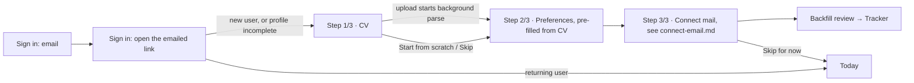

# Research: Onboarding and sign-in with an email link

Status: research complete (M0); sign-in revised 2026-10-23 from a 6-digit code to Firebase Authentication's email link ([ADR 0008](../../adr/0008-auth-email-link.md); owner decision: no mail vendor). The code-entry references below informed the email and "Check your email" steps and are kept for the record. Feeds the IA, the flow diagrams, the tokens and the component inventory (brief §5.4). Critique rounds start once the screens are built (brief §5.5).

## Scope

Research matrix rows (brief §5.3):

| Row | iOS | Desktop (`web`) |
|---|---|---|
| Onboarding, sign-in with email (link) | flows: onboarding, sign in | flows: onboarding, sign in |

The onboarding steps from brief §4.2 that this doc covers:

1. **Sign in with an email link.** No passwords and no social login (App Review Guideline 4.8). Firebase Authentication emails a one-time link; iOS opens it as a universal link, desktop through the `/auth/finish` page and the `bruteforcehr://` deep link; the client calls `signInWithEmailLink` ([ADR 0008](../../adr/0008-auth-email-link.md)).
2. **CV import step:** PDF, DOCX, JSON Resume or LinkedIn data-export ZIP, or start from scratch.
3. **Preferences step:** roles, seniority, locations and remote, salary floor and currency, work authorization, languages.

Step 4 (connect mail and backfill) is covered in [`connect-email.md`](./connect-email.md).

**Target:** value in under 3 minutes. Acceptance (§4.2): a new user with a CV and a Gmail or Outlook account reaches a populated tracker without typing application data by hand.

Every reference below was judged from its screenshots, not its metadata. Mobbin queries used `task_intent: "Design a cross-platform job search, CV builder and application tracker app"` and `output_destination: "code"`. The user's saved Mobbin collections hold website sections only (kickoff), so none of them apply to this area.

## References — iOS

### Onboarding flow (`search_flows` "onboarding", ios). Examined 8, kept 4

| App | Screen / flow | mobbin_url | What we borrow | Why |
|---|---|---|---|---|
| Brilliant | Onboarding (15 screens) | https://mobbin.com/flows/7ffbd4f0-78d1-49be-bf0d-9c90cac00e8c | Thin progress bar under the nav bar, one question per screen, option cards with a bold label and a plain description, Continue disabled until something is chosen | Gives a strong sense of progress with low effort per screen. Option cards stay readable at large Dynamic Type sizes |
| Photoroom | Onboarding (13 screens) | https://mobbin.com/flows/80139c78-5c46-460c-96e2-8f0d9f576f57 | "Start from a photo" screen: one primary import action plus a secondary way out ("Use a sample image"), then an immediate result screen ("Background removed!") before Home | This is the "aha before setup" pattern. For us the import is the CV, and the result is "Found 3 roles and 12 skills" right after upload |
| Linear Mobile | Onboarding (22 screens) | https://mobbin.com/flows/628034a6-be45-450e-99d3-fb86e4571661 | "Check your email" code step: the address shown in the body, one code field, primary "Continue with login code", quiet "Back to login" | Sets the minimal tone for an email-code product. It is calm and has no marketing |
| Blinkist | Onboarding (17 screens) | https://mobbin.com/flows/a9e95e3d-961b-422b-b217-d3fe6fe34e0f | "STEP 1 OF 4" label above the title along with the bar, the reassurance "You can always update your answers.", and a "Skip" link on optional steps | A text step label is accessible (it doesn't rely on a bar alone), and the reassurance lowers stress |

### Sign in with email code (`search_flows` "sign in with email one-time code", ios). Examined 8, kept 5

| App | Screen / flow | mobbin_url | What we borrow | Why |
|---|---|---|---|---|
| Netflix | Logging in (9 screens) | https://mobbin.com/flows/1c2c93fb-4c7b-46e5-adcb-8cfbeeebc217 | Title "Enter the code we sent to your email", email shown in a chip with "Change", segmented code cells, a helper with expiry plus "Didn't get a code? Resend code.", collapsed "Get help" | This is the most complete code screen we found: it covers the expiry, the resend and a fix for a wrong email |
| Claude | Logging in (6 screens) | https://mobbin.com/flows/34ee8283-6a62-4b6e-b6d2-970e86c495ee | Email field directly on the welcome screen. The code screen "Check your email to finish signing in" has a single code field with a number pad, "Change email address", and the legal line kept visible | The email entry lives on the first screen, which saves one screen |
| Taco Bell | Logging in (4 screens) | https://mobbin.com/flows/86ded475-f9e2-4ceb-b65d-1765847a7e3d | Copy "It may take a few minutes to arrive. If you can't find it, check your spam folder." plus an **Open Mail App** button next to Confirm and Resend | Sign-in mail from a shared sender can land in Spam. The spam hint and the shortcut to the mail app both cut down drop-off |
| TextNow | Logging in (4 screens) | https://mobbin.com/flows/73b4b4a2-249b-45f8-ac58-1e0cffb8a827 | Auto-submits on the last digit with an inline spinner instead of a button tap. An inline "Open mail app" link. The return visit offers "Welcome back — you last logged in with {email}" | Removes a tap at the most frequent auth moment. Pre-filling the last email speeds up re-login after a sign-out |
| v0 | Logging in (7 screens) | https://mobbin.com/flows/0568fe34-9298-4861-8239-c755312f65d7 | Six separate digit boxes with the focus ring on the active box, and "Use a Different Email" as a text button | Shows the 6-digit length at a glance. Matches the 6-digit code from kickoff |

### CV import step (`search_screens` "resume upload screen", ios, deep). Examined 7, kept 3

| App | Screen / flow | mobbin_url | What we borrow | Why |
|---|---|---|---|---|
| Upwork | Create your profile → Add your resume sheet | https://mobbin.com/screens/ffe20ceb-2109-43db-bae3-07a8e2e6b668 | Framing "It's quickest to import your information — you can edit it before your profile goes live", format and size rule in one sentence, attached-file row with ✓ and a delete icon | Sets the expectation that an import is followed by review. The plain format and size rule prevents errors |
| LinkedIn | Apply → Resume (2/5) | https://mobbin.com/screens/f7a4a57e-758e-4775-9674-6c7b2f6995ea | File-type badge (PDF) plus the filename in a selectable row, "Upload resume" as a secondary outline button, page progress "2/5" | A familiar job-app pattern for the attached-file state |
| Linktree | Upload your files (Step 1 of 3) | https://mobbin.com/screens/57bc21d0-f3fa-45d0-8fad-19f06e4a04bc | Tapping a dashed zone opens a native menu ("Choose from files"), with "Step 1 of 3" under the bar | Shows how to send an iOS user to the document picker without a custom file browser |

### Preferences step (`search_screens` "job preferences screen", ios, deep). Examined 7, kept 5

| App | Screen / flow | mobbin_url | What we borrow | Why |
|---|---|---|---|---|
| LinkedIn | Open to work preferences | https://mobbin.com/screens/bba7db4a-a27c-489d-bee1-7dc67bb57318 | Location tokens with ✕ plus "+ Add location", employment-type toggle chips (✓ selected, + unselected), calm radios "Immediately, I am actively applying" / "Flexible, I am casually looking" | Toggle chips with an explicit ✓/+ state pass color-blind checks. The urgency radios avoid pressure |
| Handshake | Edit my career interests | https://mobbin.com/screens/6155bb3f-4f13-4d81-91bf-4e7502f30486 | Each section (Roles, Industries, Locations) has its own search field, with the selected values as removable tokens below it | Handles long lists (roles, cities) without wheel pickers |
| Behance | Edit availability | https://mobbin.com/screens/9e43db20-7da3-4c1c-bb0f-8f1ab7b20fb2 | Grouped inset sections with toggles: "I'm willing to relocate" and "I'm looking for remote opportunities" | Matches native iOS Settings, so it's instantly familiar. Covers relocation, which matters for the EU relocation market |
| Glassdoor | Job Preferences | https://mobbin.com/screens/7542ad82-9170-4c94-8c2d-2cf3b7aed3e7 | Summary rows such as "Desired minimum salary ⓘ $100,000 annually ›" and "Remote work preferences: Remote +1 ›" | The layout for editing preferences later in Settings (one row per preference, value on the right) |
| Fiverr | Brief preferences | https://mobbin.com/screens/76bc9430-c616-4546-bfbc-9234eed8b33b | "Minimum fixed price (Optional)" field with a currency prefix, plus "You can always change this at any time." | A salary floor as an optional currency-prefixed field rather than a slider |

## References — Desktop (`web`)

### Onboarding flow (`search_flows` "onboarding", web). Examined 6, kept 3

| App | Screen / flow | mobbin_url | What we borrow | Why |
|---|---|---|---|---|
| Lightfield | Onboarding (25 screens) | https://mobbin.com/flows/06e62a8e-b613-4921-8a07-fc22238ae7f4 | Full-window wizard on a quiet background, step dots centered at the top, signed-in email plus "Log out" in the top-right, a single narrow column per step, "Skip for now" under the primary button | This is a desktop-class wizard for a data-heavy CRM, and our app is similar. Showing the signed-in email avoids "which account am I in?" doubt |
| Twenty | Onboarding (20 screens) | https://mobbin.com/flows/c05af68f-a703-4104-8e9a-c92c82cafc9d | Each step is a compact card with inline validation ("Name can not be empty"), ending on a populated table | Short cards with inline validation. The end state is real data, which is the value moment we want (a populated Tracker) |
| incident.io | Onboarding (11 screens) | https://mobbin.com/flows/1fa7c20d-6d4c-4c74-bd88-83aa8eee833b | A labeled stepper where finished steps turn into ✓ (Create workspace ✓ · Install ✓ · Get started) | Named steps tell users what is left, which beats anonymous dots |

### Sign in with email code (`search_flows` "sign in with email one-time code", web). Examined 6, kept 4

| App | Screen / flow | mobbin_url | What we borrow | Why |
|---|---|---|---|---|
| v0 | Logging in (6 screens) | https://mobbin.com/flows/37f50259-2477-423c-9d11-e358519f7a03 | A centered column with six digit boxes, the copy "we have sent a code to {email}. Enter it below.", and "← Back" | Minimal and keyboard-first. Autofocus on the first box |
| Jasper | Logging in (5 screens) | https://mobbin.com/flows/8bb92f2f-f109-4783-8d3b-794c13e76a0b | "Check your email — Confirm your email address by entering the six-digit code sent to {email}", a labeled single Code field, Continue, "Didn't get the code? Resend" | A labeled single field is the most accessible variant on desktop and pastes cleanly |
| Mobbin | Logging in (6 screens) | https://mobbin.com/flows/ec3a8763-5c8f-44cb-aa86-4e5f74dc8001 | "Welcome back — We sent a temporary login code to {email}. **Not you?**" | Returning-user greeting plus a one-click way out of the wrong account |
| Sana AI | Logging in (5 screens) | https://mobbin.com/flows/de082a8f-4228-473d-9b4b-55c6bc7b9bdb | "We sent you a code / Please wait" state while sending, Back and Continue side by side, "Resend code" under the field | Shows the in-flight sending state that most refs skip |

### CV import step (`search_screens` "resume upload screen", web, deep). Examined 7, kept 5

| App | Screen / flow | mobbin_url | What we borrow | Why |
|---|---|---|---|---|
| Remote | Upload your resume (step 8 of 8) | https://mobbin.com/screens/d8a30d6d-a843-4314-b063-f1b1652f0e77 | "We'll use it to add details to your profile in a snap", a LinkedIn PDF help link, a "Resume added successfully" state in the drop zone, an AI-processing disclosure with a privacy link, Skip + Continue | A job-search product doing exactly our step. The AI disclosure is required for us too (Claude parses CVs) |
| Upwork | Create your profile → Add your resume | https://mobbin.com/screens/328c233e-2b6f-4500-936a-81db031a74af | Three entry options behind the modal: "Import from LinkedIn" / "Upload your resume" / "Fill out manually (15 min)" | Offering all three paths at once, with a **time estimate** on the slow path, steers people to import without forcing it |
| Mercor | Complete your profile (Step 1 of 3) | https://mobbin.com/screens/23364493-bbd2-47bc-9dc2-3e2d7ccbc0fc | A large drop zone "Drop your resume here or browse files on your computer · Supports PDF up to 3MB" | Desktop users drag from Finder or Explorer, so a big target is right |
| Glassdoor | Add a resume for the employer | https://mobbin.com/screens/c6b7e870-fddf-4896-9908-87e62c2482e6 | After upload: filename, "Uploaded today", ✓, and a rendered first-page preview with a page pager | The preview confirms that the right file was picked, which matters when people keep many CV versions |
| Deputy | Your Resume/CV step | https://mobbin.com/screens/cf9f4bdb-bce8-4258-b5a6-0abc63084adf | A compact "Drop a file here, or browse · PDF and images supported" row, Back/Next | A compact drop row works as the secondary "Replace file" control after a file is attached |

### Preferences step (`search_screens` "job preferences screen" + "work authorization question in job profile", web, deep). Examined 12, kept 7

| App | Screen / flow | mobbin_url | What we borrow | Why |
|---|---|---|---|---|
| Wellfound | Set your job search preferences | https://mobbin.com/screens/35252ae0-ebe3-4cb8-9d6e-fbd0e9527fcf | A top pill stepper (Profile — Preferences — Culture — Resume/CV — Done), "Your answers determine which jobs we recommend", segmented pills with a "This means:" explanation, salary amount plus currency select with "never be shown on your public profile" | The closest match to our preferences step, including currency |
| Peerlist | Job Preferences | https://mobbin.com/screens/35e50eb4-f59a-41e3-bc3a-3991e539f362 | A two-column layout (label left, control right), an "Upto 5" counter on preferred roles, Remote Only / In-office / Hybrid, and a currency select for expected pay | A dense but scannable desktop form. The limit counter prevents an unbounded role list |
| Contra | Opportunity preferences | https://mobbin.com/screens/402d59ad-b25f-4cf7-a8cc-db75f978af66 | Token inputs for skills and tools, segmented buttons (All / Hybrid / Onsite / Remote), the copy "will use your profile data and the preferences below to find the best opportunities" | Says why we ask. A segmented control for workplace is the fastest input |
| Mercor | Work preferences | https://mobbin.com/screens/fb371f8b-a2a6-4c95-9694-aa94dff2440d | "Minimum expected compensation" with a `$` prefix and a `/ year` suffix, plus "We won't reach out about roles below this. This stays private and won't impact your offers." | The exact semantics of a salary *floor*, with privacy copy that calms the user |
| Remote | Eligibility (step 5 of 8) | https://mobbin.com/screens/f92ebeeb-b983-4887-8e11-ffa16d92acfa | "Do you require work authorization sponsorship to work from your selected locations?" as two full-sentence radio cards, "This helps us show you relevant job matches", "Skip this" | Ties work authorization to the chosen locations and explains why we ask |
| Wellfound | Preferences → US work authorization | https://mobbin.com/screens/f54544dd-d06e-45f9-a19f-fc021c17b5fa | Per-country Yes/No pairs ("Do you … require sponsorship?" / "Are you legally authorized…?") with a country flag | A per-country model fits our multi-market targets (TR, DE, NL, UK, US) |
| Deputy | Working rights | https://mobbin.com/screens/3dbc1e27-d94f-4194-b0c2-808664dfe917 | A single plain question "Are you currently eligible to work in {country}?", Yes/No | Shows the simplest form of the question, which we use per country |

## Examined but rejected

| App | mobbin_url | Reason |
|---|---|---|
| Mindvalley — Getting started | https://mobbin.com/flows/8f00cd48-86aa-4eac-9002-e1d2948653fe | A community content hub, not an onboarding flow |
| Mindvalley — Getting started (network) | https://mobbin.com/flows/d6552720-7448-40de-8194-e6a0f932dc40 | Same as above (dark variant) |
| Scoot — Onboarding | https://mobbin.com/flows/b05dcd79-9701-42f8-9136-ccbbed89558f | Illustrated marketing carousel with Sign up / Login / Guest. Slow, and promotional in tone |
| Apple Music — Onboarding | https://mobbin.com/flows/a9ef7206-5e22-4872-9dc3-92f311783eb2 | A "What's New" sheet and paywall cards. Not first-run setup |
| Zocdoc — Verifying with email | https://mobbin.com/flows/5703fb0a-5db9-4797-9bb5-328320603b48 | Phone first with an email fallback, and a loading overlay that hides the code field. We are email-only |
| MUBI GO — Logging in | https://mobbin.com/flows/ebccdf1d-8295-45eb-880e-8d488dc70ac6 | Low-contrast white text on a busy photo. Sends a link and a code together, which is confusing |
| Life Reset — Logging in | https://mobbin.com/flows/60a58e05-8b1d-4976-bb64-9c2ee8348c54 | Social buttons (we can't offer them without Sign in with Apple), dark hype styling, and "Don't screw it" copy that breaks the calm tone |
| Handshake — Add resume | https://mobbin.com/screens/707c7dc4-7ee7-4a10-802e-ec73a05eb93c | A bare "Choose file" text field with no format guidance or file state |
| Perplexity — Add skills | https://mobbin.com/screens/f4e6ee1a-3885-468f-bd92-79e17a6aed95 | Developer-style monospace requirements and a 0/5 multi-file counter. Too technical for a CV |
| Cleo AI — Time to upload | https://mobbin.com/screens/96dc99b0-c24b-4121-ab81-8d31a6bd9378 | A ten-document tile grid with a photo checklist for verification documents. Heavier than one CV needs |
| Jobber — Add attachments | https://mobbin.com/screens/96ce29b9-64b7-4e28-9ad2-66a06649a826 | Invoice attachments with an MB quota bar. Not an import step |
| Airtasker — task preferences | https://mobbin.com/screens/5411dd2b-4ac5-4566-ac71-0bf6dc42ff6b | Large icon tiles for time of day and location. Heavy for multi-value job preferences |
| Grab Driver — All settings | https://mobbin.com/screens/3e910266-6223-406e-988d-ce191b718d8c | A generic settings list, nothing specific to job preferences |
| Air — Onboarding | https://mobbin.com/flows/8c0164d5-3370-4300-b87d-b97910b917dd | Password sign-up, an email-verification banner after sign-up, and marketing questions ("How did you hear about us?") |
| Sana AI — Joining a workspace | https://mobbin.com/flows/e544fc0c-bc6b-4e45-b693-74f9541b7d6a | A team invite acceptance flow. We are single-user |
| Charma — Quick start guide | https://mobbin.com/flows/4ddf1a88-5026-45d5-a401-1b69b8b2ec50 | Tutorial popovers over the app ("Give kudos") interrupt instead of setting up data |
| KAYAK — Logging in | https://mobbin.com/flows/2cb76cbe-cf39-48c1-99c0-6eb7b319a101 | An email modal over a marketing page with ads. We have no marketing surface inside the desktop app |
| Perplexity — Logging in | https://mobbin.com/flows/f6c6df92-150e-45cc-a7c6-6d3f0504a23e | The copy says "temporary sign-in link" but the UI shows code boxes. Mismatched instructions |
| Wellfound — Edit profile, Resume/CV | https://mobbin.com/screens/f638c3ef-a1b0-4ff2-a2e8-228fed42ebe1 | A nagging completeness bar ("Increase your chances…") and "1 step to complete". A pressure pattern we avoid |
| Braintrust — Application form | https://mobbin.com/screens/b1271a5f-39f4-44cc-acce-86794150469a | The upload is buried in a long application form. Not an onboarding step |
| Uxcel — Work preferences | https://mobbin.com/screens/7f124196-e5e1-4582-88de-6c4cf6e6d26c | A good chip style, but it's mixed into a profile page with empty "Work experience" blocks. Peerlist covers the same pattern more cleanly |
| Coursera — Step 2 of 4, roles | https://mobbin.com/screens/06532b37-4671-483d-9340-fc9a76479836 | Colored icon tiles for job titles add visual noise. The icons carry no meaning and the grid doesn't scale to free-text roles |
| Braintrust — Set your work availability | https://mobbin.com/screens/e93a15b2-857c-41d2-adad-dba8c009fd78 | Working hours and time zone are freelance availability, not job-search preferences |
| Employment Hero — Work eligibility documents | https://mobbin.com/screens/8544a108-664e-4a12-909e-e9eae3014fcf | HR document upload for right-to-work. We only need a yes/no preference |
| Mercor — Work authorization attestation | https://mobbin.com/screens/73cccb9a-3fc0-47af-8e9c-3aebe3b40794 | Legal attestations plus a digital signature. Far too heavy and anxiety-inducing for a preference |

## Decision — iOS

### Flow and time budget

| Step | Budget | How we hit it |
|---|---|---|
| Sign in (email + link) | ≤ 45 s | Email on the first screen. Open Mail button. The link signs in on open, no typing |
| CV | ≤ 30 s of user time | Pick the file → Continue is enabled immediately. Parsing runs in the background while the user does preferences |
| Preferences | ≤ 60 s | One screen, pre-filled from the parsed CV. The user confirms instead of typing |
| Connect mail | ≤ 45 s | Covered in connect-email.md. The backfill runs server-side and the user is not blocked |
| **Total** | **≈ 3 min worst case, ≈ 2 min typical** | Value moment = backfill review → populated Tracker |

Detailed review of low-confidence parsed CV fields (brief §4.5) is **not** part of onboarding. Onboarding ends with a non-blocking Today card, "Review your imported CV · {n} fields to check", which opens CV Studio. This keeps the 3-minute target honest.

### Screen 1 — Sign in (email)

- **Layout:** no carousel and no splash marketing (rejected Scoot and Life Reset). Top: app mark (48 pt). Large title "Sign in to BruteForceHR". Body: "We'll email you a link to sign in. No password needed." One email field. Full-width primary **Send link** above the keyboard. Small legal line under it: "By continuing, you agree to the Terms and the Privacy Policy." (links). One screen serves both sign-in and sign-up (Claude): Firebase creates the account on the first completed link.
- **Email field:** `.keyboardType(.emailAddress)`, `.textContentType(.emailAddress)`, no autocapitalization or autocorrection, return key "Send" submits. Send link stays disabled until the address passes a basic syntax check. No live red errors while the user types.
- **Returning user** (TextNow, Mobbin): after a sign-out, pre-fill the last used email and show "Not you?" as a text button that clears it.
- **Sending state** (Sana AI): the button shows a spinner and "Sending…". The field becomes read-only.
- **Errors** (inline under the button): offline → "We couldn't send the link. Check your connection and try again."; Firebase rate limit → "Several links were sent just now. Wait a few minutes, then try again. The last link still works."; invalid address → "This address can't receive a sign-in link. Check it for typos."

### Screen 2 — Check your email

- **Title** "Check your email". **Body** "We sent a sign-in link to {email}." plus "Open it on this iPhone to finish signing in." (Netflix-style address with **Use a different email**).
- **Helper (Taco Bell):** "It can take a minute to arrive. Check Spam if you don't see it." Secondary actions: **Open Mail** and **Resend link** (cooldown; a new link replaces the old one — verified against Firebase, ADR 0008).
- **Opening the link:** the universal link (`applinks:bruteforcehr.firebaseapp.com`) opens the app, which shows "Signing you in…" and calls `signIn(withEmail:link:)` with the stored address.
- **Link opened without a stored address** (another device): "Confirm your email" with one field; Firebase rejects a different address ("This link went to a different address. Enter the email you asked with.").
- **Link errors:** expired → "This link has expired" + **Send a new link**; used or replaced → "This link doesn't work anymore" + **Send a new link**; offline → "Signing in didn't finish … Your link still works."
- **Success:** route to Today for a returning user or to Step 1/3 otherwise.
- Shipped strings: `packages/swift/BFHRUI/Sources/BFHRUI/SignIn/SignInStrings.swift` (EN source + `SignIn.xcstrings`).

### Screen 3 — Onboarding step 1/3: CV

- **Chrome (Blinkist + Brilliant):** nav bar with Back and **Skip for now** (right). Under it, a 4 pt progress bar with 3 segments and the label "Step 1 of 3" above the title. Text size is footnote, secondary color.
- **Title** "Start with your CV". **Body** "We'll use it to fill in your profile and preferences. You can change everything later." (reassurance from Blinkist and Upwork).
- **Three option rows** (Upwork web's three paths, iOS grouped-inset style, 64 pt min height, icon 28 pt, chevron):
  1. **Upload a file** with the caption "PDF, Word (DOCX) or JSON Resume · up to 10 MB". Opens the system document picker (Files), filtered to `com.adobe.pdf`, `org.openxmlformats.wordprocessingml.document`, `public.json` (Linktree's tap → native picker).
  2. **Import LinkedIn export** with the caption "The ZIP file LinkedIn emails you". The secondary link **How to get it** opens a short sheet: "LinkedIn › Settings › Data privacy › Get a copy of your data". It also says when the email arrives (see Open questions). The picker is filtered to `public.zip-archive`.
  3. **Start from scratch** with the caption "Build it step by step in CV Studio (about 10 min)". The time estimate comes from Upwork. Choosing it marks the step done and goes to Preferences.
- **Attached state** (Upwork, LinkedIn): the option list collapses into one attached-file row: type badge (PDF/DOCX/JSON/ZIP), filename (middle-truncated), size, and a status line, plus a trailing **Remove** (trash, 44 pt target). Status line sequence: "Uploading…" → "Reading your CV…" → "Found {roles} roles and {skills} skills" (the Photoroom-style aha). **Continue** is enabled as soon as the upload finishes. Parsing continues in the background. A secondary text button **Choose a different file** sits below the row.
- **AI disclosure** (Remote), footnote under the row: "Your CV is read by AI (Anthropic Claude) to fill in your profile. Privacy Policy".
- **Errors** (inline under the row; the row turns into the error state with a retry):
  - Wrong type: "This file type isn't supported. Use PDF, DOCX, JSON Resume or the LinkedIn ZIP."
  - Too large: "This file is over 10 MB. Try exporting a smaller PDF."
  - No text found (scanned PDF): "We couldn't read text in this PDF. It may be a scan. Try a DOCX, or start from scratch." The user can still Continue; preferences then start empty.
  - LinkedIn ZIP missing `Profile.csv`/`Positions.csv`: "This doesn't look like a LinkedIn data export. Check you picked the ZIP from LinkedIn."

### Screen 4 — Onboarding step 2/3: Preferences

**Decision: one scrolling screen with six grouped sections, pre-filled from the CV.** We are not using one question per screen (Brilliant, Remote): six screens would cost about 90 s on their own, and with pre-filled values the user only confirms. Native grouped-inset style (Behance) with section headers.

- **Title** "What are you looking for?" **Body**, when a CV was parsed: "We filled in what we could from your CV. Adjust anything that's off." Values that came from the CV show a small "From CV" caption tag the first time; it disappears once edited. **Body** without a CV: "This shapes which jobs we suggest. You can change it anytime."
- **If no CV was imported:** add a first section **Your name** (first and last name fields). It is needed for CVs and emails.
- **Sections:**
  1. **Roles:** a token field with search (Handshake) and a counter "{n}/5" (Peerlist "Upto 5"). Suggestions come from the CV titles and a role list. Tokens use ✕ to remove.
  2. **Seniority:** multi-select toggle chips with ✓/+ (LinkedIn): Intern · Junior · Mid-level · Senior · Lead / Staff · Principal · Manager · Director+. Up to 2. The final enum must match `@bfhr/core`.
  3. **Where:** a workplace multi-select chip row (Remote · Hybrid · On-site), then location tokens with "+ Add location" (LinkedIn). Quick-add suggestion chips cover the target markets: Türkiye, Germany, Netherlands, United Kingdom, United States, Remote worldwide. Below them is the toggle **Open to relocation** (Behance).
  4. **Salary floor (optional):** one row with an amount field (`keyboardType="number-pad"`, grouped digits per locale), a currency button (TRY / EUR / GBP / USD, default from device region) that opens a searchable currency sheet, and a period segmented control **per month / per year**. The default period follows the currency: TRY defaults to per month, others to per year, because Turkish offers are usually quoted monthly. The footnote follows Mercor: "Private. We only use it to hide roles that clearly pay less." Never use a slider (Behance's range slider was rejected for exact numbers).
  5. **Work authorization:** generated from section 3 with one row per selected country, or one "EU / EEA" row for the EU picks. Each row reads "Can you work in Germany without sponsorship?" with a **Yes / No / Not sure** segmented control (Remote, Wellfound, Deputy). The row is hidden when only "Remote worldwide" is picked. Footnote: "This helps us show jobs you can actually take."
  6. **Languages:** a token list with a proficiency label (Native · Fluent · Professional · Basic). Tapping a token opens a small menu to change the level. It is pre-filled from the CV, with quick-add EN / TR / DE.
- **Footer:** a sticky **Continue** bar (safe-area aware, blurred material). Nothing is required except, when shown, the name. Skipped sections save as unset; the matching engine treats unset as "no filter". **Skip for now** sits in the nav bar.
- **Later editing:** Settings › Job preferences uses Glassdoor-style summary rows ("Salary floor · €70,000 / year ›") that open these same section editors.

### Accessibility (iOS)

- Every step label is text ("Step 2 of 3") as well as the bar. Progress is announced on screen change.
- Chips are buttons with `accessibilityState={{ selected }}`. The ✓/+ glyph changes, so state is never conveyed by color alone. Chips wrap at all Dynamic Type sizes; at AX sizes, chip rows switch to a vertical list.
- Touch targets are ≥ 44×44 pt, including token ✕ and Remove.
- Reduce Motion replaces the success and progress animations with fades.

## Decision — Desktop (macOS + Windows)

### Window and sign-in

- **Sign-in lives in the app window**, which is 960×640 at minimum (the desktop shell owns window sizing). The content is a centered 400 px column on the app background color with no split hero image (rejected the Mobbin/Sana split: it needs real product imagery and placeholders are banned). The top 40 px is a draggable title-bar region (macOS traffic lights and Windows caption buttons stay native).
- **Email step:** app mark, "Sign in to BruteForceHR", body, a labeled **Email** field (autofocus), primary **Send sign-in link**, and the legal line. `Enter` submits.
- **Check your email** (Jasper + v0 tone): "We sent a sign-in link to **{email}**. Open it on this computer to sign in." Helper with the Spam hint, **Send again** (cooldown), **← Use a different email**; `Esc` does the same. No Open Mail button on desktop (no reliable cross-platform target).
- **Opening the link:** the email opens in the browser, Firebase forwards to `https://bruteforcehr.web.app/auth/finish`, and that page hands the link to the app through `bruteforcehr://auth/finish?link=…` (see Sign-in link landing page below). The app shows "Signing you in…".
- **Returning user** (Mobbin): "Welcome back" plus the remembered email plus "Not you?".
- **States and copy** match iOS (confirm email on another device, expired, used, offline, rate limited). Errors render inline with `role="alert"`. Shipped strings: `apps/desktop/src/i18n/{en,tr,de}.json` (`auth.*`).

### Sign-in link landing page (web, `/auth/finish`)

References (`search_screens` web, deep: "browser page that hands off to the installed desktop app with an open app button"; examined 8, kept 4):

| App    | Screen                | mobbin_url                                                      | What we borrow                                                                                         | Why                                                                             |
| ------ | --------------------- | --------------------------------------------------------------- | ------------------------------------------------------------------------------------------------------ | ------------------------------------------------------------------------------- |
| Air    | Launching Air Flow    | https://mobbin.com/screens/505f10ac-90ee-443e-ba5a-0ae358ae85b7 | "The app should open automatically. If the launch fails, click here." + "Don't have the app? Download" | Automatic hand-off with a manual retry and an install path, in one quiet column |
| Zoom   | Launch Meeting        | https://mobbin.com/screens/76e3ba53-8ddc-4c03-917b-6b012f807f62 | Names the browser's own "Open …?" dialog before it appears, then a manual button                       | The browser prompt is the main source of confusion on hand-off pages            |
| Slack  | Open Slack            | https://mobbin.com/screens/7ce5f60f-9ede-4808-90fd-f413f7cca4b3 | One calm sentence plus a "Not working?" line                                                           | Short and non-technical                                                         |
| Sketch | Launching the Mac app | https://mobbin.com/screens/5873b15c-c841-44cd-88c5-ab120077f77e | "If nothing happens, you may need to install the Mac app"                                              | The honest fallback, since a page can't detect whether the app opened           |

Rejected: Framer and Dropbox Dash (download upsell, not a hand-off), Microsoft Teams (marketing hero), Portrait (download modal).

Decision: wordmark, title "Opening BruteForceHR", "Your browser may ask to open the app. Choose Open to finish signing in.", primary **Return to BruteForceHR** (the deep link, also opened automatically once), then below a divider: "Didn't open? Make sure the BruteForceHR app is installed on this computer. Download BruteForceHR", "Open the link on the device where you asked for it…", and "You won't be signed in to this browser." A bare or broken URL shows "This link isn't complete" + **Get help with signing in**. Copy follows Firebase's `lang` parameter (EN, TR siz, DE du). Critique: [critiques/web/auth-finish](../critiques/web/auth-finish/r3.md).

### Onboarding wizard

- **Full-window wizard (Lightfield), not modals over the app shell.** We rejected the Twenty-style dimmed shell: before onboarding our shell has no data, and showing fake rows is banned.
- **Header:** a labeled stepper centered at the top with three steps, **CV · Preferences · Mail** (incident.io and Wellfound; finished steps show ✓). The signed-in email plus **Sign out** sit top-right (Lightfield). Back is a text button top-left.
- **Content column** is 560 px wide and centered. The step title uses the large title style. **Primary** is right-aligned in a footer row with **Skip for now** to its left as a ghost button (Remote: Skip + Continue). Keyboard: `Tab` order follows the visual order, `⌘↩` / `Ctrl+Enter` = Continue, `⌘[` / `Alt+←` = Back.

### Step 1/3 CV (desktop)

- **Drop zone** (Mercor), 560×200 px, dashed 1.5 px border with radius from tokens: "Drop your CV here or **browse files** · PDF, DOCX, JSON Resume or LinkedIn ZIP · up to 10 MB". It accepts a drag from Finder or Explorer. A drag-over turns the border to the accent color with the label "Drop to upload". Browse opens the native dialog with the same filters.
- **Under the zone,** two secondary option rows (Upwork three paths): **Import LinkedIn export (ZIP)** with "How to get it" (a popover with the steps) and **Start from scratch (about 10 min)**.
- **Attached state** (Glassdoor + Remote): the zone is replaced by a card with a **first-page thumbnail** on the left (rendered locally; for a DOCX, a generic DOCX icon until the parse returns), filename, size and "Uploaded just now". On the right is the parse status line, ending with "Found 3 roles and 12 skills". The card has **Replace** and **Remove** actions (the Deputy compact drop row serves as Replace). The AI disclosure footnote comes from Remote.

### Step 2/3 Preferences (desktop)

- **Two-column form** (Peerlist): the label column is 200 px with a one-line helper, and the control column is 360 px. The six sections and their rules are the same as iOS.
- **Controls:** token inputs (Contra) where `Enter` adds, `Backspace` on an empty input removes the last token, and arrow keys move through suggestions. Workplace is a segmented button group (Contra). Seniority uses toggle chips. Salary is an amount input with a currency `Select` (Radix) and a period segmented control (Wellfound, Mercor). Work authorization uses per-country Yes / No / Not sure radio groups (Wellfound). Languages are tokens with a proficiency dropdown.
- The "From CV" tags and the privacy footnote under salary are the same as iOS.

### After onboarding

- No "All set!" interstitial (incident.io's is an extra click). The wizard lands directly on **Tracker** when backfill items were imported, otherwise on **Today**, with a toast: "You're set up. Your preferences are saved in Settings." The toast has an **Open settings** action.

## Components needed

| Component | iOS | Desktop | Notes |
|---|---|---|---|
| `EmailField` | ✓ | ✓ | Platform autofill props; inline error slot |
| `LinkSentPanel` / `ConfirmEmailForm` | ✓ | ✓ | Check-your-email state; asks for the address when a link opens without one |
| `ResendLinkButton` | ✓ | ✓ | Cooldown countdown, announces when enabled |
| `OpenMailButton` | ✓ | — | Opens the default mail app |
| `StepProgress` | bar + "Step n of m" | labeled stepper with ✓ | Same data: steps[], current |
| `OnboardingHeader` | nav bar + Skip | stepper + account email + Sign out | — |
| `OptionRow` | ✓ | ✓ | Icon, title, caption, chevron/accessory, optional time estimate |
| `FileDropZone` | — | ✓ | Drag states, browse button, accept list, size limit |
| `AttachedFileCard` | row | card with thumbnail | Type badge, name, size, status line (uploading / parsing / parsed summary / error), Replace / Remove |
| `InlineNotice` | ✓ | ✓ | Info (AI disclosure), warning, error variants |
| `TokenField` | ✓ | ✓ | Search, suggestions, max count, removable tokens, "From CV" source tag |
| `ChipGroup` | ✓ | ✓ | Single/multi select, ✓/+ glyph state, max selection |
| `SegmentedControl` | native-style | Radix toggle group | Workplace, period, Yes/No/Not sure |
| `CurrencyAmountField` | ✓ | ✓ | Locale digit grouping, currency picker (searchable sheet / Select), period |
| `WorkAuthorizationRow` | ✓ | ✓ | Derived from the location list |
| `LanguageToken` | ✓ | ✓ | Language + proficiency menu |
| `StickyFooterBar` | ✓ | footer row | Primary + secondary (Skip) |
| `SourceTag` | ✓ | ✓ | "From CV" caption tag, reused later for "From email" provenance |
| `Toast` | ✓ | ✓ | With optional action (shared app-wide) |

## Copy notes

Tone: calm, plain, no exclamation marks, no hype, no guilt ("Skip for now", never "Are you sure you want to miss out?"). We say **CV** everywhere, not "resume", because the target markets are TR, EU and UK. German uses **du**, Turkish uses **sen** (open question below). Layout must allow about **+35 % for German** and about **+25 % for Turkish**. Buttons size to their content, titles wrap to 3 lines, and nothing is truncated.

Sign-in strings now live with the code (iOS `SignInStrings.swift` / `SignIn.xcstrings`, desktop `apps/desktop/src/i18n/*.json` `auth.*`); the code-entry rows were removed with ADR 0008. Turkish uses **siz** and German **du** (kickoff decision; the rows below predate it).

| Key | EN | TR | DE |
|---|---|---|---|
| onb.step | Step {n} of {total} | Adım {n}/{total} | Schritt {n} von {total} |
| onb.skip | Skip for now | Şimdilik geç | Vorerst überspringen |
| onb.continue | Continue | Devam et | Weiter |
| cv.title | Start with your CV | CV'nle başla | Starte mit deinem Lebenslauf |
| cv.body | We'll use it to fill in your profile and preferences. You can change everything later. | Profilini ve tercihlerini doldurmak için kullanacağız. Her şeyi sonra değiştirebilirsin. | Wir nutzen ihn, um dein Profil und deine Präferenzen auszufüllen. Du kannst alles später ändern. |
| cv.upload | Upload a file | Dosya yükle | Datei hochladen |
| cv.uploadCaption | PDF, Word (DOCX) or JSON Resume · up to 10 MB | PDF, Word (DOCX) veya JSON Resume · en fazla 10 MB | PDF, Word (DOCX) oder JSON Resume · bis 10 MB |
| cv.linkedin | Import LinkedIn export | LinkedIn dışa aktarımını içe aktar | LinkedIn-Export importieren |
| cv.linkedinCaption | The ZIP file LinkedIn emails you | LinkedIn'in sana e-postayla gönderdiği ZIP dosyası | Die ZIP-Datei, die LinkedIn dir per E-Mail schickt |
| cv.scratch | Start from scratch | Sıfırdan başla | Neu beginnen |
| cv.scratchCaption | Build it step by step in CV Studio (about 10 min) | CV Stüdyosu'nda adım adım oluştur (yaklaşık 10 dk) | Schritt für Schritt im CV-Studio erstellen (ca. 10 Min.) |
| cv.reading | Reading your CV… | CV'n okunuyor… | Dein Lebenslauf wird gelesen… |
| cv.found | Found {roles} roles and {skills} skills | {roles} pozisyon ve {skills} yetkinlik bulundu | {roles} Positionen und {skills} Skills gefunden |
| cv.ai | Your CV is read by AI (Anthropic Claude) to fill in your profile. | CV'n, profilini doldurmak için yapay zekâ (Anthropic Claude) tarafından okunur. | Dein Lebenslauf wird von einer KI (Anthropic Claude) gelesen, um dein Profil auszufüllen. |
| cv.errScan | We couldn't read text in this PDF. It may be a scan. Try a DOCX, or start from scratch. | Bu PDF'teki metni okuyamadık. Taranmış olabilir. DOCX dene ya da sıfırdan başla. | Wir konnten in diesem PDF keinen Text lesen. Vielleicht ist es ein Scan. Versuch es mit DOCX oder beginne neu. |
| prefs.title | What are you looking for? | Nasıl bir iş arıyorsun? | Wonach suchst du? |
| prefs.bodyCv | We filled in what we could from your CV. Adjust anything that's off. | CV'nden doldurabildiklerimizi doldurduk. Yanlış olanı düzelt. | Wir haben ausgefüllt, was wir aus deinem Lebenslauf entnehmen konnten. Pass an, was nicht stimmt. |
| prefs.salaryHelp | Private. We only use it to hide roles that clearly pay less. | Gizli kalır. Yalnızca açıkça daha düşük ödeyen ilanları gizlemek için kullanırız. | Privat. Wir nutzen ihn nur, um deutlich schlechter bezahlte Stellen auszublenden. |
| prefs.workAuth | Can you work in {country} without sponsorship? | {country} ülkesinde vize sponsorluğu olmadan çalışabilir misin? | Kannst du ohne Visa-Sponsoring in {country} arbeiten? |
| prefs.fromCv | From CV | CV'den | Aus dem Lebenslauf |

Turkish country names need the locative/genitive form ("Almanya'da"). The `prefs.workAuth` string therefore uses the neutral "{country} ülkesinde" to avoid suffix agreement, and translators may refine it per country through ICU `select`.

## Open questions

1. **Link lifetime and resend cooldown.** *Resolved 2026-10-23:* Firebase owns link lifetime; each link works once and a new link replaces the previous one (verified, ADR 0008). Clients use a short resend cooldown and don't promise a duration in copy.
2. **iOS code autofill from Mail.** *Obsolete:* there is no code; the link opens the app as a universal link.
3. **Open Mail target.** Verify which URL opens the user's default mail app (Apple Mail `message:` vs a user-chosen default client) on iOS 26. If no reliable target exists, hide the button rather than open the wrong app.
4. **LinkedIn export timing.** LinkedIn emails the data export in two waves (a faster partial archive, then the complete one). Confirm current timing and which archive contains `Positions.csv`/`Profile.csv` before writing the "How to get it" sheet. Owner: research for the CV import integration (docs/integrations).
5. **Seniority enum, language proficiency enum, currency list and salary period** must match the zod schemas in `@bfhr/core` (CoreDomain). Also: should the salary floor record gross vs net? TR offers are often net and monthly, DE offers gross and annual. The design shows no gross/net control. Add one only if the matching engine needs it.
6. **Formality:** German **du** vs **Sie**, Turkish **sen** vs **siz**. The proposal is du/sen to match the calm, personal tone. Needs a user decision before the TR/DE string pass.
7. **"CV" in German UI:** the body copy uses "Lebenslauf", but the tab label "CVs" may stay "CVs" because "Lebensläufe" is long in the tab bar. Decide this with the IA.
8. **Sign-in email deliverability.** Firebase sends from the shared `noreply@bruteforcehr.firebaseapp.com`; validate the Spam guidance with the owner's first real sign-in (runbooks/accounts.md §1).
